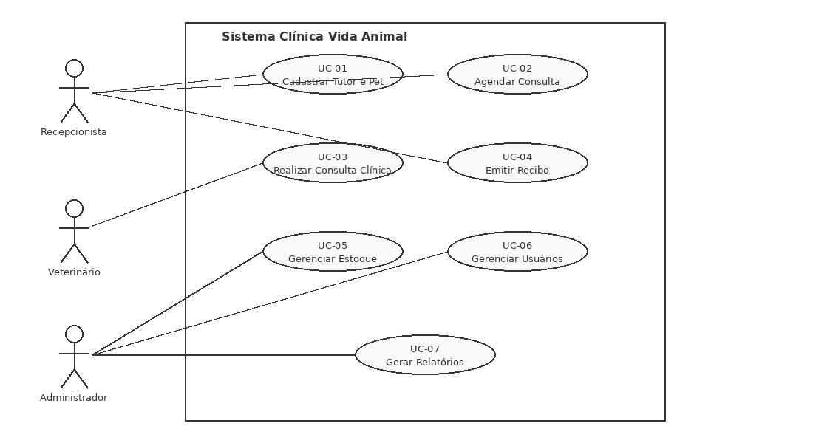
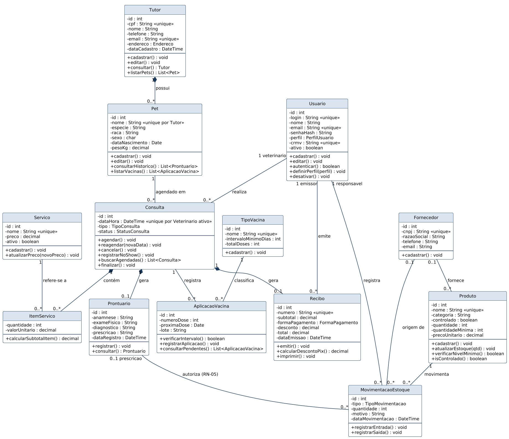
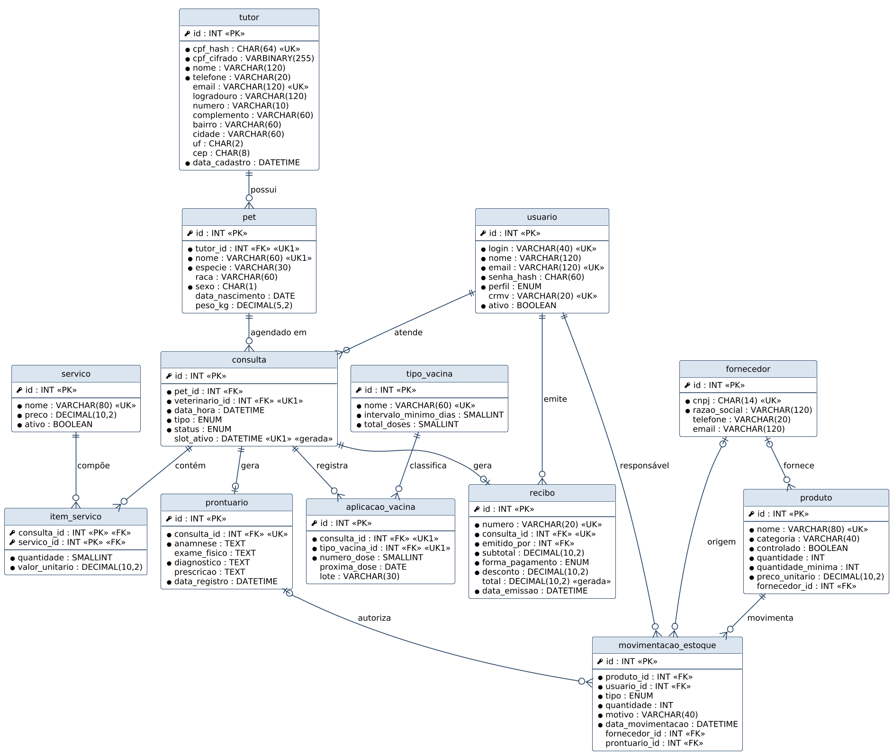
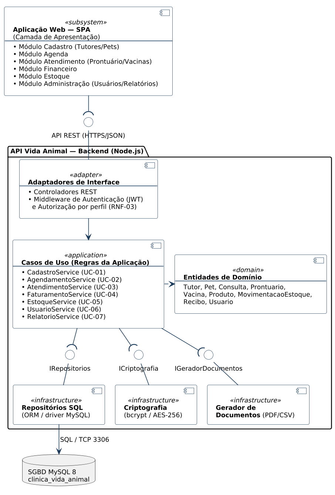
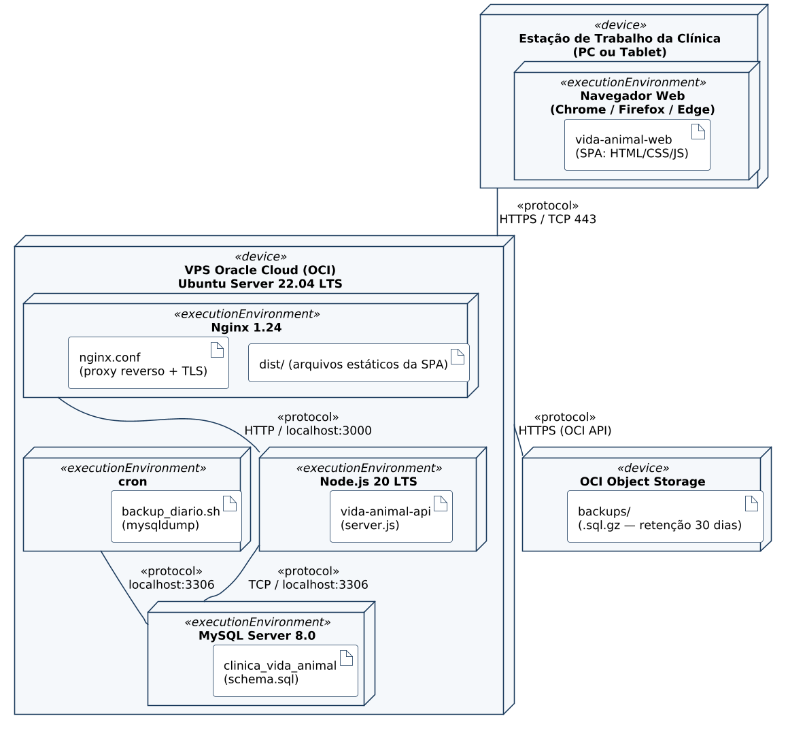
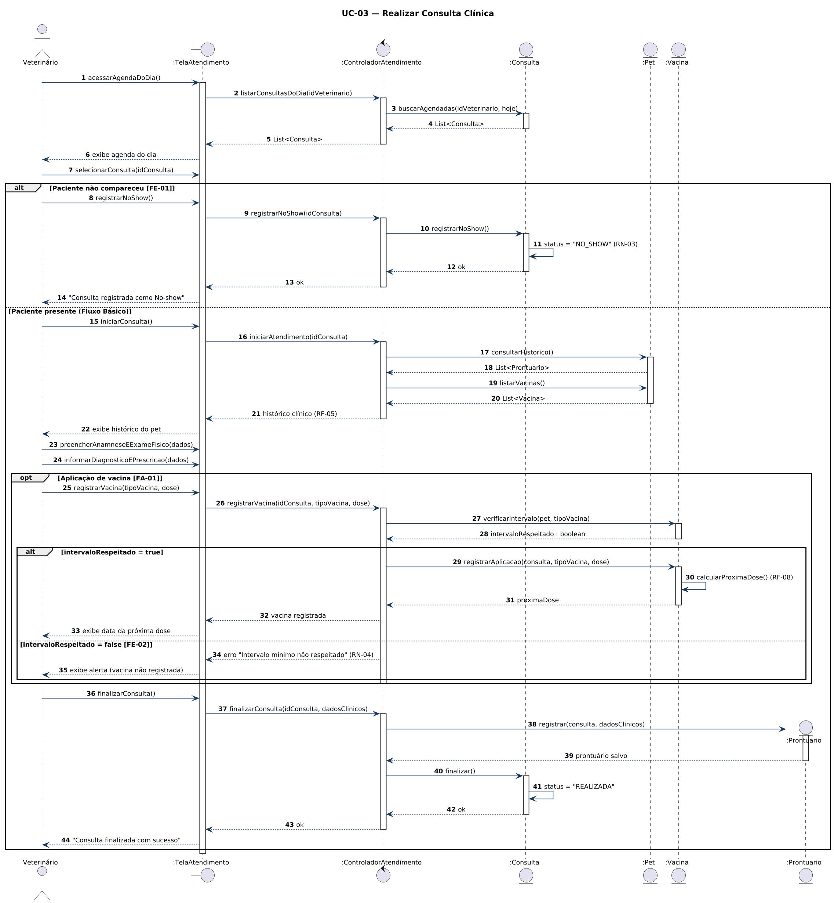
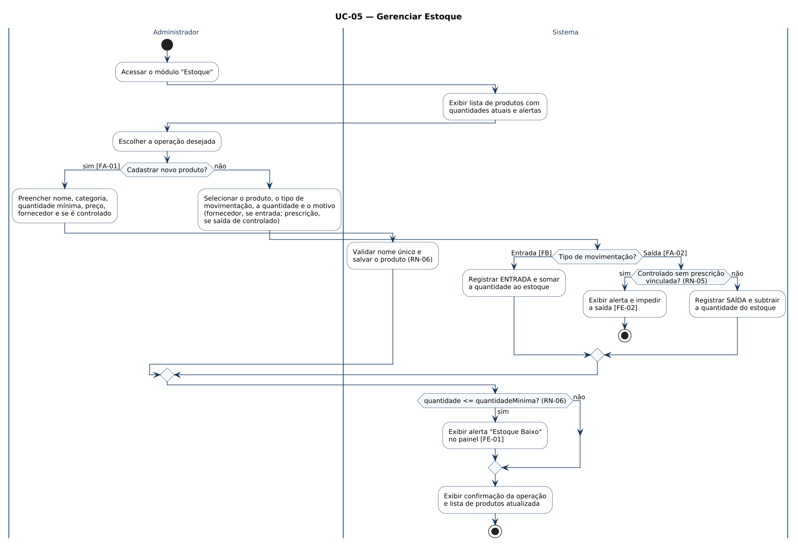
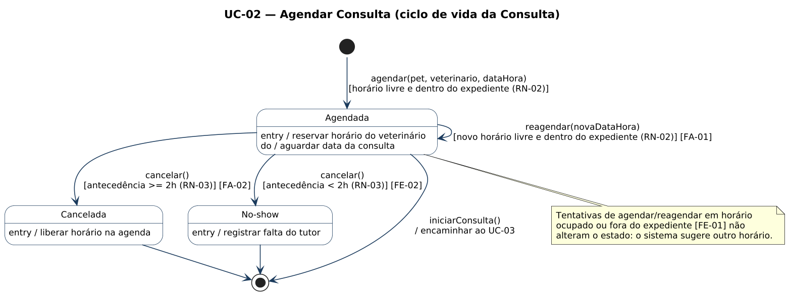
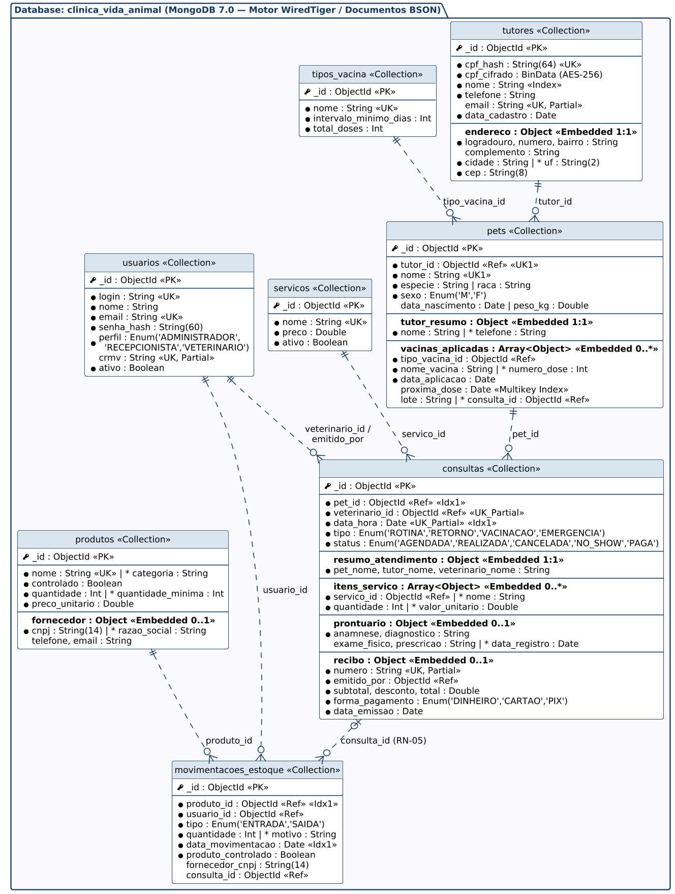
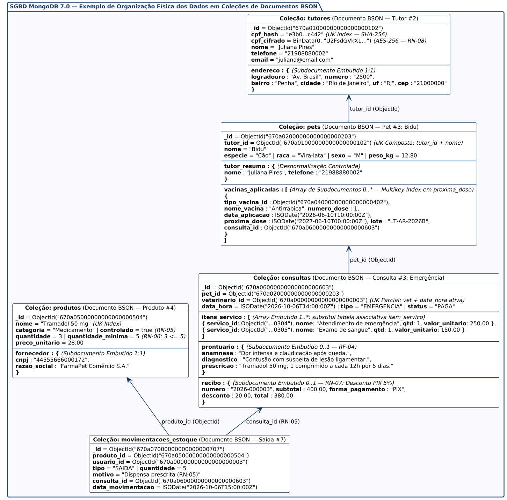

# Sistema de Gestão para Clínica Veterinária "Vida Animal"
## Fases A, B, C-5 e C-6 — Requisitos, Modelagem, Projeto e Esquemas Físicos (Relacional e Não Relacional)

**Disciplina:** Projeto Integrador II  
**Integrantes:** Pierre Claudino Chapetta, Rayanne Adjene Gonçalves de Souza  
**SGBDs:** MySQL 8.0 (Relacional — Seção 11) e MongoDB 7.0 (Não Relacional — Seção 12)  
**Data:** 19 de outubro de 2026  

---

## 1. Introdução
### 1.1. Objetivo e Visão Geral do Documento
Este documento apresenta a Especificação de Requisitos e a Modelagem Inicial (Fases A-1 e A-2) do sistema de gestão para a clínica veterinária fictícia "Vida Animal". Apresenta o contexto, escopo, atores, regras de negócio, requisitos, e os diagramas e descrições de Casos de Uso e de Classes.

### 1.2. Termos e Siglas
- **Tutor:** responsável legal pelo pet. 
- **Pet:** animal atendido, sempre vinculado a um tutor.
- **Prontuário:** histórico clínico do pet (consultas, diagnósticos, vacinas).
- **No-show:** falta sem cancelamento prévio dentro do prazo. 
- **LGPD:** Lei nº 13.709/2018.
- **RN / RF / RNF / UC:** identificadores de Regra de Negócio, Requisito Funcional, Requisito Não-Funcional e Caso de Uso.

## 2. Visão Geral do Produto
### 2.1. Descrição do Minimundo
A clínica "Vida Animal" atende pequenos animais, mas seus processos são manuais: agendamento por telefone/planilha (gerando conflitos), prontuário em papel (risco de perda de informação) e estoque e financeiro sem controle sistemático. A direção decidiu informatizar esses processos para reduzir retrabalho e melhorar a gestão.

### 2.2. Delimitação do Escopo Inicial
- **Público-alvo:** clínicas veterinárias de pequeno/médio porte (recepção, veterinários e tutores).
- **Macro-funcionalidades:** cadastro de tutores/pets; agendamento; prontuário eletrônico; controle de estoque; emissão de recibos; calendário de vacinas; gestão de usuários.
- **Fora do escopo:** Pagamento online/NFe, app móvel nativo, telemedicina, programa de fidelidade.

## 3. Atores e Envolvidos

### 3.1. Atores (interagem com o sistema)
| Ator | Descrição |
|---|---|
| **Recepcionista** | Cadastra tutores/pets, agenda consultas e emite recibos. |
| **Veterinário** | Realiza consultas, registra o prontuário e prescreve tratamentos. |
| **Administrador do Sistema** | Gerencia usuários, controla estoque, acessos e relatórios. |

> **Nota:** O "Auxiliar Veterinário" listado na Fase A-1 foi absorvido pelo perfil "Administrador do Sistema", já que na prática suas ações no sistema (basicamente movimentar estoque) são as mesmas. Se no futuro houver necessidade de permissões separadas, o ator pode voltar.

### 3.2. Envolvidos (não interagem com o sistema)
| Envolvido | Descrição |
|---|---|
| **Tutor (Cliente)** | Responsável pelo pet; solicita e acompanha atendimentos. Não opera o sistema diretamente — fornece dados ao Recepcionista. |
| **Proprietário(a)/Gerente** | Interessado nos relatórios e resultados; não opera o sistema. |
| **Fornecedor de Insumos**| Não interage com o sistema; afeta a reposição de estoque. |

## 4. Requisitos

### 4.1. Regras de Negócio (RN)
| ID | Descrição | RF Impactado |
|---|---|---|
| **RN-01** | Todo pet atendido pela clínica deve ter um tutor responsável identificado. | RF-02 |
| **RN-02** | Atendimentos só ocorrem dentro do horário de funcionamento (seg-sáb, 8h-19h). | RF-03 |
| **RN-03** | Cancelamento deve ser avisado com 2h de antecedência; senão, conta como falta. | RF-03 |
| **RN-04** | Vacina só pode ser aplicada respeitando o intervalo mínimo da dose anterior. | RF-08 |
| **RN-05** | Medicamento controlado só é dispensado mediante prescrição veterinária. | RF-04, RF-06 |
| **RN-06** | Cada produto deve ter uma quantidade mínima definida em estoque. | RF-06 |
| **RN-07** | Pagamento via PIX tem 5% de desconto sobre o valor do serviço. | RF-07 |
| **RN-08** | Dados sensíveis são confidenciais e devem ser criptografados (LGPD). | RF-01, RF-02, RF-05 |

### 4.2. Requisitos Funcionais (RF)
| ID | Descrição | UC |
|---|---|---|
| **RF-01** | Cadastrar, editar e consultar tutores. | UC-01 |
| **RF-02** | Cadastrar, editar e consultar pets, vinculados a um tutor. | UC-01 |
| **RF-03** | Agendar, reagendar, cancelar e visualizar a agenda de consultas. | UC-02 |
| **RF-04** | Registrar no prontuário a anamnese, o diagnóstico e prescrição. | UC-03 |
| **RF-05** | Consultar o histórico clínico completo de um pet. | UC-03 |
| **RF-06** | Controlar entradas e saídas de estoque, com alerta de nível mínimo. | UC-05 |
| **RF-07** | Emitir recibo do atendimento, aplicando desconto quando cabível. | UC-04 |
| **RF-08** | Manter o calendário de vacinas e sinalizar doses pendentes. | UC-03 |
| **RF-09** | Cadastrar usuários e definir perfis de acesso. | UC-06 |
| **RF-10** | Gerar relatórios gerenciais (atendimentos, faturamento, serviços). | UC-07 |

### 4.3. Requisitos Não-Funcionais (RNF)
| ID | Tipo | Descrição |
|---|---|---|
| **RNF-01** | Usabilidade | Acesso via navegador, responsivo para computador e tablet. |
| **RNF-02** | Desempenho | Operações comuns respondem em até 3 segundos. |
| **RNF-03** | Segurança | Só usuários autenticados (veterinário/administrador) acessam prontuários. |
| **RNF-04** | Confiabilidade | Disponibilidade mínima de 99% no horário de funcionamento. |
| **RNF-05** | Segurança | Senhas armazenadas com criptografia (hash). |
| **RNF-06** | Confiabilidade | Backup automático diário dos dados. |
| **RNF-07** | Portabilidade | Funciona nos navegadores mais usados (Chrome, Firefox, Edge). |

---

## 5. Diagrama de Casos de Uso

Abaixo o diagrama seguindo a notação UML padrão:



---

## 6. Cenários dos Casos de Uso (Descrições)

### UC-01 — Cadastrar Tutor e Pet
| Item | Descrição |
|---|---|
| **Identificador / Título** | UC-01 — Cadastrar Tutor e Pet |
| **Tipo do UC** | Primário |
| **Atores** | Recepcionista (Primário) |
| **Objetivo** | Registrar um novo cliente (Tutor) e seu(s) respectivo(s) animal(is) (Pet) no sistema. |
| **Pré-Condições** | O Recepcionista deve estar autenticado no sistema. |
| **Pós-Condições** | Um novo registro de Tutor e ao menos um Pet são persistidos e vinculados. |
| **Trigger (Gatilho)** | O Recepcionista seleciona a opção "Novo Cadastro de Tutor" no sistema. |
| **Fluxo Básico/Principal** | 1. O Recepcionista seleciona a opção "Novo Cadastro de Tutor".<br>2. O sistema exibe o formulário de dados cadastrais.<br>3. O Recepcionista preenche os dados do tutor (nome, CPF, telefone, e-mail, endereço).<br>4. O sistema valida os dados (CPF válido e único) e salva o Tutor. [RN-08]<br>5. O sistema exibe o formulário "Adicionar Pet".<br>6. O Recepcionista insere os dados do animal (nome, espécie, raça, sexo, data de nascimento, peso). [RN-01]<br>7. O sistema salva o Pet, vinculando-o ao Tutor cadastrado.<br>8. O sistema exibe a confirmação do cadastro completo. |
| **Fluxos Alternativos** | **FA-01 — Adicionar múltiplos pets:** No passo 8 do FB, o Recepcionista seleciona "Adicionar outro Pet". O fluxo retorna ao passo 5 do FB para cada pet adicional do mesmo tutor. Ao finalizar, retorna ao passo 8 do FB. |
| **Fluxos de Exceção** | **FE-01 — CPF já cadastrado:** No passo 4 do FB, se o CPF já existir no sistema, o sistema exibe alerta "Tutor já cadastrado" e redireciona para a tela de edição do cadastro existente. O caso de uso é encerrado sem novo cadastro.<br><br>**FE-02 — CPF inválido:** No passo 4 do FB, se o CPF for inválido (dígito verificador incorreto), o sistema exibe alerta e retorna ao passo 3 do FB. |
| **Referências Cruzadas** | RF-01, RF-02, RN-01 (Pet deve ter tutor), RN-08 (LGPD — criptografia de dados sensíveis). |

### UC-02 — Agendar Consulta
| Item | Descrição |
|---|---|
| **Identificador / Título** | UC-02 — Agendar Consulta |
| **Tipo do UC** | Primário |
| **Atores** | Recepcionista (Primário) |
| **Objetivo** | Marcar, reagendar ou cancelar uma consulta para um pet com um veterinário específico. |
| **Pré-Condições** | O Tutor e o Pet devem estar previamente cadastrados (UC-01 realizado). O Recepcionista deve estar autenticado. |
| **Pós-Condições** | A consulta é salva no banco com status "Agendada". |
| **Trigger (Gatilho)** | O Recepcionista acessa a aba de "Agendamentos" no sistema. |
| **Fluxo Básico/Principal** | 1. O Recepcionista acessa a aba de "Agendamentos".<br>2. O sistema exibe o calendário da agenda.<br>3. O Recepcionista busca e seleciona o Pet cadastrado.<br>4. O Recepcionista seleciona o Veterinário desejado, a data e o horário. [RN-02]<br>5. O sistema verifica a disponibilidade do horário.<br>6. O sistema confirma e grava a consulta com status "Agendada". |
| **Fluxos Alternativos** | **FA-01 — Remarcação:** No passo 1 do FB, o Recepcionista localiza uma consulta já existente com status "Agendada" e seleciona "Reagendar". O sistema exibe os dados atuais. O Recepcionista altera a data e/ou horário. O sistema verifica a disponibilidade [RN-02] e atualiza o registro. O fluxo retorna ao passo 6 do FB.<br><br>**FA-02 — Cancelamento dentro do prazo:** No passo 1 do FB, o Recepcionista localiza uma consulta "Agendada" e seleciona "Cancelar". O sistema verifica que faltam mais de 2 horas para a consulta [RN-03], altera o status para "Cancelada" e libera o horário. Retorna ao passo 2 do FB. |
| **Fluxos de Exceção** | **FE-01 — Horário indisponível:** No passo 5 do FB (ou durante FA-01), se o horário estiver ocupado ou fora do expediente [RN-02], o sistema exibe alerta e sugere o próximo horário livre. O fluxo retorna ao passo 4 do FB.<br><br>**FE-02 — Cancelamento fora do prazo (No-show):** No FA-02, se faltarem menos de 2 horas para a consulta, o sistema impede o cancelamento e registra a consulta como "No-show" [RN-03]. O caso de uso é encerrado. |
| **Referências Cruzadas** | RF-03, RN-02 (Horário de funcionamento), RN-03 (Cancelamento / No-show). |

### UC-03 — Realizar Consulta Clínica
| Item | Descrição |
|---|---|
| **Identificador / Título** | UC-03 — Realizar Consulta Clínica |
| **Tipo do UC** | Primário |
| **Atores** | Veterinário (Primário) |
| **Objetivo** | Registrar o atendimento clínico (anamnese, diagnóstico, prescrição) no prontuário do pet e, quando aplicável, atualizar o calendário de vacinas. |
| **Pré-Condições** | Existir uma consulta com status "Agendada" para o Veterinário autenticado. |
| **Pós-Condições** | Consulta finalizada (status "Realizada"), Prontuário criado/atualizado e, se aplicável, calendário de vacinas atualizado. |
| **Trigger (Gatilho)** | O Veterinário clica em "Iniciar Consulta" em sua agenda do dia no sistema. |
| **Fluxo Básico/Principal** | 1. O Veterinário acessa sua agenda do dia.<br>2. O Veterinário seleciona a consulta e clica em "Iniciar Consulta".<br>3. O sistema carrega o histórico clínico do Pet (prontuários anteriores e vacinas). [RF-05]<br>4. O Veterinário preenche a anamnese e os resultados do exame físico.<br>5. O Veterinário insere o diagnóstico e a prescrição. [RN-05]<br>6. O Veterinário clica em "Finalizar Consulta".<br>7. O sistema salva o prontuário e atualiza o status da consulta para "Realizada". |
| **Fluxos Alternativos** | **FA-01 — Aplicação de vacina:** No passo 5 do FB, se houver aplicação de vacina, o Veterinário seleciona "Registrar Vacina". O sistema verifica o intervalo mínimo em relação à dose anterior [RN-04]. Se o intervalo for respeitado, o Veterinário registra a dose no cartão virtual do pet e o sistema calcula automaticamente a data da próxima dose [RF-08]. O fluxo retorna ao passo 6 do FB. |
| **Fluxos de Exceção** | **FE-01 — No-show:** No passo 2 do FB, se o paciente não compareceu, o Veterinário ou Recepcionista seleciona "Registrar No-show". O sistema altera o status da consulta para "No-show" [RN-03]. O caso de uso é encerrado sem criação de prontuário.<br><br>**FE-02 — Intervalo vacinal não respeitado:** No FA-01, se o intervalo mínimo entre doses não for respeitado [RN-04], o sistema exibe alerta e impede o registro da vacina. O Veterinário pode prosseguir sem registrar a vacina, retornando ao passo 6 do FB. |
| **Referências Cruzadas** | RF-04, RF-05, RF-08, RN-03 (No-show), RN-04 (Intervalo vacinal), RN-05 (Medicamento controlado). |

### UC-04 — Emitir Recibo de Pagamento
| Item | Descrição |
|---|---|
| **Identificador / Título** | UC-04 — Emitir Recibo de Pagamento |
| **Tipo do UC** | Primário |
| **Atores** | Recepcionista (Primário) |
| **Objetivo** | Cobrar pelo atendimento e emitir o comprovante de pagamento ao tutor. |
| **Pré-Condições** | A consulta deve ter o status "Realizada" (UC-03 concluído). O Recepcionista deve estar autenticado. |
| **Pós-Condições** | Recibo gerado, consulta marcada como "Paga" e valores registrados no financeiro. |
| **Trigger (Gatilho)** | O Recepcionista acessa o módulo "Financeiro/Faturamento" no sistema. |
| **Fluxo Básico/Principal** | 1. O Recepcionista acessa o módulo "Financeiro/Faturamento".<br>2. O sistema lista as consultas com status "Realizada" pendentes de pagamento.<br>3. O Recepcionista seleciona a consulta desejada.<br>4. O sistema calcula o subtotal com base nos serviços e procedimentos registrados.<br>5. O Recepcionista define a forma de pagamento (Dinheiro, Cartão ou PIX).<br>6. O sistema aplica o desconto de 5% automaticamente, se a forma selecionada for PIX. [RN-07]<br>7. O Recepcionista confirma o pagamento.<br>8. O sistema gera o recibo (PDF/Impressão), atualiza o status da consulta para "Paga" e registra o pagamento. |
| **Fluxos Alternativos** | Nenhum. |
| **Fluxos de Exceção** | **FE-01 — Pagamento não aprovado:** No passo 7 do FB, se o pagamento via cartão for recusado pela operadora, o sistema exibe alerta "Pagamento recusado" e retorna ao passo 5 do FB para que o Recepcionista selecione outra forma de pagamento. |
| **Referências Cruzadas** | RF-07, RN-07 (Desconto 5% PIX). |

### UC-05 — Gerenciar Estoque
| Item | Descrição |
|---|---|
| **Identificador / Título** | UC-05 — Gerenciar Estoque |
| **Tipo do UC** | Primário |
| **Atores** | Administrador do Sistema (Primário) |
| **Objetivo** | Cadastrar produtos, registrar entradas e saídas de estoque e monitorar os níveis mínimos. |
| **Pré-Condições** | O Administrador deve estar autenticado no sistema. |
| **Pós-Condições** | Produto cadastrado/atualizado e movimentação de estoque registrada. |
| **Trigger (Gatilho)** | O Administrador acessa o módulo "Estoque" no sistema. |
| **Fluxo Básico/Principal** | 1. O Administrador acessa o módulo "Estoque".<br>2. O sistema exibe a lista de produtos com suas quantidades atuais.<br>3. O Administrador seleciona um produto e escolhe "Registrar Entrada".<br>4. O Administrador informa a quantidade recebida, o motivo (compra, doação, devolução) e o fornecedor.<br>5. O sistema registra a movimentação de entrada e atualiza a quantidade em estoque do produto.<br>6. O sistema exibe a confirmação da operação. |
| **Fluxos Alternativos** | **FA-01 — Cadastrar novo produto:** No passo 3 do FB, o Administrador seleciona "Novo Produto". Preenche nome, categoria, quantidade mínima, preço unitário, fornecedor e se é controlado. [RN-06] O sistema salva o produto. O fluxo retorna ao passo 2 do FB.<br><br>**FA-02 — Registrar saída de estoque:** No passo 3 do FB, o Administrador seleciona "Registrar Saída". Informa a quantidade, o motivo (uso em procedimento, vencimento, perda) e, se o produto for controlado, vincula a prescrição veterinária correspondente [RN-05]. O sistema atualiza a quantidade e retorna ao passo 6 do FB. |
| **Fluxos de Exceção** | **FE-01 — Estoque abaixo do nível mínimo:** No passo 5 do FB ou no FA-02, se a quantidade resultante ficar igual ou abaixo da quantidade mínima definida [RN-06], o sistema exibe alerta "Estoque Baixo" ao Administrador. O caso de uso não é cancelado; a operação é concluída normalmente, mas o alerta fica visível no painel.<br><br>**FE-02 — Saída de controlado sem prescrição:** No FA-02, se o produto for controlado e não houver prescrição veterinária vinculada, o sistema impede a saída e exibe alerta [RN-05]. O fluxo retorna ao passo 3 do FB. |
| **Referências Cruzadas** | RF-06, RN-05 (Medicamento controlado requer prescrição), RN-06 (Quantidade mínima de estoque). |

### UC-06 — Gerenciar Usuários
| Item | Descrição |
|---|---|
| **Identificador / Título** | UC-06 — Gerenciar Usuários |
| **Tipo do UC** | Primário |
| **Atores** | Administrador do Sistema (Primário) |
| **Objetivo** | Cadastrar, editar, consultar e desativar usuários do sistema, definindo seus perfis de acesso (Recepcionista, Veterinário, Administrador). |
| **Pré-Condições** | O Administrador deve estar autenticado no sistema com perfil "Administrador". |
| **Pós-Condições** | Usuário cadastrado/atualizado com perfil de acesso definido. |
| **Trigger (Gatilho)** | O Administrador acessa o módulo "Gestão de Usuários" no sistema. |
| **Fluxo Básico/Principal** | 1. O Administrador acessa o módulo "Gestão de Usuários".<br>2. O sistema exibe a lista de usuários cadastrados (ativos e inativos).<br>3. O Administrador seleciona "Novo Usuário".<br>4. O Administrador preenche os dados (nome, login, e-mail, senha provisória e perfil de acesso).<br>5. Se o perfil selecionado for "Veterinário", o sistema exige o preenchimento do campo CRMV.<br>6. O sistema valida os dados (login único), criptografa a senha [RN-08] e salva o usuário.<br>7. O sistema exibe a confirmação do cadastro. |
| **Fluxos Alternativos** | **FA-01 — Editar usuário:** No passo 3 do FB, o Administrador seleciona um usuário existente e clica em "Editar". O sistema carrega os dados atuais. O Administrador altera os campos desejados. O sistema valida e salva as alterações. Retorna ao passo 7 do FB.<br><br>**FA-02 — Desativar usuário:** No passo 3 do FB, o Administrador seleciona um usuário ativo e clica em "Desativar". O sistema altera o campo `ativo` para `false`, impedindo futuros logins. Retorna ao passo 2 do FB. |
| **Fluxos de Exceção** | **FE-01 — Login duplicado:** No passo 6 do FB (ou no FA-01), se o login já estiver em uso por outro usuário, o sistema exibe alerta "Login já cadastrado" e retorna ao passo 4 do FB.<br><br>**FE-02 — CRMV não informado:** No passo 5 do FB, se o perfil for "Veterinário" e o CRMV não for preenchido, o sistema exibe alerta e impede o salvamento. Retorna ao passo 4 do FB. |
| **Referências Cruzadas** | RF-09, RN-08 (LGPD — criptografia de senhas). |

### UC-07 — Gerar Relatórios
| Item | Descrição |
|---|---|
| **Identificador / Título** | UC-07 — Gerar Relatórios |
| **Tipo do UC** | Primário |
| **Atores** | Administrador do Sistema (Primário) |
| **Objetivo** | Consultar indicadores gerenciais de atendimentos, faturamento e serviços da clínica. |
| **Pré-Condições** | O Administrador deve estar autenticado no sistema. Devem existir dados de consultas e pagamentos registrados. |
| **Pós-Condições** | Relatório gerado e disponibilizado para visualização ou exportação. |
| **Trigger (Gatilho)** | O Administrador acessa o módulo "Relatórios" no sistema. |
| **Fluxo Básico/Principal** | 1. O Administrador acessa o módulo "Relatórios".<br>2. O sistema exibe os tipos de relatórios disponíveis (Atendimentos por período, Faturamento, Serviços mais realizados, Vacinas pendentes).<br>3. O Administrador seleciona o tipo de relatório desejado.<br>4. O Administrador define os filtros (período, veterinário, tipo de serviço).<br>5. O sistema processa os dados e gera o relatório.<br>6. O sistema exibe o relatório na tela com opção de exportação (PDF/CSV). |
| **Fluxos Alternativos** | **FA-01 — Exportar relatório:** No passo 6 do FB, o Administrador clica em "Exportar". O sistema gera o arquivo no formato escolhido (PDF ou CSV) e disponibiliza para download. Retorna ao passo 6 do FB. |
| **Fluxos de Exceção** | **FE-01 — Sem dados no período:** No passo 5 do FB, se não houver dados para os filtros informados, o sistema exibe mensagem "Nenhum registro encontrado para o período selecionado" e retorna ao passo 4 do FB para ajuste de filtros. |
| **Referências Cruzadas** | RF-10. |

---

## 7. Diagrama de Classes (UML)

O diagrama abaixo apresenta as classes com seus atributos (incluindo chaves naturais marcadas com `<<unique>>`), métodos, associações com nomes de papel e multiplicidades em cada ponta, e composições (losango preenchido) onde há dependência existencial.



#### Notas UML — Restrições de Negócio

| Classe | Restrição / Nota |
|---|---|
| **Tutor** | **Chave natural:** `cpf` (e `email`). **RN-08 / LGPD:** `cpf` e dados sensíveis são armazenados com criptografia. |
| **Pet** | **Chave natural composta:** `{nome + tutor}`. **RN-01:** Todo pet deve obrigatoriamente possuir um tutor (`1` Tutor para `0..*` Pets em composição). |
| **Usuario** | **Chaves naturais:** `login`, `email` e `crmv`. O atributo `crmv` é obrigatório e preenchido somente quando `perfil = "VETERINARIO"`. Perfis válidos: `{RECEPCIONISTA, VETERINARIO, ADMINISTRADOR}`. |
| **Consulta** | **RN-02:** `dataHora` dentro do horário de funcionamento (seg–sáb, 8h–19h), sem conflito de horário ativo para o mesmo veterinário. **RN-03:** Cancelamento com menos de 2h → `status = "NO_SHOW"`. |
| **Servico / ItemServico** | `Servico` representa o catálogo de procedimentos (`nome` único); `ItemServico` registra os serviços executados na `Consulta` e o `valorUnitario` praticado na data. |
| **Prontuario** | **Composição `1:0..1` com `Consulta`:** gerado no atendimento clínico (RF-04). O vínculo com o `Pet` dá-se por meio da `Consulta` (`Prontuario → Consulta → Pet`), evitando associação redundante direta. |
| **TipoVacina / AplicacaoVacina** | **RN-04 / RF-08:** `TipoVacina` define o imunizante e o `intervaloMinimoDias`; `AplicacaoVacina` registra a dose aplicada em uma `Consulta`, calculando a `proximaDose`. |
| **Recibo** | **Composição `1:0..1` com `Consulta`:** emitido por um `Usuario` (`1 emissor`) após a consulta; o `Tutor` destinatário é identificado via `Recibo → Consulta → Pet → Tutor`. **RN-07:** Se `formaPagamento = "PIX"`, `desconto = subtotal × 0,05`. |
| **Fornecedor / Produto / MovimentacaoEstoque** | **RN-05:** Saída de `Produto` com `controlado = true` exige `Prontuario` (prescrição) vinculado à `MovimentacaoEstoque`. **RN-06:** Alerta quando `quantidade ≤ quantidadeMinima`. |

### 7.1. Descrição Conceitual das Classes

*   **Tutor:** Responsável legal pelo animal. Identificador natural: `cpf` (protegido conforme RN-08). Possui composição com `Pet` (`1` para `0..*`).
*   **Pet:** Paciente da clínica. Identificador natural composto: `{tutor + nome}`. Todo pet pertence obrigatoriamente a um tutor (RN-01) e relaciona-se às consultas em que é atendido (`1` para `0..*`).
*   **Usuario:** Representa os operadores do sistema (`RECEPCIONISTA`, `VETERINARIO`, `ADMINISTRADOR`), com `senhaHash` (RNF-05) e `crmv` exclusivo e obrigatório para veterinários.
*   **Consulta:** Entidade central do atendimento, associando um `Pet` e um `Usuario` (veterinário) em uma `dataHora` (RN-02, RN-03). Agrega os itens de serviço realizados (`ItemServico`) e origina até um `Prontuario` (`0..1`), até um `Recibo` (`0..1`) e zero ou mais aplicações de vacina (`AplicacaoVacina`).
*   **Servico e ItemServico:** `Servico` mantém a tabela de preços da clínica; `ItemServico` materializa os procedimentos realizados em cada `Consulta`, preservando o valor unitário histórico para cálculo do recibo (UC-04) e relatórios (UC-07).
*   **Prontuario:** Registro clínico da consulta (anamnese, exame físico, diagnóstico e prescrição). O histórico clínico do pet (RF-05) é obtido navegando pelas consultas do animal (`Pet → Consulta → Prontuario`).
*   **TipoVacina e AplicacaoVacina:** `TipoVacina` armazena o catálogo de vacinas e seu `intervaloMinimoDias` (RN-04), enquanto `AplicacaoVacina` registra cada dose aplicada durante uma `Consulta`, o lote e a `proximaDose` (RF-08).
*   **Recibo:** Comprovante financeiro da `Consulta`, emitido por um `Usuario` e associado ao `Tutor` por meio da consulta do pet. Aplica desconto automático de 5% em pagamentos via PIX (RN-07).
*   **Fornecedor, Produto e MovimentacaoEstoque:** `Fornecedor` (identificado por `cnpj`) fornece os insumos (`Produto`) e é referenciado nas entradas de estoque. `MovimentacaoEstoque` registra cada entrada ou saída realizada por um `Usuario`, exigindo vínculo com a prescrição (`Prontuario`) quando se trata de saída de medicamento controlado (RN-05).


---

---

## 8. Esquema Lógico do Banco de Dados Relacional (Fase B-3)

### 8.1. Diagrama do Esquema Lógico (notação pé-de-galinha)

O esquema lógico abaixo foi derivado diretamente do Diagrama de Classes atualizado (Seção 7), mantendo **compatibilidade integral (1:1)** entre o modelo conceitual e o modelo lógico relacional segundo as regras de mapeamento objeto-relacional (Bezerra, Cap. 12) e as formas normais (1FN, 2FN e 3FN). O diagrama foi produzido em **PlantUML (notação IE / pé-de-galinha)** e o script DDL correspondente pode ser importado no **MySQL Workbench** (*File › Import › Reverse Engineer MySQL Create Script*).



**Legenda:** `<<PK>>` chave primária · `<<FK>>` chave estrangeira · `<<UK>>` chave única (identificador natural / chave candidata) · `<<UK1>>` chave única composta (todas as colunas marcadas com `UK1` na mesma tabela formam uma única chave) · `<<gerada>>` coluna calculada pelo SGBD · `●` coluna obrigatória (NOT NULL). Cardinalidades: `||` exatamente um, `|o` zero ou um, `o{` zero ou muitos.

### 8.2. Relações (tabelas) e Restrições

| Tabela | Chave primária | Identificador natural (UK) | Chaves estrangeiras | Principais restrições |
|---|---|---|---|---|
| **tutor** | id | cpf_hash; email | — | CPF guardado em duas colunas: hash (unicidade/busca) e cifrado (RN-08). |
| **pet** | id | (tutor_id, nome) | tutor_id → tutor | `tutor_id NOT NULL` (RN-01); `ON DELETE CASCADE` (composição); `sexo IN ('M','F')`. |
| **usuario** | id | login; email; crmv | — | `perfil` ∈ {RECEPCIONISTA, VETERINARIO, ADMINISTRADOR}; CHECK: CRMV obrigatório só para veterinário; `senha_hash` bcrypt (RNF-05). |
| **consulta** | id | (veterinario_id, slot_ativo) | pet_id → pet; veterinario_id → usuario | `status` ∈ {AGENDADA, REALIZADA, CANCELADA, NO_SHOW, PAGA}; impede dois atendimentos ativos do mesmo veterinário no mesmo horário; trigger RN-02. |
| **servico** | id | nome | — | `preco ≥ 0`. |
| **item_servico** | (consulta_id, servico_id) | — | consulta_id → consulta; servico_id → servico | `quantidade > 0`; `valor_unitario` guarda o preço praticado. |
| **prontuario** | id | consulta_id | consulta_id → consulta | 0..1 prontuário por consulta (UK em consulta_id). |
| **tipo_vacina** | id | nome | — | `intervalo_minimo_dias > 0` (RN-04). |
| **aplicacao_vacina** | id | (consulta_id, tipo_vacina_id) | consulta_id → consulta; tipo_vacina_id → tipo_vacina | `numero_dose > 0`; `proxima_dose` alimenta o calendário (RF-08). |
| **recibo** | id | numero; consulta_id | consulta_id → consulta; emitido_por → usuario | `total = subtotal − desconto` (coluna gerada); CHECK do desconto PIX de 5% (RN-07). |
| **fornecedor** | id | cnpj | — | — |
| **produto** | id | nome | fornecedor_id → fornecedor | `quantidade ≥ 0`, `quantidade_minima ≥ 0`; visão `vw_produtos_estoque_baixo` (RN-06). |
| **movimentacao_estoque** | id | — | produto_id → produto; usuario_id → usuario; fornecedor_id → fornecedor; prontuario_id → prontuario | `quantidade > 0`; fornecedor só em ENTRADA; prescrição só em SAÍDA; trigger RN-05 e atualização do saldo. |

### 8.3. Observações sobre o Esquema Relacional

**a) Mapeamento das classes e associações**

1. Cada uma das **13 classes persistentes** do Diagrama de Classes (Seção 7) foi mapeada diretamente para uma tabela homônima no esquema lógico relacional (`tutor`, `pet`, `usuario`, `consulta`, `servico`, `item_servico`, `prontuario`, `tipo_vacina`, `aplicacao_vacina`, `recibo`, `fornecedor`, `produto`, `movimentacao_estoque`), mantendo compatibilidade total entre os modelos conceitual e lógico.
2. Os identificadores naturais apontados no modelo conceitual (CPF, login, CRMV, CNPJ, número do recibo, nome do produto/serviço/vacina, `{tutor + nome}` do pet) foram mantidos como **chaves únicas (`UNIQUE`)**.
3. Associações **1:N** foram mapeadas com chave estrangeira no lado "muitos" (ex.: `pet.tutor_id`, `consulta.pet_id`, `aplicacao_vacina.consulta_id`).
4. Associações **1:0..1** (`Consulta–Prontuario` e `Consulta–Recibo`) foram mapeadas com FK (`consulta_id`) + restrição `UNIQUE` no lado opcional, garantindo no máximo um prontuário e um recibo por consulta.
5. As **composições** foram tratadas conforme a regra de negócio: `Tutor–Pet` e `Consulta–ItemServico` usam `ON DELETE CASCADE`. Em `Consulta–Prontuario/Recibo` não se aplica exclusão em cascata física porque prontuário e recibo têm valor legal/fiscal (consultas realizadas não são deletadas, apenas gerenciadas por `status`).
6. O atributo composto `endereco` de `Tutor` foi decomposto em colunas atômicas (`logradouro`, `numero`, `complemento`, `bairro`, `cidade`, `uf`, `cep`) para atender à **1FN**.

**b) Compatibilidade entre Modelo Conceitual (Seção 7) e Modelo Lógico (Seção 8)**

Atendendo às observações de revisão da Fase B-3, o Diagrama de Classes da Seção 7 foi atualizado para refletir todas as decisões de modelagem e eliminar divergências entre os dois modelos:
1. **Relacionamento `Pet` ↔ `Prontuario` e `Tutor` ↔ `Recibo`:** Tanto no modelo conceitual quanto no lógico, todo `Prontuario` e todo `Recibo` são gerados por uma `Consulta` (`1` para `0..1`), que por sua vez pertence a um `Pet` (`1`) e este a um `Tutor` (`1`). Assim, a navegabilidade `Prontuario → Consulta → Pet` e `Recibo → Consulta → Pet → Tutor` preserva integralmente o vínculo sem criar chaves estrangeiras transitivas redundantes que violariam a **3FN**.
2. **`Consulta` ↔ `AplicacaoVacina` ↔ `TipoVacina`:** A separação entre o catálogo de vacinas (`TipoVacina`, com `intervaloMinimoDias` — RN-04) e o registro da dose aplicada na consulta (`AplicacaoVacina`, vinculada a `Consulta` e `TipoVacina`) está agora representada de forma idêntica no Diagrama de Classes e no Esquema Lógico.
3. **`Servico`, `ItemServico` e `Fornecedor`:** As classes `Servico`, `ItemServico` (detalhamento dos serviços da consulta) e `Fornecedor` (cadastro de fornecedores por CNPJ) integram tanto o Diagrama de Classes quanto o Esquema Lógico.

**c) Redundâncias controladas (desnormalizações intencionais)**

1. `produto.quantidade` poderia ser calculada pela soma das movimentações, mas foi mantida para atender ao **RNF-02** (resposta em até 3 s) e permitir o alerta imediato de estoque mínimo (RN-06). A consistência é garantida pelos *triggers* `trg_mov_estoque_bi/ai`: o saldo só muda via `movimentacao_estoque`.
2. `recibo.subtotal` guarda uma "fotografia" do valor no momento da emissão (documento fiscal não pode mudar se o preço do serviço mudar depois). `recibo.total` é uma **coluna gerada** (`subtotal − desconto`), por isso nunca fica inconsistente.

**d) Regras de negócio no esquema**

| Regra | Como é garantida no banco |
|---|---|
| RN-01 | `pet.tutor_id NOT NULL` + FK. |
| RN-02 | *Trigger* `trg_consulta_bi` (segunda a sábado, 8h–19h) + UK `(veterinario_id, slot_ativo)` contra conflito de horário. A coluna gerada `slot_ativo` vale `NULL` para consultas canceladas/no-show, liberando o horário. |
| RN-03 | Domínio de `consulta.status` (inclui `NO_SHOW`). O cálculo das 2h é feito na camada de aplicação (UC-02). |
| RN-04 | `tipo_vacina.intervalo_minimo_dias`, validado pela aplicação antes de inserir em `aplicacao_vacina` (UC-03, FA-01). |
| RN-05 | `movimentacao_estoque.prontuario_id` + *trigger* que bloqueia saída de produto controlado sem prescrição. |
| RN-06 | `produto.quantidade_minima` + visão `vw_produtos_estoque_baixo`. |
| RN-07 | CHECK `ck_recibo_desconto_pix` (desconto = 5% do subtotal se PIX, senão 0). |
| RN-08 / RNF-05 | `tutor.cpf_cifrado` (AES-256 na aplicação) + `tutor.cpf_hash` (SHA-256 para unicidade e busca, sem expor o CPF) e `usuario.senha_hash` (bcrypt). |

**e) Relação com o protótipo NoSQL**

O protótipo em MongoDB, implantado na VPS Oracle Cloud nas fases anteriores, foi um estudo de modelagem orientada a documentos. Para o sistema em produção foi adotado o modelo **relacional**, porque o domínio exige integridade referencial forte (pet ↔ tutor, consulta ↔ recibo), transações envolvendo várias entidades (registrar uma saída de estoque e atualizar o saldo) e restrições declarativas (UK, CHECK) que garantem as regras de negócio.

### 8.4. Respostas às Observações de Revisão da Fase B-3

| Observação do professor (06/out) | Correção realizada | Onde verificar |
|---|---|---|
| Modelo de classes ilegível, impossibilitando verificar o modelo lógico. | Diagrama de Classes redesenhado em alta resolução, sem sobreposição de linhas ou caixas, com todos os atributos, métodos, papéis e multiplicidades legíveis. | Seção 7 (`classes.png`) |
| Onde está a tradução do relacionamento entre **Pet** e **Prontuário**? | O vínculo é indireto por decisão de projeto: `prontuario.consulta_id` (FK, NOT NULL, UNIQUE) → `consulta.pet_id` (FK, NOT NULL) → `pet`. Uma FK direta `prontuario.pet_id` seria redundante, violaria a 3FN (dependência transitiva) e permitiria inconsistência (prontuário de uma consulta apontando para outro pet). O método `Pet.consultarHistorico()` do modelo conceitual percorre `Pet → Consulta → Prontuario`. Esse caminho consta explicitamente nas Seções 7, 8.2 e 8.3. | Seções 7, 8.2 e 8.3-b |
| Situações possivelmente não modeladas no conceitual; manter os dois modelos compatíveis. | O modelo conceitual foi atualizado e agora possui exatamente as mesmas 13 classes que o lógico possui de tabelas (ver matriz abaixo), com as mesmas multiplicidades e chaves naturais. | Seções 7 e 8.3-b |
| De onde surgiu o relacionamento **Consulta ↔ Aplicacao_Vacina**, ausente no conceitual? | Foram incluídas no modelo conceitual as classes `TipoVacina` e `AplicacaoVacina` e as associações `Consulta 1 — 0..* AplicacaoVacina` ("registra") e `TipoVacina 1 — 0..* AplicacaoVacina` ("classifica"), originadas do RF-08 e da RN-04. Agora conceitual e lógico são idênticos nesse ponto. | Seções 7 e 8.1 |
| Onde está o relacionamento entre **Tutor** e **Recibo**? | Tutor e Recibo relacionam-se pelo caminho `Recibo → Consulta → Pet → Tutor` (`recibo.consulta_id` UNIQUE NOT NULL → `consulta.pet_id` → `pet.tutor_id`). O tutor pagador é sempre o tutor do pet atendido, sem FK redundante. O emissor é registrado por `recibo.emitido_por` → `usuario`. Documentado nos dois modelos. | Seções 7 e 8.3-b |
| Rever outras situações similares. | Revisados todos os relacionamentos classe a classe: `Servico`/`ItemServico` (composição com `Consulta`), `Fornecedor`↔`Produto`/`MovimentacaoEstoque`, `Usuario` (veterinário, emissor e responsável pela movimentação) e `Prontuario`↔`MovimentacaoEstoque` (RN-05). Todos aparecem no conceitual e no lógico. | Matriz abaixo |

#### Matriz de rastreabilidade: Modelo Conceitual × Modelo Lógico

| Classe (Seção 7) | Tabela (Seção 8) | Associações e como foram traduzidas |
|---|---|---|
| Tutor | tutor | `Tutor 1—0..* Pet` → `pet.tutor_id` |
| Pet | pet | `Pet 1—0..* Consulta` → `consulta.pet_id` |
| Usuario | usuario | `realiza` → `consulta.veterinario_id`; `emite` → `recibo.emitido_por`; `registra` → `movimentacao_estoque.usuario_id` |
| Consulta | consulta | `contém` → `item_servico`; `gera` → `prontuario.consulta_id` e `recibo.consulta_id` (UNIQUE); `registra` → `aplicacao_vacina.consulta_id` |
| Servico | servico | `refere-se a` → `item_servico.servico_id` |
| ItemServico | item_servico | PK composta `(consulta_id, servico_id)` |
| Prontuario | prontuario | `autoriza` → `movimentacao_estoque.prontuario_id` (RN-05) |
| TipoVacina | tipo_vacina | `classifica` → `aplicacao_vacina.tipo_vacina_id` |
| AplicacaoVacina | aplicacao_vacina | UK `(consulta_id, tipo_vacina_id)` |
| Recibo | recibo | FK `consulta_id` (UNIQUE) e `emitido_por` |
| Fornecedor | fornecedor | `fornece` → `produto.fornecedor_id`; `origem` → `movimentacao_estoque.fornecedor_id` |
| Produto | produto | `movimenta` → `movimentacao_estoque.produto_id` |
| MovimentacaoEstoque | movimentacao_estoque | FKs: `produto_id`, `usuario_id`, `fornecedor_id` (opcional), `prontuario_id` (opcional) |


---

---

## 9. Projeto Arquitetural do Sistema (Fase B-4)

### 9.1. Visão Geral da Arquitetura

O sistema segue uma arquitetura **cliente-servidor em três camadas físicas**: navegador, servidor de aplicação e SGBD. No backend, a organização lógica segue a **Arquitetura Limpa** (*Clean Architecture*, R. C. Martin), em que as dependências do código apontam sempre para dentro, em direção às regras de negócio:

| Camada (de fora para dentro) | Responsabilidade | Exemplos no sistema |
|---|---|---|
| **Frameworks e Drivers** | Detalhes técnicos substituíveis: banco, criptografia, geração de arquivos. | Repositórios SQL (MySQL), bcrypt/AES, gerador de PDF/CSV. |
| **Adaptadores de Interface** | Converter requisições HTTP/JSON em chamadas aos casos de uso e devolver as respostas. | Controladores REST, middleware de autenticação JWT e autorização por perfil. |
| **Casos de Uso** | Orquestrar cada caso de uso (UC-01 a UC-07) e aplicar as regras da aplicação. | `AgendamentoService` (RN-02, RN-03), `AtendimentoService` (RN-04), `FaturamentoService` (RN-07). |
| **Entidades** | Regras de negócio centrais, independentes de framework. | Tutor, Pet, Consulta, Prontuario, Vacina, Produto, Recibo, Usuario (Seção 7). |

Os casos de uso dependem apenas de **interfaces** (`IRepositorios`, `ICriptografia`, `IGeradorDocumentos`), que são implementadas pela camada de infraestrutura (inversão de dependência). Assim, dá para trocar o SGBD ou a biblioteca de PDF sem alterar as regras de negócio, e os casos de uso podem ser testados com repositórios simulados (*mocks*).

### 9.2. Diagrama de Componentes (visão lógica)



**Descrição dos componentes:**

| Componente | Interfaces fornecidas / requeridas | Descrição |
|---|---|---|
| **Aplicação Web (SPA)** | Requer: *API REST* | Interface responsiva para computador e tablet (RNF-01, RNF-07). Um módulo por área funcional; não contém regras de negócio. |
| **Adaptadores de Interface** | Fornece: *API REST (HTTPS/JSON)* | Expõe os *endpoints* (`/tutores`, `/pets`, `/consultas`, `/prontuarios`, `/recibos`, `/produtos`, `/usuarios`, `/relatorios`). O middleware valida o token JWT e o perfil do usuário (ex.: prontuário só para Veterinário/Administrador — RNF-03). |
| **Casos de Uso** | Requer: *IRepositorios*, *ICriptografia*, *IGeradorDocumentos* | Um serviço por caso de uso, rastreável aos UCs da Seção 6. |
| **Entidades de Domínio** | — | Classes do Diagrama de Classes com seus métodos de negócio (ex.: `Consulta.cancelar()`, `Vacina.verificarIntervalo()`, `Recibo.calcularDescontoPix()`). |
| **Repositórios SQL** | Fornece: *IRepositorios* | Persistência no esquema relacional da Seção 8, por meio de ORM/driver MySQL. |
| **Criptografia** | Fornece: *ICriptografia* | Hash de senhas com bcrypt (RNF-05) e cifragem AES-256 do CPF (RN-08). |
| **Gerador de Documentos** | Fornece: *IGeradorDocumentos* | Geração do recibo em PDF (UC-04) e exportação de relatórios em PDF/CSV (UC-07). |
| **SGBD MySQL** | — | Banco `clinica_vida_animal` (Apêndice A). |

### 9.3. Diagrama de Implantação (visão física)



**Descrição dos nós:**

| Nó | Tipo | Artefatos implantados / Observações |
|---|---|---|
| **Estação de Trabalho** (PC ou tablet) | `<<device>>` | Navegador (Chrome, Firefox ou Edge — RNF-07) que executa a SPA `vida-animal-web`. Nenhuma instalação local é necessária. |
| **VPS Oracle Cloud (OCI)** | `<<device>>` | Servidor Ubuntu 22.04 LTS (o mesmo provedor usado no protótipo das fases anteriores). Concentra os ambientes de execução abaixo. |
| ↳ **Nginx** | `<<executionEnvironment>>` | Serve os arquivos estáticos da SPA, termina o TLS (HTTPS na porta 443) e atua como *proxy* reverso para a API. |
| ↳ **Node.js 20 LTS** | `<<executionEnvironment>>` | Executa o artefato `vida-animal-api` (componentes de backend da Seção 9.2), ouvindo apenas em `localhost:3000`. |
| ↳ **MySQL Server 8.0** | `<<executionEnvironment>>` | Hospeda o banco `clinica_vida_animal`, acessível apenas por `localhost:3306` (não exposto à Internet). |
| ↳ **cron** | `<<executionEnvironment>>` | Executa diariamente `backup_diario.sh` (`mysqldump` compactado) — RNF-06. |
| **OCI Object Storage** | `<<device>>` | Armazena as cópias de segurança fora da VPS, com retenção de 30 dias. |

**Decisões de implantação:** apenas a porta 443 fica exposta. A API e o banco escutam somente em *localhost*, o que reduz a superfície de ataque (RNF-03, RN-08). O processo Node.js é supervisionado (ex.: `systemd`/PM2), com reinício automático, para apoiar a meta de disponibilidade de 99% (RNF-04).

---

## 10. Projeto Funcional do Sistema (Modelo de Interações)

### 10.1. Casos de Uso Selecionados

Foram escolhidos os três casos de uso com mais regras de negócio e mais desvios de fluxo. Cada diagrama cobre um único caso de uso:

| Diagrama | Caso de Uso | Justificativa da escolha |
|---|---|---|
| **Sequência** (obrigatório) | UC-03 — Realizar Consulta Clínica | Envolve mais objetos colaborando (Consulta, Pet, Vacina, Prontuario), consulta ao histórico (RF-05), validação vacinal (RN-04) e registro de No-show (RN-03). |
| **Atividades** (obrigatório) | UC-05 — Gerenciar Estoque | Fluxo com várias decisões (entrada, saída, novo produto), bloqueio de controlados sem prescrição (RN-05) e alerta de estoque mínimo (RN-06). |
| **Estados** (escolhido) | UC-02 — Agendar Consulta | O comportamento do UC-02 é essencialmente a evolução do estado da `Consulta` (agendar, reagendar, cancelar, no-show), com guardas de horário (RN-02) e antecedência (RN-03). |

### 10.2. Diagrama de Sequência — UC-03 Realizar Consulta Clínica



**Correspondência com a descrição do UC-03 (Seção 6):**

| Mensagens | Fluxo do UC-03 |
|---|---|
| 1 a 7 | FB passos 1–2 (acessar agenda e selecionar consulta). |
| 8 a 14 (fragmento `alt`, 1º operando) | FE-01 — No-show: a consulta muda para `NO_SHOW` (RN-03) e nenhum prontuário é criado. |
| 15 a 22 | FB passo 3 — carregar histórico clínico e vacinas do pet (RF-05). |
| 23 a 24 | FB passos 4–5 — anamnese, exame físico, diagnóstico e prescrição (RN-05). |
| 25 a 33 (fragmento `opt` + `alt`) | FA-01 — aplicação de vacina com verificação de intervalo (RN-04) e cálculo da próxima dose (RF-08). |
| 34 a 35 | FE-02 — intervalo vacinal não respeitado; a vacina não é registrada e o fluxo segue para a finalização. |
| 36 a 44 | FB passos 6–7 — criação do `Prontuario` e mudança do status da consulta para `REALIZADA`. |

> **Nota:** os métodos usados correspondem aos do Diagrama de Classes (`consultarHistorico()`, `listarVacinas()`, `verificarIntervalo()`, `registrarAplicacao()`, `registrar()`, `registrarNoShow()`). Foram acrescentados à classe `Consulta` os métodos `buscarAgendadas()` e `finalizar()`, identificados durante a modelagem das interações.

### 10.3. Diagrama de Atividades — UC-05 Gerenciar Estoque



**Correspondência com a descrição do UC-05 (Seção 6):**

| Caminho no diagrama | Fluxo do UC-05 |
|---|---|
| Acessar módulo → Exibir lista → Escolher operação | FB passos 1–3. |
| "Cadastrar novo produto? = sim" | FA-01 — cadastro de novo produto com quantidade mínima (RN-06). |
| "Tipo de movimentação = Entrada" | FB passos 4–5 — registro de entrada e atualização do saldo. |
| "Tipo de movimentação = Saída" | FA-02 — registro de saída com subtração do saldo. |
| "Controlado sem prescrição vinculada? = sim" | FE-02 — saída bloqueada (RN-05); a atividade é encerrada sem movimentação. |
| "quantidade ≤ quantidadeMinima? = sim" | FE-01 — alerta "Estoque Baixo" (RN-06); a operação é concluída normalmente. |
| Exibir confirmação | FB passo 6. |

### 10.4. Diagrama de Estados — UC-02 Agendar Consulta



**Descrição dos estados e transições do objeto `Consulta` no escopo do UC-02:**

| Estado | Descrição | Ação de entrada |
|---|---|---|
| **Agendada** | Consulta marcada para um pet com um veterinário, em data/hora válida. | Reservar o horário do veterinário na agenda. |
| **Cancelada** | Cancelada com pelo menos 2h de antecedência (FA-02). Estado final. | Liberar o horário na agenda. |
| **No-show** | Tentativa de cancelamento com menos de 2h de antecedência (FE-02). Estado final. | Registrar a falta do tutor. |

| Transição | Evento [guarda] | Fluxo do UC-02 |
|---|---|---|
| início → Agendada | `agendar()` [horário livre e dentro do expediente — RN-02] | FB passos 4–6. |
| Agendada → Agendada | `reagendar()` [novo horário livre e dentro do expediente — RN-02] | FA-01 — Remarcação. |
| Agendada → Cancelada | `cancelar()` [antecedência ≥ 2h — RN-03] | FA-02 — Cancelamento dentro do prazo. |
| Agendada → No-show | `cancelar()` [antecedência < 2h — RN-03] | FE-02 — Cancelamento fora do prazo. |
| Agendada → fim | `iniciarConsulta()` | Encerra o escopo do UC-02; a consulta segue para o UC-03 (estados `REALIZADA` e `PAGA`, tratados nos UC-03 e UC-04). |

> O FE-01 (horário indisponível) não gera transição: a guarda da transição de agendamento/reagendamento é falsa, o objeto permanece no estado atual e o sistema sugere o próximo horário livre.


---

## 11. Esquema Físico e Carga Inicial do Banco de Dados Relacional (Fase C-5)

### 11.1. SGBD Utilizado

| Item | Definição |
|---|---|
| **SGBD** | **MySQL 8.0** (versão mínima **8.0.16**, a partir da qual as restrições `CHECK` são efetivamente impostas) |
| **Motor de armazenamento** | InnoDB (transações ACID, chaves estrangeiras e *row-level locking*) |
| **Codificação** | `utf8mb4` / `utf8mb4_0900_ai_ci` |
| **Scripts** | [`fase_c/schema_fisico.sql`](fase_c/schema_fisico.sql) (DDL) e [`fase_c/carga_inicial.sql`](fase_c/carga_inicial.sql) (DML) |
| **Ordem de execução** | `mysql -u root -p < fase_c/schema_fisico.sql` e depois `mysql -u root -p < fase_c/carga_inicial.sql` |

### 11.2. Decisões do Esquema Físico

- **Chaves primárias:** substitutas (`INT UNSIGNED AUTO_INCREMENT`); `item_servico` usa **chave composta** (`consulta_id`, `servico_id`).
- **Chaves candidatas** (`UNIQUE`): `tutor.cpf_hash`, `usuario.login/email/crmv`, `recibo.numero`, `fornecedor.cnpj`, `produto.nome`, entre outras.
- **Integridade referencial:** FKs nomeadas (`fk_<tabela>_<ref>`); `ON DELETE CASCADE` apenas onde há dependência de existência (`pet` → `tutor`, `item_servico` → `consulta`).
- **Regras de negócio no SGBD:**

| Regra | Mecanismo |
|---|---|
| RN-01 (pet com tutor) | `pet.tutor_id NOT NULL` + FK |
| RN-02 (horário de atendimento) | *trigger* `trg_consulta_bi` |
| RN-02/RF-03 (sem conflito de agenda) | `UNIQUE (veterinario_id, slot_ativo)` sobre coluna gerada que ignora canceladas/no-show |
| RN-05 (controlado exige prescrição) | *trigger* `trg_mov_estoque_bi` + `CHECK` |
| RN-06 (estoque mínimo) | `VIEW vw_produtos_estoque_baixo` |
| RN-07 (desconto PIX 5%) | `CHECK ck_recibo_desconto_pix` + coluna gerada `total` |
| RN-08 / RNF-05 (LGPD, senha) | `cpf_cifrado` (AES), `cpf_hash` (SHA-256), `senha_hash` (bcrypt) |

- **Índices:** além dos criados automaticamente por PK/UK/FK, foram criados `ix_consulta_data`, `ix_consulta_pet_data` (histórico do pet, UC-05), `ix_tutor_nome` (busca na recepção), `ix_aplicacao_proxima` (doses pendentes, RF-08), `ix_recibo_data` (relatórios, UC-07) e `ix_mov_produto_data` (extrato de estoque).
- **Atendimento a RN-04** (intervalo vacinal) depende da data da dose anterior e é validada na camada de casos de uso (`AtendimentoService`); o banco guarda `intervalo_minimo_dias` e `proxima_dose`.

### 11.3. Script SQL do Esquema (DDL)

```sql
-- =====================================================================
-- Clínica Veterinária "Vida Animal" — Esquema Físico (Fase C-5)
-- SGBD alvo: MySQL 8.0.16+ (InnoDB, utf8mb4)  -- CHECK só é imposto a partir da 8.0.16
-- Execução:  mysql -u root -p < schema_fisico.sql
-- Derivado do esquema lógico da Fase B-3, acrescido de índices de apoio
-- às consultas mais frequentes (seção "Índices adicionais" no final).
-- =====================================================================

DROP DATABASE IF EXISTS clinica_vida_animal;
CREATE DATABASE IF NOT EXISTS clinica_vida_animal
  DEFAULT CHARACTER SET utf8mb4 COLLATE utf8mb4_0900_ai_ci;
USE clinica_vida_animal;

-- ---------------------------------------------------------------------
-- Cadastro
-- ---------------------------------------------------------------------
CREATE TABLE tutor (
  id             INT UNSIGNED  NOT NULL AUTO_INCREMENT,
  cpf_hash       CHAR(64)      NOT NULL COMMENT 'SHA-256 do CPF normalizado (busca/unicidade) - RN-08',
  cpf_cifrado    VARBINARY(255) NOT NULL COMMENT 'CPF cifrado com AES-256 pela aplicação - RN-08',
  nome           VARCHAR(120)  NOT NULL,
  telefone       VARCHAR(20)   NOT NULL,
  email          VARCHAR(120)  NULL,
  logradouro     VARCHAR(120)  NULL,
  numero         VARCHAR(10)   NULL,
  complemento    VARCHAR(60)   NULL,
  bairro         VARCHAR(60)   NULL,
  cidade         VARCHAR(60)   NULL,
  uf             CHAR(2)       NULL,
  cep            CHAR(8)       NULL,
  data_cadastro  DATETIME      NOT NULL DEFAULT CURRENT_TIMESTAMP,
  CONSTRAINT pk_tutor PRIMARY KEY (id),
  CONSTRAINT uk_tutor_cpf UNIQUE (cpf_hash),
  CONSTRAINT uk_tutor_email UNIQUE (email)
) ENGINE=InnoDB;

CREATE TABLE pet (
  id               INT UNSIGNED NOT NULL AUTO_INCREMENT,
  tutor_id         INT UNSIGNED NOT NULL COMMENT 'RN-01: todo pet tem tutor',
  nome             VARCHAR(60)  NOT NULL,
  especie          VARCHAR(30)  NOT NULL,
  raca             VARCHAR(60)  NULL,
  sexo             CHAR(1)      NOT NULL,
  data_nascimento  DATE         NULL,
  peso_kg          DECIMAL(5,2) NULL,
  CONSTRAINT pk_pet PRIMARY KEY (id),
  CONSTRAINT uk_pet_tutor_nome UNIQUE (tutor_id, nome),
  CONSTRAINT fk_pet_tutor FOREIGN KEY (tutor_id) REFERENCES tutor (id)
    ON DELETE CASCADE ON UPDATE CASCADE,
  CONSTRAINT ck_pet_sexo CHECK (sexo IN ('M', 'F')),
  CONSTRAINT ck_pet_peso CHECK (peso_kg IS NULL OR peso_kg > 0)
) ENGINE=InnoDB;

-- ---------------------------------------------------------------------
-- Usuários e perfis de acesso
-- ---------------------------------------------------------------------
CREATE TABLE usuario (
  id          INT UNSIGNED NOT NULL AUTO_INCREMENT,
  login       VARCHAR(40)  NOT NULL,
  nome        VARCHAR(120) NOT NULL,
  email       VARCHAR(120) NOT NULL,
  senha_hash  CHAR(60)     NOT NULL COMMENT 'bcrypt - RNF-05',
  perfil      ENUM('RECEPCIONISTA', 'VETERINARIO', 'ADMINISTRADOR') NOT NULL,
  crmv        VARCHAR(20)  NULL,
  ativo       BOOLEAN      NOT NULL DEFAULT TRUE,
  CONSTRAINT pk_usuario PRIMARY KEY (id),
  CONSTRAINT uk_usuario_login UNIQUE (login),
  CONSTRAINT uk_usuario_email UNIQUE (email),
  CONSTRAINT uk_usuario_crmv UNIQUE (crmv),
  CONSTRAINT ck_usuario_crmv CHECK (
    (perfil = 'VETERINARIO' AND crmv IS NOT NULL) OR
    (perfil <> 'VETERINARIO' AND crmv IS NULL)
  )
) ENGINE=InnoDB;

-- ---------------------------------------------------------------------
-- Agenda e atendimento
-- ---------------------------------------------------------------------
CREATE TABLE consulta (
  id              INT UNSIGNED NOT NULL AUTO_INCREMENT,
  pet_id          INT UNSIGNED NOT NULL,
  veterinario_id  INT UNSIGNED NOT NULL,
  data_hora       DATETIME     NOT NULL COMMENT 'RN-02: seg-sab, 8h-19h (validado na aplicação/trigger)',
  tipo            ENUM('ROTINA', 'RETORNO', 'VACINACAO', 'EMERGENCIA') NOT NULL DEFAULT 'ROTINA',
  status          ENUM('AGENDADA', 'REALIZADA', 'CANCELADA', 'NO_SHOW', 'PAGA') NOT NULL DEFAULT 'AGENDADA',
  -- Coluna gerada: só "ocupa" o horário se a consulta não foi cancelada nem virou no-show.
  slot_ativo      DATETIME GENERATED ALWAYS AS (
                    IF(status IN ('AGENDADA', 'REALIZADA', 'PAGA'), data_hora, NULL)
                  ) STORED,
  CONSTRAINT pk_consulta PRIMARY KEY (id),
  CONSTRAINT uk_consulta_vet_horario UNIQUE (veterinario_id, slot_ativo),
  CONSTRAINT fk_consulta_pet FOREIGN KEY (pet_id) REFERENCES pet (id),
  CONSTRAINT fk_consulta_vet FOREIGN KEY (veterinario_id) REFERENCES usuario (id)
) ENGINE=InnoDB;

CREATE INDEX ix_consulta_data ON consulta (data_hora);

CREATE TABLE servico (
  id     INT UNSIGNED  NOT NULL AUTO_INCREMENT,
  nome   VARCHAR(80)   NOT NULL,
  preco  DECIMAL(10,2) NOT NULL,
  ativo  BOOLEAN       NOT NULL DEFAULT TRUE,
  CONSTRAINT pk_servico PRIMARY KEY (id),
  CONSTRAINT uk_servico_nome UNIQUE (nome),
  CONSTRAINT ck_servico_preco CHECK (preco >= 0)
) ENGINE=InnoDB;

CREATE TABLE item_servico (
  consulta_id     INT UNSIGNED  NOT NULL,
  servico_id      INT UNSIGNED  NOT NULL,
  quantidade      SMALLINT      NOT NULL DEFAULT 1,
  valor_unitario  DECIMAL(10,2) NOT NULL COMMENT 'preço praticado no dia (histórico)',
  CONSTRAINT pk_item_servico PRIMARY KEY (consulta_id, servico_id),
  CONSTRAINT fk_item_consulta FOREIGN KEY (consulta_id) REFERENCES consulta (id)
    ON DELETE CASCADE,
  CONSTRAINT fk_item_servico FOREIGN KEY (servico_id) REFERENCES servico (id),
  CONSTRAINT ck_item_qtd CHECK (quantidade > 0),
  CONSTRAINT ck_item_valor CHECK (valor_unitario >= 0)
) ENGINE=InnoDB;

CREATE TABLE prontuario (
  id             INT UNSIGNED NOT NULL AUTO_INCREMENT,
  consulta_id    INT UNSIGNED NOT NULL,
  anamnese       TEXT         NOT NULL,
  exame_fisico   TEXT         NULL,
  diagnostico    TEXT         NOT NULL,
  prescricao     TEXT         NULL,
  data_registro  DATETIME     NOT NULL DEFAULT CURRENT_TIMESTAMP,
  CONSTRAINT pk_prontuario PRIMARY KEY (id),
  CONSTRAINT uk_prontuario_consulta UNIQUE (consulta_id),
  CONSTRAINT fk_prontuario_consulta FOREIGN KEY (consulta_id) REFERENCES consulta (id)
) ENGINE=InnoDB;

-- ---------------------------------------------------------------------
-- Vacinação
-- ---------------------------------------------------------------------
CREATE TABLE tipo_vacina (
  id                     INT UNSIGNED NOT NULL AUTO_INCREMENT,
  nome                   VARCHAR(60)  NOT NULL,
  intervalo_minimo_dias  SMALLINT     NOT NULL COMMENT 'RN-04',
  total_doses            SMALLINT     NOT NULL DEFAULT 1,
  CONSTRAINT pk_tipo_vacina PRIMARY KEY (id),
  CONSTRAINT uk_tipo_vacina_nome UNIQUE (nome),
  CONSTRAINT ck_tipo_vacina_intervalo CHECK (intervalo_minimo_dias > 0),
  CONSTRAINT ck_tipo_vacina_doses CHECK (total_doses > 0)
) ENGINE=InnoDB;

CREATE TABLE aplicacao_vacina (
  id              INT UNSIGNED NOT NULL AUTO_INCREMENT,
  consulta_id     INT UNSIGNED NOT NULL,
  tipo_vacina_id  INT UNSIGNED NOT NULL,
  numero_dose     SMALLINT     NOT NULL,
  proxima_dose    DATE         NULL COMMENT 'RF-08: data prevista do reforço',
  lote            VARCHAR(30)  NULL,
  CONSTRAINT pk_aplicacao_vacina PRIMARY KEY (id),
  CONSTRAINT uk_aplicacao_consulta_tipo UNIQUE (consulta_id, tipo_vacina_id),
  CONSTRAINT fk_aplicacao_consulta FOREIGN KEY (consulta_id) REFERENCES consulta (id),
  CONSTRAINT fk_aplicacao_tipo FOREIGN KEY (tipo_vacina_id) REFERENCES tipo_vacina (id),
  CONSTRAINT ck_aplicacao_dose CHECK (numero_dose > 0)
) ENGINE=InnoDB;

-- ---------------------------------------------------------------------
-- Financeiro
-- ---------------------------------------------------------------------
CREATE TABLE recibo (
  id               INT UNSIGNED  NOT NULL AUTO_INCREMENT,
  numero           VARCHAR(20)   NOT NULL COMMENT 'identificador natural, ex.: 2026-000123',
  consulta_id      INT UNSIGNED  NOT NULL,
  emitido_por      INT UNSIGNED  NOT NULL,
  subtotal         DECIMAL(10,2) NOT NULL,
  forma_pagamento  ENUM('DINHEIRO', 'CARTAO', 'PIX') NOT NULL,
  desconto         DECIMAL(10,2) NOT NULL DEFAULT 0.00,
  total            DECIMAL(10,2) GENERATED ALWAYS AS (subtotal - desconto) STORED,
  data_emissao     DATETIME      NOT NULL DEFAULT CURRENT_TIMESTAMP,
  CONSTRAINT pk_recibo PRIMARY KEY (id),
  CONSTRAINT uk_recibo_numero UNIQUE (numero),
  CONSTRAINT uk_recibo_consulta UNIQUE (consulta_id),
  CONSTRAINT fk_recibo_consulta FOREIGN KEY (consulta_id) REFERENCES consulta (id),
  CONSTRAINT fk_recibo_usuario FOREIGN KEY (emitido_por) REFERENCES usuario (id),
  CONSTRAINT ck_recibo_subtotal CHECK (subtotal >= 0),
  -- RN-07: PIX recebe exatamente 5% de desconto; demais formas, nenhum.
  CONSTRAINT ck_recibo_desconto_pix CHECK (
    (forma_pagamento = 'PIX' AND desconto = ROUND(subtotal * 0.05, 2)) OR
    (forma_pagamento <> 'PIX' AND desconto = 0)
  )
) ENGINE=InnoDB;

-- ---------------------------------------------------------------------
-- Estoque
-- ---------------------------------------------------------------------
CREATE TABLE fornecedor (
  id            INT UNSIGNED NOT NULL AUTO_INCREMENT,
  cnpj          CHAR(14)     NOT NULL,
  razao_social  VARCHAR(120) NOT NULL,
  telefone      VARCHAR(20)  NULL,
  email         VARCHAR(120) NULL,
  CONSTRAINT pk_fornecedor PRIMARY KEY (id),
  CONSTRAINT uk_fornecedor_cnpj UNIQUE (cnpj)
) ENGINE=InnoDB;

CREATE TABLE produto (
  id                 INT UNSIGNED  NOT NULL AUTO_INCREMENT,
  nome               VARCHAR(80)   NOT NULL,
  categoria          VARCHAR(40)   NOT NULL,
  controlado         BOOLEAN       NOT NULL DEFAULT FALSE COMMENT 'RN-05',
  quantidade         INT           NOT NULL DEFAULT 0,
  quantidade_minima  INT           NOT NULL COMMENT 'RN-06',
  preco_unitario     DECIMAL(10,2) NOT NULL,
  fornecedor_id      INT UNSIGNED  NULL COMMENT 'fornecedor habitual',
  CONSTRAINT pk_produto PRIMARY KEY (id),
  CONSTRAINT uk_produto_nome UNIQUE (nome),
  CONSTRAINT fk_produto_fornecedor FOREIGN KEY (fornecedor_id) REFERENCES fornecedor (id),
  CONSTRAINT ck_produto_qtd CHECK (quantidade >= 0),
  CONSTRAINT ck_produto_qtd_min CHECK (quantidade_minima >= 0),
  CONSTRAINT ck_produto_preco CHECK (preco_unitario >= 0)
) ENGINE=InnoDB;

CREATE TABLE movimentacao_estoque (
  id                 INT UNSIGNED NOT NULL AUTO_INCREMENT,
  produto_id         INT UNSIGNED NOT NULL,
  usuario_id         INT UNSIGNED NOT NULL,
  tipo               ENUM('ENTRADA', 'SAIDA') NOT NULL,
  quantidade         INT          NOT NULL,
  motivo             VARCHAR(40)  NOT NULL,
  data_movimentacao  DATETIME     NOT NULL DEFAULT CURRENT_TIMESTAMP,
  fornecedor_id      INT UNSIGNED NULL COMMENT 'apenas em ENTRADA',
  prontuario_id      INT UNSIGNED NULL COMMENT 'prescrição que autoriza SAIDA de controlado (RN-05)',
  CONSTRAINT pk_movimentacao PRIMARY KEY (id),
  CONSTRAINT fk_mov_produto FOREIGN KEY (produto_id) REFERENCES produto (id),
  CONSTRAINT fk_mov_usuario FOREIGN KEY (usuario_id) REFERENCES usuario (id),
  CONSTRAINT fk_mov_fornecedor FOREIGN KEY (fornecedor_id) REFERENCES fornecedor (id),
  CONSTRAINT fk_mov_prontuario FOREIGN KEY (prontuario_id) REFERENCES prontuario (id),
  CONSTRAINT ck_mov_qtd CHECK (quantidade > 0),
  CONSTRAINT ck_mov_fornecedor CHECK (tipo = 'ENTRADA' OR fornecedor_id IS NULL),
  CONSTRAINT ck_mov_prontuario CHECK (tipo = 'SAIDA' OR prontuario_id IS NULL)
) ENGINE=InnoDB;

CREATE INDEX ix_mov_produto_data ON movimentacao_estoque (produto_id, data_movimentacao);

-- ---------------------------------------------------------------------
-- Regras que envolvem mais de uma tabela (não expressáveis com CHECK)
-- ---------------------------------------------------------------------
DELIMITER $$

-- RN-05 + controle de saldo: valida a saída e atualiza produto.quantidade
CREATE TRIGGER trg_mov_estoque_bi
BEFORE INSERT ON movimentacao_estoque
FOR EACH ROW
BEGIN
  DECLARE v_controlado BOOLEAN;
  DECLARE v_saldo INT;

  SELECT controlado, quantidade INTO v_controlado, v_saldo
    FROM produto WHERE id = NEW.produto_id FOR UPDATE;

  IF NEW.tipo = 'SAIDA' THEN
    IF v_controlado AND NEW.prontuario_id IS NULL THEN
      SIGNAL SQLSTATE '45000'
        SET MESSAGE_TEXT = 'RN-05: saída de produto controlado exige prescrição vinculada';
    END IF;
    IF NEW.quantidade > v_saldo THEN
      SIGNAL SQLSTATE '45000'
        SET MESSAGE_TEXT = 'Saldo insuficiente em estoque';
    END IF;
  END IF;
END$$

CREATE TRIGGER trg_mov_estoque_ai
AFTER INSERT ON movimentacao_estoque
FOR EACH ROW
BEGIN
  UPDATE produto
     SET quantidade = quantidade + IF(NEW.tipo = 'ENTRADA', NEW.quantidade, -NEW.quantidade)
   WHERE id = NEW.produto_id;
END$$

-- RN-02: horário de funcionamento (segunda a sábado, 8h às 19h)
CREATE TRIGGER trg_consulta_bi
BEFORE INSERT ON consulta
FOR EACH ROW
BEGIN
  IF DAYOFWEEK(NEW.data_hora) = 1
     OR TIME(NEW.data_hora) < '08:00:00'
     OR TIME(NEW.data_hora) >= '19:00:00' THEN
    SIGNAL SQLSTATE '45000'
      SET MESSAGE_TEXT = 'RN-02: fora do horário de funcionamento';
  END IF;
END$$

DELIMITER ;

-- RN-06: produtos com estoque baixo (consumida pelo painel/alerta)
CREATE VIEW vw_produtos_estoque_baixo AS
  SELECT id, nome, quantidade, quantidade_minima
    FROM produto
   WHERE quantidade <= quantidade_minima;

-- ---------------------------------------------------------------------
-- Índices adicionais (as PKs, UKs e FKs já geram índices automaticamente)
-- ---------------------------------------------------------------------
-- UC-02/UC-05: histórico e consultas de um pet, em ordem cronológica
CREATE INDEX ix_consulta_pet_data ON consulta (pet_id, data_hora);
-- Busca de tutor por nome (recepção)
CREATE INDEX ix_tutor_nome ON tutor (nome);
-- RF-08: doses pendentes (próximas doses por data)
CREATE INDEX ix_aplicacao_proxima ON aplicacao_vacina (proxima_dose);
-- UC-07: relatórios de faturamento por período
CREATE INDEX ix_recibo_data ON recibo (data_emissao);
```

### 11.4. Carga Inicial (DML)

A carga cria 4 usuários (um por perfil, com dois veterinários), 3 tutores, 4 pets, 5 serviços, 3 tipos de vacina, 2 fornecedores, 5 produtos, 6 consultas em estados variados (`PAGA`, `REALIZADA`, `AGENDADA`, `CANCELADA`, `NO_SHOW`), prontuários, uma aplicação de vacina, 2 recibos (um PIX com 5% de desconto e um no cartão) e movimentações de estoque. Os dados exercitam as regras RN-02, RN-05, RN-06 e RN-07.

> O estoque dos produtos é inicializado em 0 e abastecido por movimentações de `ENTRADA`, porque o *trigger* `trg_mov_estoque_ai` mantém `produto.quantidade`. Após a carga, `vw_produtos_estoque_baixo` retorna o *Tramadol 50 mg* (3 ≤ 5).

```sql
-- =====================================================================
-- Vida Animal — Carga inicial (Fase C-5)
-- Pré-requisito: schema_fisico.sql já executado.
-- Execução:  mysql -u root -p < carga_inicial.sql
-- Datas de consultas respeitam RN-02 (seg–sáb, 8h–19h), validada por trigger.
-- Os hashes de senha abaixo são APENAS ilustrativos (formato bcrypt, 60 car.);
-- a aplicação gera os reais. O CPF é cifrado com AES e indexado por SHA-256.
-- =====================================================================
USE clinica_vida_animal;
SET @chave = 'chave-demo-apenas-desenvolvimento';

START TRANSACTION;

-- Usuários (RF-09). VETERINARIO exige CRMV; demais perfis não possuem.
INSERT INTO usuario (id, login, nome, email, senha_hash, perfil, crmv) VALUES
 (1, 'admin',    'Rayanne Souza',   'admin@vidaanimal.com',    '$2b$10$abcdefghijklmnopqrstuvwxyzABCDEFGHIJKLMNOPQRSTUVWXYZ0', 'ADMINISTRADOR', NULL),
 (2, 'recep1',   'Carla Menezes',   'carla@vidaanimal.com',    '$2b$10$abcdefghijklmnopqrstuvwxyzABCDEFGHIJKLMNOPQRSTUVWXYZ1', 'RECEPCIONISTA', NULL),
 (3, 'vet.pedro','Pedro Chapetta',  'pedro@vidaanimal.com',    '$2b$10$abcdefghijklmnopqrstuvwxyzABCDEFGHIJKLMNOPQRSTUVWXYZ2', 'VETERINARIO',  'CRMV-RJ 12345'),
 (4, 'vet.ana',  'Ana Beatriz Lima','ana@vidaanimal.com',      '$2b$10$abcdefghijklmnopqrstuvwxyzABCDEFGHIJKLMNOPQRSTUVWXYZ3', 'VETERINARIO',  'CRMV-RJ 23456');

-- Tutores (RF-01). CPFs fictícios.
INSERT INTO tutor (id, cpf_hash, cpf_cifrado, nome, telefone, email, logradouro, numero, bairro, cidade, uf, cep) VALUES
 (1, SHA2('11144477735',256), AES_ENCRYPT('11144477735', @chave), 'Marcos Oliveira', '21988880001', 'marcos@email.com',  'Rua das Flores',  '100', 'Centro',    'Rio de Janeiro', 'RJ', '20000000'),
 (2, SHA2('52998224725',256), AES_ENCRYPT('52998224725', @chave), 'Juliana Pires',   '21988880002', 'juliana@email.com', 'Av. Brasil',      '2500','Penha',     'Rio de Janeiro', 'RJ', '21000000'),
 (3, SHA2('39053344705',256), AES_ENCRYPT('39053344705', @chave), 'Roberto Castro',  '21988880003', NULL,                'Rua Verde',       '45',  'Tijuca',    'Rio de Janeiro', 'RJ', '20500000');

-- Pets (RF-02). RN-01: todo pet tem tutor.
INSERT INTO pet (id, tutor_id, nome, especie, raca, sexo, data_nascimento, peso_kg) VALUES
 (1, 1, 'Thor',  'Cão',   'Labrador',     'M', '2020-03-10', 30.50),
 (2, 1, 'Luna',  'Gato',  'Siamês',       'F', '2022-07-21',  4.20),
 (3, 2, 'Bidu',  'Cão',   'Vira-lata',    'M', '2018-11-02', 12.80),
 (4, 3, 'Mel',   'Cão',   'Poodle',       'F', '2023-01-15',  5.10);

-- Catálogo de serviços (preço de tabela)
INSERT INTO servico (id, nome, preco) VALUES
 (1, 'Consulta de rotina',    120.00),
 (2, 'Aplicação de vacina',    80.00),
 (3, 'Consulta de retorno',    60.00),
 (4, 'Atendimento de emergência', 250.00),
 (5, 'Exame de sangue',       150.00);

-- Tipos de vacina (RN-04: intervalo mínimo entre doses)
INSERT INTO tipo_vacina (id, nome, intervalo_minimo_dias, total_doses) VALUES
 (1, 'V10 (polivalente canina)', 21, 3),
 (2, 'Antirrábica',             365, 1),
 (3, 'Tríplice felina (V3)',     21, 3);

-- Fornecedores e produtos. Estoque nasce em 0 e é abastecido por ENTRADAs,
-- pois o trigger trg_mov_estoque_ai mantém produto.quantidade.
INSERT INTO fornecedor (id, cnpj, razao_social, telefone, email) VALUES
 (1, '11222333000181', 'VetDistribuidora Ltda', '2133330001', 'vendas@vetdist.com'),
 (2, '44555666000172', 'FarmaPet Comércio S.A.', '2133330002', 'contato@farmapet.com');

INSERT INTO produto (id, nome, categoria, controlado, quantidade, quantidade_minima, preco_unitario, fornecedor_id) VALUES
 (1, 'Vacina V10',              'Vacina',      FALSE, 0, 10,  45.00, 1),
 (2, 'Vacina Antirrábica',      'Vacina',      FALSE, 0, 10,  30.00, 1),
 (3, 'Dipirona veterinária',    'Medicamento', FALSE, 0, 15,  12.50, 2),
 (4, 'Tramadol 50 mg',          'Medicamento', TRUE,  0,  5,  28.00, 2),
 (5, 'Seringa descartável 5ml', 'Material',    FALSE, 0, 50,   1.20, 1);

-- Consultas (RF-03). Datas passadas e futuras; RN-02 validada por trigger.
INSERT INTO consulta (id, pet_id, veterinario_id, data_hora, tipo, status) VALUES
 (1, 1, 3, '2026-10-05 09:00:00', 'ROTINA',     'PAGA'),
 (2, 2, 4, '2026-10-05 10:00:00', 'VACINACAO',  'PAGA'),
 (3, 3, 3, '2026-10-06 14:00:00', 'EMERGENCIA', 'REALIZADA'),
 (4, 1, 3, '2026-10-14 09:00:00', 'RETORNO',    'AGENDADA'),
 (5, 4, 4, '2026-10-08 15:00:00', 'ROTINA',     'CANCELADA'),
 (6, 4, 4, '2026-10-09 16:00:00', 'ROTINA',     'NO_SHOW');

INSERT INTO item_servico (consulta_id, servico_id, quantidade, valor_unitario) VALUES
 (1, 1, 1, 120.00),
 (2, 2, 1,  80.00),
 (3, 4, 1, 250.00),
 (3, 5, 1, 150.00);

-- Prontuários (RF-04)
INSERT INTO prontuario (id, consulta_id, anamnese, exame_fisico, diagnostico, prescricao) VALUES
 (1, 1, 'Tutor relata apetite normal; check-up anual.', 'Sem alterações.', 'Animal saudável.', NULL),
 (2, 3, 'Dor intensa e claudicação após queda.', 'Dor à palpação do membro posterior direito.', 'Contusão com suspeita de lesão ligamentar.', 'Tramadol 50 mg, 1 comprimido a cada 12h por 5 dias.');

-- Vacinação (RF-08). proxima_dose = data + intervalo mínimo (RN-04).
INSERT INTO aplicacao_vacina (consulta_id, tipo_vacina_id, numero_dose, proxima_dose, lote) VALUES
 (2, 3, 1, '2026-10-26', 'LT-V3-2026A');

-- Recibos (RF-07). RN-07: PIX = 5% de desconto exato; demais formas = 0.
INSERT INTO recibo (numero, consulta_id, emitido_por, subtotal, forma_pagamento, desconto) VALUES
 ('2026-000001', 1, 2, 120.00, 'PIX',    6.00),
 ('2026-000002', 2, 2,  80.00, 'CARTAO', 0.00);

-- Movimentações de estoque (RF-06). ENTRADAs primeiro; depois SAÍDAs.
INSERT INTO movimentacao_estoque (produto_id, usuario_id, tipo, quantidade, motivo, data_movimentacao, fornecedor_id) VALUES
 (1, 1, 'ENTRADA', 30, 'Compra inicial', '2026-10-01 08:30:00', 1),
 (2, 1, 'ENTRADA', 20, 'Compra inicial', '2026-10-01 08:30:00', 1),
 (3, 1, 'ENTRADA', 40, 'Compra inicial', '2026-10-01 08:35:00', 2),
 (4, 1, 'ENTRADA',  8, 'Compra inicial', '2026-10-01 08:35:00', 2),
 (5, 1, 'ENTRADA',100, 'Compra inicial', '2026-10-01 08:40:00', 1);

INSERT INTO movimentacao_estoque (produto_id, usuario_id, tipo, quantidade, motivo, data_movimentacao, prontuario_id) VALUES
 (5, 4, 'SAIDA', 1, 'Uso em vacinação',   '2026-10-05 10:05:00', NULL),
 (4, 3, 'SAIDA', 5, 'Dispensa prescrita (RN-05)', '2026-10-06 15:00:00', 2);  -- controlado: exige prontuário

COMMIT;

-- Conferência rápida
-- SELECT * FROM vw_produtos_estoque_baixo;  -- deve listar 'Tramadol 50 mg' (3 <= 5)
```

### 11.5. Validação do Esquema e da Carga

Os dois scripts foram executados em sequência em uma instalação limpa do **MySQL 8.0.43**, sem erros: o DDL cria **13 tabelas**, 3 *triggers* e 1 *view*, e a carga popula todas as tabelas. Em seguida, as regras de negócio foram testadas com inserções inválidas, todas rejeitadas pelo próprio SGBD:

| Teste | Resultado esperado | Mecanismo |
|---|---|---|
| Consulta em domingo (RN-02) | Erro `RN-02: fora do horário de funcionamento` | *trigger* `trg_consulta_bi` |
| Dois agendamentos do mesmo veterinário no mesmo horário | Erro de chave duplicada | `uk_consulta_vet_horario` |
| Saída de produto controlado sem prescrição (RN-05) | Erro `RN-05: saída de produto controlado exige prescrição vinculada` | *trigger* `trg_mov_estoque_bi` |
| Recibo PIX sem o desconto de 5% (RN-07) | `Check constraint 'ck_recibo_desconto_pix' is violated` | `CHECK` |
| Pet sem tutor (RN-01) | `Column 'tutor_id' cannot be null` | `NOT NULL` |

Após a carga, o recibo PIX apresenta subtotal 120,00, desconto 6,00 e total 114,00, e `vw_produtos_estoque_baixo` lista o *Tramadol 50 mg* (3 ≤ 5), conforme RN-06 e RN-07.

---

## 12. Esquema Físico e Carga Inicial do Banco de Dados Não Relacional (Fase C-6)

### 12.1. SGBD Não Relacional Utilizado

| Item | Definição |
|---|---|
| **SGBD** | **MongoDB 7.0 Community Edition** (SGBD NoSQL orientado a documentos; classificado como **CP** no Teorema CAP — Consistência e Tolerância a Partição) |
| **Motor de armazenamento** | **WiredTiger** (controle de concorrência multiversão MVCC, transações ACID multi-documento, compressão nativa Snappy e índices em árvore B+) |
| **Formato físico / Codificação** | Documentos binários **BSON** (*Binary JSON*) codificados em UTF-8 |
| **Linguagem específica** | **MQL** (*MongoDB Query Language* / JavaScript para `mongosh`), com validação declarativa via `$jsonSchema` e `$expr` |
| **Scripts** | [`fase_c/schema_fisico_mongodb.js`](fase_c/schema_fisico_mongodb.js) (esquema, restrições e índices) e [`fase_c/carga_inicial_mongodb.js`](fase_c/carga_inicial_mongodb.js) (carga inicial) |
| **Ordem de execução** | `mongosh < fase_c/schema_fisico_mongodb.js` e depois `mongosh < fase_c/carga_inicial_mongodb.js` |

### 12.2. Decisões do Esquema Físico e Mapeamento para Agregados

A transição do modelo relacional normalizado em 3FN (13 tabelas na Seção 11) para o modelo físico orientado a documentos no MongoDB resultou em **8 coleções** e **1 *view***, aplicando os padrões de projeto de agregados NoSQL (*Embedding* vs. *Referencing*):

1. **Documentos embutidos 1:1 e 1:0..1 (*Embedded Subdocuments*):**
   - `tutores.endereco`: o endereço compõe exclusivamente o cadastro do tutor e é sempre lido junto com ele.
   - `consultas.prontuario` e `consultas.recibo`: no modelo de domínio (Seção 7), uma consulta gera no máximo um prontuário (`0..1`) e um recibo (`0..1`). Embuti-los no próprio documento da consulta elimina junções (`$lookup`) ao abrir o histórico clínico (UC-03) ou o comprovante financeiro (UC-04), além de garantir atomicidade na gravação de um único documento BSON.
   - `produtos.fornecedor`: os dados do fornecedor habitual ficam aninhados no produto, evitando uma coleção separada apenas para consulta cadastral.
2. **Arrays de subdocumentos embutidos 1:N limitados (*Bounded Embedded Arrays*):**
   - `pets.vacinas_aplicadas`: um pet recebe um número reduzido e limitado de doses ao longo da vida (dezenas de subdocumentos, longe do limite de 16 MB do BSON). Embutir o histórico vacinal diretamente no documento de `pets` permite carregar a carteira de vacinação em uma única leitura (RF-05, RF-08) e indexar `vacinas_aplicadas.proxima_dose` com um **índice *multikey***.
   - `consultas.itens_servico`: substitui a tabela associativa `item_servico`, armazenando dentro da própria consulta os serviços executados e o `valor_unitario` histórico praticado no atendimento.
3. **Referências (`ObjectId`) para agregados com ciclo de vida próprio ou crescimento contínuo (*Unbounded Growth*):**
   - `tutores` (1) ← `pets` (N) ← `consultas` (N): mantidos em coleções separadas porque `pets` e `consultas` são consultados diretamente pela agenda e pelo prontuário, e o histórico de consultas de toda a clínica cresce continuamente.
   - `movimentacoes_estoque`: mantida em coleção própria (referenciando `produto_id`, `usuario_id` e `consulta_id`), pois o extrato de entradas e saídas de um produto cresce indefinidamente ao longo do tempo e não deve formar um array ilimitado dentro de `produtos`.
4. **Desnormalização controlada para desempenho (RNF-02):**
   - `pets.tutor_resumo` (`{ nome, telefone }`) e `consultas.resumo_atendimento` (`{ pet_nome, tutor_nome, veterinario_nome }`) replicam campos de leitura frequente na recepção e na agenda diária, evitando operações `$lookup` nas telas mais acessadas.

**Resumo das coleções, chaves, índices e restrições físicas:**

| Coleção (PK: `_id`) | Chaves únicas e compostas (UK) | Índices secundários / *Multikey* | Principais restrições (`$jsonSchema` / `$expr`) |
|---|---|---|---|
| **usuarios** | `uk_usuario_login` (`login`); `uk_usuario_email` (`email`); `uk_usuario_crmv` (`crmv`, *partial*) | — | `perfil` ∈ {`ADMINISTRADOR`, `RECEPCIONISTA`, `VETERINARIO`}; `oneOf` exige `crmv` se e só se `VETERINARIO`; `senha_hash` bcrypt 60 car. (RNF-05). |
| **tutores** | `uk_tutor_cpf` (`cpf_hash`); `uk_tutor_email` (`email`, *partial*) | `ix_tutor_nome` (`nome`) | `cpf_hash` (SHA-256, 64 car.) e `cpf_cifrado` (`binData` AES-256) obrigatórios (RN-08); subdocumento `endereco` com CEP de 8 dígitos. |
| **pets** | **Composta:** `uk_pet_tutor_nome` (`tutor_id` + `nome`) | **Multikey:** `ix_pet_vacinas_proxima` (`vacinas_aplicadas.proxima_dose`) | `tutor_id` obrigatório (`objectId`, RN-01); `sexo` ∈ {`'M'`, `'F'`}; `peso_kg > 0`; validação dos itens de `vacinas_aplicadas`. |
| **servicos** | `uk_servico_nome` (`nome`) | — | `preco >= 0`; `ativo` booleano. |
| **tipos_vacina** | `uk_tipo_vacina_nome` (`nome`) | — | `intervalo_minimo_dias >= 1` (RN-04); `total_doses >= 1`. |
| **consultas** | **Composta parcial:** `uk_consulta_vet_horario_ativo` (`veterinario_id` + `data_hora`); `uk_recibo_numero` (`recibo.numero`, *partial*) | **Composto:** `ix_consulta_pet_data` (`pet_id`, `data_hora: -1`); `ix_consulta_data` (`data_hora`) | `$expr` valida RN-02 (seg–sáb, 8h–19h) e RN-07 (`recibo.total = subtotal - desconto` e desconto de 5% exclusivo para `PIX`). |
| **produtos** | `uk_produto_nome` (`nome`) | — | `quantidade >= 0`, `quantidade_minima >= 0` (RN-06), `preco_unitario >= 0`; subdocumento `fornecedor` com CNPJ de 14 dígitos. |
| **movimentacoes_estoque** | — | **Composto:** `ix_mov_produto_data` (`produto_id`, `data_movimentacao: -1`) | `quantidade >= 1`; `oneOf` impõe RN-05: saída de controlado (`produto_controlado: true`) exige `consulta_id` (`objectId`) não nulo. |

**Atendimento às Regras de Negócio no SGBD Não Relacional:**

| Regra | Mecanismo físico no MongoDB |
|---|---|
| **RN-01** (pet com tutor) | Campo `tutor_id` com `bsonType: "objectId"` listado em `required` no `$jsonSchema` da coleção `pets`. |
| **RN-02** (horário e sem conflito) | Expressão `$expr` com `$dayOfWeek` e `$hour` no validador de `consultas` (seg–sáb, 8h–19h) + **chave composta única parcial** `uk_consulta_vet_horario_ativo` (`partialFilterExpression: { status: { $in: ["AGENDADA", "REALIZADA", "PAGA"] } }`), que libera o horário automaticamente quando a consulta passa para `CANCELADA` ou `NO_SHOW`. |
| **RN-04** (intervalo vacinal) | Campo `intervalo_minimo_dias` (`minimum: 1`) em `tipos_vacina` e registro de `proxima_dose` nos subdocumentos de `pets.vacinas_aplicadas`, indexado via índice *multikey*. |
| **RN-05** (controlado exige prescrição) | Cláusula `oneOf` no `$jsonSchema` de `movimentacoes_estoque`: quando `tipo = "SAIDA"` e `produto_controlado = true`, o campo `consulta_id` é obrigado a ser um `objectId` válido. |
| **RN-06** (estoque mínimo) | View `vw_produtos_estoque_baixo` criada com `db.createView` e estágio `$match: { $expr: { $lte: ["$quantidade", "$quantidade_minima"] } }`. |
| **RN-07** (desconto PIX de 5%) | Expressão `$expr` no validador de `consultas`: exige `recibo.total == recibo.subtotal - recibo.desconto` e `recibo.desconto == round(recibo.subtotal * 0.05, 2)` se `forma_pagamento == "PIX"` (ou `0` caso contrário). |
| **RN-08 / RNF-05** (LGPD e senha) | `tutores.cpf_cifrado` (`bsonType: "binData"`, AES-256), `tutores.cpf_hash` (SHA-256, 64 caracteres, índice único) e `usuarios.senha_hash` (bcrypt, 60 caracteres). |

---

### 12.3. Diagramas da Estrutura e Organização Física no SGBD Não Relacional

#### 12.3.1. Diagrama do Esquema de Coleções, Documentos Embutidos e Referências

O diagrama abaixo representa a estrutura das 8 coleções do banco `clinica_vida_animal` no MongoDB, destacando os subdocumentos embutidos (`<<Embedded 1:1>>` e `<<Embedded 0..1>>`), os arrays de subdocumentos (`<<Embedded 0..*>>`), as chaves compostas e índices (`<<UK>>`, `<<UK1>>`, `<<UK_Partial>>`, `<<Multikey Index>>`) e os relacionamentos por referência (`ObjectId`):



#### 12.3.2. Diagrama de Exemplo da Organização Física dos Documentos BSON

O diagrama a seguir exemplifica a **organização física real dos dados** armazenados no motor WiredTiger do MongoDB a partir de instâncias da carga inicial, ilustrando como o aninhamento físico (subdocumentos `endereco`, `tutor_resumo`, `prontuario`, `recibo`, `fornecedor` e arrays `vacinas_aplicadas`, `itens_servico`) coexiste com o encadeamento por `ObjectId` entre coleções (`tutores` ← `pets` ← `consultas` ← `movimentacoes_estoque` → `produtos`):



---

### 12.4. Script do Esquema Físico Não Relacional (`schema_fisico_mongodb.js`)

```javascript
// =====================================================================
// Clínica Veterinária "Vida Animal" — Esquema Físico Não Relacional (Fase C-6)
// SGBD alvo: MongoDB 7.0+ (Motor WiredTiger, codificação BSON/UTF-8)
// Execução:  mongosh < fase_c/schema_fisico_mongodb.js
// =====================================================================

db = db.getSiblingDB("clinica_vida_animal");

// Remove coleções e views anteriores para recriação limpa do esquema
db.vw_produtos_estoque_baixo.drop();
db.movimentacoes_estoque.drop();
db.consultas.drop();
db.produtos.drop();
db.tipos_vacina.drop();
db.servicos.drop();
db.pets.drop();
db.tutores.drop();
db.usuarios.drop();

// ---------------------------------------------------------------------
// 1. Coleção: usuarios (RF-09, RNF-05)
// Restrição condicional (oneOf): CRMV é obrigatório se e somente se
// o perfil for VETERINARIO.
// ---------------------------------------------------------------------
db.createCollection("usuarios", {
  validator: {
    $jsonSchema: {
      bsonType: "object",
      required: ["login", "nome", "email", "senha_hash", "perfil", "ativo"],
      properties: {
        login:      { bsonType: "string", minLength: 3, maxLength: 40 },
        nome:       { bsonType: "string", minLength: 2, maxLength: 120 },
        email:      { bsonType: "string", pattern: "^.+@.+\\..+$" },
        senha_hash: { bsonType: "string", minLength: 60, maxLength: 60, description: "Hash bcrypt (RNF-05)" },
        perfil:     { enum: ["ADMINISTRADOR", "RECEPCIONISTA", "VETERINARIO"] },
        crmv:       { bsonType: ["string", "null"], maxLength: 20 },
        ativo:      { bsonType: "bool" }
      },
      oneOf: [
        { properties: { perfil: { enum: ["VETERINARIO"] }, crmv: { bsonType: "string", minLength: 4 } }, required: ["crmv"] },
        { properties: { perfil: { enum: ["ADMINISTRADOR", "RECEPCIONISTA"] }, crmv: { bsonType: "null" } } }
      ]
    }
  },
  validationLevel: "strict",
  validationAction: "error"
});

db.usuarios.createIndex({ login: 1 }, { name: "uk_usuario_login", unique: true });
db.usuarios.createIndex({ email: 1 }, { name: "uk_usuario_email", unique: true });
db.usuarios.createIndex(
  { crmv: 1 },
  { name: "uk_usuario_crmv", unique: true, partialFilterExpression: { crmv: { $type: "string" } } }
);

// ---------------------------------------------------------------------
// 2. Coleção: tutores (RF-01, RN-08)
// Embute o subdocumento 'endereco' (1:1 fortemente acoplado).
// ---------------------------------------------------------------------
db.createCollection("tutores", {
  validator: {
    $jsonSchema: {
      bsonType: "object",
      required: ["cpf_hash", "cpf_cifrado", "nome", "telefone", "data_cadastro"],
      properties: {
        cpf_hash:      { bsonType: "string", minLength: 64, maxLength: 64, description: "SHA-256 do CPF (RN-08)" },
        cpf_cifrado:   { bsonType: "binData", description: "CPF cifrado com AES-256 (RN-08)" },
        nome:          { bsonType: "string", minLength: 2, maxLength: 120 },
        telefone:      { bsonType: "string", minLength: 8, maxLength: 20 },
        email:         { bsonType: ["string", "null"] },
        data_cadastro: { bsonType: "date" },
        endereco: {
          bsonType: "object",
          required: ["logradouro", "numero", "bairro", "cidade", "uf", "cep"],
          properties: {
            logradouro:  { bsonType: "string", maxLength: 120 },
            numero:      { bsonType: "string", maxLength: 10 },
            complemento: { bsonType: ["string", "null"], maxLength: 60 },
            bairro:      { bsonType: "string", maxLength: 60 },
            cidade:      { bsonType: "string", maxLength: 60 },
            uf:          { bsonType: "string", minLength: 2, maxLength: 2 },
            cep:         { bsonType: "string", pattern: "^[0-9]{8}$" }
          }
        }
      }
    }
  },
  validationLevel: "strict",
  validationAction: "error"
});

db.tutores.createIndex({ cpf_hash: 1 }, { name: "uk_tutor_cpf", unique: true });
db.tutores.createIndex(
  { email: 1 },
  { name: "uk_tutor_email", unique: true, partialFilterExpression: { email: { $type: "string" } } }
);
db.tutores.createIndex({ nome: 1 }, { name: "ix_tutor_nome" });

// ---------------------------------------------------------------------
// 3. Coleção: pets (RF-02, RF-08, RN-01, RN-04)
// Chave composta única (tutor_id, nome). Embute 'tutor_resumo' e o array
// limitado 'vacinas_aplicadas' (histórico vacinal do pet).
// ---------------------------------------------------------------------
db.createCollection("pets", {
  validator: {
    $jsonSchema: {
      bsonType: "object",
      required: ["tutor_id", "nome", "especie", "sexo", "tutor_resumo", "vacinas_aplicadas"],
      properties: {
        tutor_id:        { bsonType: "objectId", description: "RN-01: todo pet possui tutor obrigatório" },
        nome:            { bsonType: "string", minLength: 1, maxLength: 60 },
        especie:         { bsonType: "string", maxLength: 30 },
        raca:            { bsonType: ["string", "null"], maxLength: 60 },
        sexo:            { enum: ["M", "F"] },
        data_nascimento: { bsonType: ["date", "null"] },
        peso_kg:         { bsonType: ["double", "int", "decimal", "null"], exclusiveMinimum: 0 },
        tutor_resumo: {
          bsonType: "object",
          required: ["nome", "telefone"],
          properties: {
            nome:     { bsonType: "string" },
            telefone: { bsonType: "string" }
          }
        },
        vacinas_aplicadas: {
          bsonType: "array",
          items: {
            bsonType: "object",
            required: ["tipo_vacina_id", "nome_vacina", "numero_dose", "data_aplicacao", "consulta_id"],
            properties: {
              tipo_vacina_id: { bsonType: "objectId" },
              nome_vacina:    { bsonType: "string" },
              numero_dose:    { bsonType: "int", minimum: 1 },
              data_aplicacao: { bsonType: "date" },
              proxima_dose:   { bsonType: ["date", "null"] },
              lote:           { bsonType: ["string", "null"], maxLength: 30 },
              consulta_id:    { bsonType: "objectId" }
            }
          }
        }
      }
    }
  },
  validationLevel: "strict",
  validationAction: "error"
});

// Chave composta única: um mesmo tutor não pode ter dois pets com o mesmo nome
db.pets.createIndex({ tutor_id: 1, nome: 1 }, { name: "uk_pet_tutor_nome", unique: true });
// Índice Multikey sobre o array de subdocumentos para busca de doses pendentes (RF-08)
db.pets.createIndex({ "vacinas_aplicadas.proxima_dose": 1 }, { name: "ix_pet_vacinas_proxima" });

// ---------------------------------------------------------------------
// 4. Coleções de Catálogo: servicos e tipos_vacina (RN-04)
// ---------------------------------------------------------------------
db.createCollection("servicos", {
  validator: {
    $jsonSchema: {
      bsonType: "object",
      required: ["nome", "preco", "ativo"],
      properties: {
        nome:  { bsonType: "string", maxLength: 80 },
        preco: { bsonType: ["double", "int", "decimal"], minimum: 0 },
        ativo: { bsonType: "bool" }
      }
    }
  },
  validationLevel: "strict",
  validationAction: "error"
});

db.servicos.createIndex({ nome: 1 }, { name: "uk_servico_nome", unique: true });

db.createCollection("tipos_vacina", {
  validator: {
    $jsonSchema: {
      bsonType: "object",
      required: ["nome", "intervalo_minimo_dias", "total_doses"],
      properties: {
        nome:                  { bsonType: "string", maxLength: 60 },
        intervalo_minimo_dias: { bsonType: "int", minimum: 1, description: "RN-04: intervalo mínimo em dias" },
        total_doses:           { bsonType: "int", minimum: 1 }
      }
    }
  },
  validationLevel: "strict",
  validationAction: "error"
});

db.tipos_vacina.createIndex({ nome: 1 }, { name: "uk_tipo_vacina_nome", unique: true });

// ---------------------------------------------------------------------
// 5. Coleção: consultas (RF-03, RF-04, RF-05, RF-07, RN-02, RN-03, RN-07)
// Agregado de atendimento: unifica a consulta, os itens de serviço
// realizados, o prontuário clínico (0..1) e o recibo financeiro (0..1).
// Valida RN-02 (horário comercial seg-sáb 8h-19h) e RN-07 (desconto PIX 5%).
// ---------------------------------------------------------------------
db.createCollection("consultas", {
  validator: {
    $and: [
      {
        $jsonSchema: {
          bsonType: "object",
          required: ["pet_id", "veterinario_id", "data_hora", "tipo", "status", "resumo_atendimento", "itens_servico"],
          properties: {
            pet_id:         { bsonType: "objectId" },
            veterinario_id: { bsonType: "objectId" },
            data_hora:      { bsonType: "date" },
            tipo:           { enum: ["ROTINA", "RETORNO", "VACINACAO", "EMERGENCIA"] },
            status:         { enum: ["AGENDADA", "REALIZADA", "CANCELADA", "NO_SHOW", "PAGA"] },
            resumo_atendimento: {
              bsonType: "object",
              required: ["pet_nome", "tutor_nome", "veterinario_nome"],
              properties: {
                pet_nome:         { bsonType: "string" },
                tutor_nome:       { bsonType: "string" },
                veterinario_nome: { bsonType: "string" }
              }
            },
            itens_servico: {
              bsonType: "array",
              items: {
                bsonType: "object",
                required: ["servico_id", "nome", "quantidade", "valor_unitario"],
                properties: {
                  servico_id:     { bsonType: "objectId" },
                  nome:           { bsonType: "string" },
                  quantidade:     { bsonType: "int", minimum: 1 },
                  valor_unitario: { bsonType: ["double", "int", "decimal"], minimum: 0 }
                }
              }
            },
            prontuario: {
              bsonType: ["object", "null"],
              required: ["anamnese", "diagnostico", "data_registro"],
              properties: {
                anamnese:      { bsonType: "string" },
                exame_fisico:  { bsonType: ["string", "null"] },
                diagnostico:   { bsonType: "string" },
                prescricao:    { bsonType: ["string", "null"] },
                data_registro: { bsonType: "date" }
              }
            },
            recibo: {
              bsonType: ["object", "null"],
              required: ["numero", "emitido_por", "subtotal", "forma_pagamento", "desconto", "total", "data_emissao"],
              properties: {
                numero:          { bsonType: "string", maxLength: 20 },
                emitido_por:     { bsonType: "objectId" },
                subtotal:        { bsonType: ["double", "int", "decimal"], minimum: 0 },
                forma_pagamento: { enum: ["DINHEIRO", "CARTAO", "PIX"] },
                desconto:        { bsonType: ["double", "int", "decimal"], minimum: 0 },
                total:           { bsonType: ["double", "int", "decimal"], minimum: 0 },
                data_emissao:    { bsonType: "date" }
              }
            }
          }
        }
      },
      {
        // RN-02: Horário de funcionamento (segunda a sábado, 8h às 19h UTC)
        $expr: {
          $and: [
            { $ne: [{ $dayOfWeek: "$data_hora" }, 1] },
            { $gte: [{ $hour: "$data_hora" }, 8] },
            { $lt: [{ $hour: "$data_hora" }, 19] }
          ]
        }
      },
      {
        // RN-07: Se houver recibo emitido, valida total = subtotal - desconto e PIX = 5%
        $expr: {
          $cond: {
            if: { $eq: [{ $ifNull: ["$recibo", null] }, null] },
            then: true,
            else: {
              $and: [
                { $eq: ["$recibo.total", { $subtract: ["$recibo.subtotal", "$recibo.desconto"] }] },
                {
                  $cond: {
                    if: { $eq: ["$recibo.forma_pagamento", "PIX"] },
                    then: { $eq: ["$recibo.desconto", { $round: [{ $multiply: ["$recibo.subtotal", 0.05] }, 2] }] },
                    else: { $eq: ["$recibo.desconto", 0] }
                  }
                }
              ]
            }
          }
        }
      }
    ]
  },
  validationLevel: "strict",
  validationAction: "error"
});

// Chave composta única parcial: impede conflito de horário do mesmo veterinário
// apenas para consultas ativas (AGENDADA, REALIZADA, PAGA), liberando o slot em CANCELADA/NO_SHOW
db.consultas.createIndex(
  { veterinario_id: 1, data_hora: 1 },
  {
    name: "uk_consulta_vet_horario_ativo",
    unique: true,
    partialFilterExpression: { status: { $in: ["AGENDADA", "REALIZADA", "PAGA"] } }
  }
);

// Índice único parcial para o número do recibo embutido
db.consultas.createIndex(
  { "recibo.numero": 1 },
  {
    name: "uk_recibo_numero",
    unique: true,
    partialFilterExpression: { "recibo.numero": { $type: "string" } }
  }
);

// Índice composto para histórico clínico do pet em ordem cronológica (UC-03 / RF-05)
db.consultas.createIndex({ pet_id: 1, data_hora: -1 }, { name: "ix_consulta_pet_data" });
// Índice secundário por data para listagem da agenda e faturamento
db.consultas.createIndex({ data_hora: 1 }, { name: "ix_consulta_data" });

// ---------------------------------------------------------------------
// 6. Coleção: produtos (RF-06, RN-05, RN-06)
// Embute os dados do fornecedor habitual no subdocumento 'fornecedor'.
// ---------------------------------------------------------------------
db.createCollection("produtos", {
  validator: {
    $jsonSchema: {
      bsonType: "object",
      required: ["nome", "categoria", "controlado", "quantidade", "quantidade_minima", "preco_unitario"],
      properties: {
        nome:              { bsonType: "string", maxLength: 80 },
        categoria:         { bsonType: "string", maxLength: 40 },
        controlado:        { bsonType: "bool", description: "RN-05: exige prescrição para saída" },
        quantidade:        { bsonType: "int", minimum: 0 },
        quantidade_minima: { bsonType: "int", minimum: 0, description: "RN-06: estoque mínimo" },
        preco_unitario:    { bsonType: ["double", "int", "decimal"], minimum: 0 },
        fornecedor: {
          bsonType: ["object", "null"],
          required: ["cnpj", "razao_social"],
          properties: {
            cnpj:         { bsonType: "string", pattern: "^[0-9]{14}$" },
            razao_social: { bsonType: "string", maxLength: 120 },
            telefone:     { bsonType: ["string", "null"] },
            email:        { bsonType: ["string", "null"] }
          }
        }
      }
    }
  },
  validationLevel: "strict",
  validationAction: "error"
});

db.produtos.createIndex({ nome: 1 }, { name: "uk_produto_nome", unique: true });

// ---------------------------------------------------------------------
// 7. Coleção: movimentacoes_estoque (RF-06, RN-05)
// Coleção separada (crescimento contínuo / unbounded array).
// Restrição condicional: fornecedor_cnpj restrito a ENTRADA;
// consulta_id (prescrição) restrito a SAIDA e obrigatório se controlado.
// ---------------------------------------------------------------------
db.createCollection("movimentacoes_estoque", {
  validator: {
    $jsonSchema: {
      bsonType: "object",
      required: ["produto_id", "usuario_id", "tipo", "quantidade", "motivo", "data_movimentacao", "produto_controlado"],
      properties: {
        produto_id:         { bsonType: "objectId" },
        usuario_id:         { bsonType: "objectId" },
        tipo:               { enum: ["ENTRADA", "SAIDA"] },
        quantidade:         { bsonType: "int", minimum: 1 },
        motivo:             { bsonType: "string", maxLength: 60 },
        data_movimentacao:  { bsonType: "date" },
        produto_controlado: { bsonType: "bool" },
        fornecedor_cnpj:    { bsonType: ["string", "null"], pattern: "^[0-9]{14}$" },
        consulta_id:        { bsonType: ["objectId", "null"], description: "Prescrição que autoriza saída (RN-05)" }
      },
      oneOf: [
        {
          // ENTRADA: aceita fornecedor_cnpj, mas não consulta_id
          properties: { tipo: { enum: ["ENTRADA"] }, consulta_id: { bsonType: "null" } }
        },
        {
          // SAIDA de produto NÃO controlado: fornecedor_cnpj nulo
          properties: {
            tipo: { enum: ["SAIDA"] },
            produto_controlado: { enum: [false] },
            fornecedor_cnpj: { bsonType: "null" }
          }
        },
        {
          // RN-05 — SAIDA de produto CONTROLADO: exige consulta_id (ObjectId da prescrição)
          properties: {
            tipo: { enum: ["SAIDA"] },
            produto_controlado: { enum: [true] },
            fornecedor_cnpj: { bsonType: "null" },
            consulta_id: { bsonType: "objectId" }
          },
          required: ["consulta_id"]
        }
      ]
    }
  },
  validationLevel: "strict",
  validationAction: "error"
});

// Índice composto para extrato de movimentações por produto e data
db.movimentacoes_estoque.createIndex(
  { produto_id: 1, data_movimentacao: -1 },
  { name: "ix_mov_produto_data" }
);

// ---------------------------------------------------------------------
// 8. View: vw_produtos_estoque_baixo (RN-06)
// Pipeline de agregação equivalente à VIEW relacional para alerta de estoque
// ---------------------------------------------------------------------
db.createView("vw_produtos_estoque_baixo", "produtos", [
  { $match: { $expr: { $lte: ["$quantidade", "$quantidade_minima"] } } },
  { $project: { _id: 1, nome: 1, categoria: 1, quantidade: 1, quantidade_minima: 1 } }
]);

print("Esquema físico MongoDB (clinica_vida_animal) criado com sucesso.");
```

---

### 12.5. Carga Inicial do Banco de Dados Não Relacional (`carga_inicial_mongodb.js`)

A carga inicial insere documentos equivalentes aos do banco relacional (Seção 11.4): **4 usuários** (um administrador, uma recepcionista e dois veterinários com CRMV), **3 tutores** (com subdocumento `endereco`, `cpf_hash` e `cpf_cifrado`), **4 pets** (com `tutor_resumo` e array `vacinas_aplicadas`), **5 serviços**, **3 tipos de vacina**, **5 produtos** (com subdocumento `fornecedor` embutido), **6 consultas** nos estados `PAGA`, `AGENDADA`, `CANCELADA` e `NO_SHOW` (contendo `itens_servico`, `prontuario` e `recibo` embutidos) e **7 movimentações de estoque** (5 entradas e 2 saídas, atualizando `produtos.quantidade` atomicamente com o operador `$inc`).

```javascript
// =====================================================================
// Clínica Veterinária "Vida Animal" — Carga Inicial Não Relacional (Fase C-6)
// Pré-requisito: schema_fisico_mongodb.js já executado.
// Execução:      mongosh < fase_c/carga_inicial_mongodb.js
// =====================================================================

db = db.getSiblingDB("clinica_vida_animal");

// Identificadores ObjectId determinísticos para rastreabilidade entre coleções
const ids = {
  usuarios: {
    admin:    ObjectId("670a00000000000000000001"),
    recep1:   ObjectId("670a00000000000000000002"),
    vetPedro: ObjectId("670a00000000000000000003"),
    vetAna:   ObjectId("670a00000000000000000004")
  },
  tutores: {
    marcos:   ObjectId("670a01000000000000000101"),
    juliana:  ObjectId("670a01000000000000000102"),
    roberto:  ObjectId("670a01000000000000000103")
  },
  pets: {
    thor:     ObjectId("670a02000000000000000201"),
    luna:     ObjectId("670a02000000000000000202"),
    bidu:     ObjectId("670a02000000000000000203"),
    mel:      ObjectId("670a02000000000000000204")
  },
  servicos: {
    rotina:     ObjectId("670a03000000000000000301"),
    vacina:     ObjectId("670a03000000000000000302"),
    retorno:    ObjectId("670a03000000000000000303"),
    emergencia: ObjectId("670a03000000000000000304"),
    exame:      ObjectId("670a03000000000000000305")
  },
  tiposVacina: {
    v10:         ObjectId("670a04000000000000000401"),
    antirrabica: ObjectId("670a04000000000000000402"),
    v3:          ObjectId("670a04000000000000000403")
  },
  produtos: {
    vacinaV10:    ObjectId("670a05000000000000000501"),
    vacinaRaiva:  ObjectId("670a05000000000000000502"),
    dipirona:     ObjectId("670a05000000000000000503"),
    tramadol:     ObjectId("670a05000000000000000504"),
    seringa:      ObjectId("670a05000000000000000505")
  },
  consultas: {
    c1: ObjectId("670a06000000000000000601"),
    c2: ObjectId("670a06000000000000000602"),
    c3: ObjectId("670a06000000000000000603"),
    c4: ObjectId("670a06000000000000000604"),
    c5: ObjectId("670a06000000000000000605"),
    c6: ObjectId("670a06000000000000000606")
  }
};

// ---------------------------------------------------------------------
// 1. Usuários (RF-09, RNF-05)
// ---------------------------------------------------------------------
db.usuarios.insertMany([
  {
    _id: ids.usuarios.admin,
    login: "admin",
    nome: "Rayanne Souza",
    email: "admin@vidaanimal.com",
    senha_hash: "$2b$10$abcdefghijklmnopqrstuvwxyzABCDEFGHIJKLMNOPQRSTUVWXYZ0",
    perfil: "ADMINISTRADOR",
    crmv: null,
    ativo: true
  },
  {
    _id: ids.usuarios.recep1,
    login: "recep1",
    nome: "Carla Menezes",
    email: "carla@vidaanimal.com",
    senha_hash: "$2b$10$abcdefghijklmnopqrstuvwxyzABCDEFGHIJKLMNOPQRSTUVWXYZ1",
    perfil: "RECEPCIONISTA",
    crmv: null,
    ativo: true
  },
  {
    _id: ids.usuarios.vetPedro,
    login: "vet.pedro",
    nome: "Pedro Chapetta",
    email: "pedro@vidaanimal.com",
    senha_hash: "$2b$10$abcdefghijklmnopqrstuvwxyzABCDEFGHIJKLMNOPQRSTUVWXYZ2",
    perfil: "VETERINARIO",
    crmv: "CRMV-RJ 12345",
    ativo: true
  },
  {
    _id: ids.usuarios.vetAna,
    login: "vet.ana",
    nome: "Ana Beatriz Lima",
    email: "ana@vidaanimal.com",
    senha_hash: "$2b$10$abcdefghijklmnopqrstuvwxyzABCDEFGHIJKLMNOPQRSTUVWXYZ3",
    perfil: "VETERINARIO",
    crmv: "CRMV-RJ 23456",
    ativo: true
  }
]);

// ---------------------------------------------------------------------
// 2. Tutores com subdocumento 'endereco' embutido (RF-01, RN-08)
// ---------------------------------------------------------------------
db.tutores.insertMany([
  {
    _id: ids.tutores.marcos,
    cpf_hash: "8f3a1b2c3d4e5f60718293a4b5c6d7e8f90123456789abcdef0123456789e91b",
    cpf_cifrado: BinData(0, "U2FsdGVkX19tYXJjb3Nfb2xpdmVpcmFfY3BmX2FlczI1Ng=="),
    nome: "Marcos Oliveira",
    telefone: "21988880001",
    email: "marcos@email.com",
    data_cadastro: new Date("2026-10-01T08:00:00Z"),
    endereco: {
      logradouro: "Rua das Flores",
      numero: "100",
      complemento: null,
      bairro: "Centro",
      cidade: "Rio de Janeiro",
      uf: "RJ",
      cep: "20000000"
    }
  },
  {
    _id: ids.tutores.juliana,
    cpf_hash: "e3b0c44298fc1c149afbf4c8996fb92427ae41e4649b934ca495991b7852c442",
    cpf_cifrado: BinData(0, "U2FsdGVkX19qdWxpYW5hX3BpcmVzX2NwZl9hZXMyNTY="),
    nome: "Juliana Pires",
    telefone: "21988880002",
    email: "juliana@email.com",
    data_cadastro: new Date("2026-10-01T08:10:00Z"),
    endereco: {
      logradouro: "Av. Brasil",
      numero: "2500",
      complemento: "Bloco 2",
      bairro: "Penha",
      cidade: "Rio de Janeiro",
      uf: "RJ",
      cep: "21000000"
    }
  },
  {
    _id: ids.tutores.roberto,
    cpf_hash: "4b227777d4dd1fc61c6f884f48641d02b4d121d3fd328cb08b5531fcacdabf8a",
    cpf_cifrado: BinData(0, "U2FsdGVkX19yb2JlcnRvX2Nhc3Ryb19jcGZFYWVzMjU2"),
    nome: "Roberto Castro",
    telefone: "21988880003",
    email: null,
    data_cadastro: new Date("2026-10-01T08:20:00Z"),
    endereco: {
      logradouro: "Rua Verde",
      numero: "45",
      complemento: null,
      bairro: "Tijuca",
      cidade: "Rio de Janeiro",
      uf: "RJ",
      cep: "20500000"
    }
  }
]);

// ---------------------------------------------------------------------
// 3. Catálogo de Serviços e Tipos de Vacina (RN-04)
// ---------------------------------------------------------------------
db.servicos.insertMany([
  { _id: ids.servicos.rotina,     nome: "Consulta de rotina",        preco: 120.00, ativo: true },
  { _id: ids.servicos.vacina,     nome: "Aplicação de vacina",       preco:  80.00, ativo: true },
  { _id: ids.servicos.retorno,    nome: "Consulta de retorno",       preco:  60.00, ativo: true },
  { _id: ids.servicos.emergencia, nome: "Atendimento de emergência", preco: 250.00, ativo: true },
  { _id: ids.servicos.exame,      nome: "Exame de sangue",           preco: 150.00, ativo: true }
]);

db.tipos_vacina.insertMany([
  { _id: ids.tiposVacina.v10,         nome: "V10 (polivalente canina)", intervalo_minimo_dias:  21, total_doses: 3 },
  { _id: ids.tiposVacina.antirrabica, nome: "Antirrábica",              intervalo_minimo_dias: 365, total_doses: 1 },
  { _id: ids.tiposVacina.v3,          nome: "Tríplice felina (V3)",     intervalo_minimo_dias:  21, total_doses: 3 }
]);

// ---------------------------------------------------------------------
// 4. Pets com 'tutor_resumo' e array 'vacinas_aplicadas' embutidos (RF-02, RF-08, RN-01)
// ---------------------------------------------------------------------
db.pets.insertMany([
  {
    _id: ids.pets.thor,
    tutor_id: ids.tutores.marcos,
    nome: "Thor",
    especie: "Cão",
    raca: "Labrador",
    sexo: "M",
    data_nascimento: new Date("2020-03-10T00:00:00Z"),
    peso_kg: 30.50,
    tutor_resumo: { nome: "Marcos Oliveira", telefone: "21988880001" },
    vacinas_aplicadas: []
  },
  {
    _id: ids.pets.luna,
    tutor_id: ids.tutores.marcos,
    nome: "Luna",
    especie: "Gato",
    raca: "Siamês",
    sexo: "F",
    data_nascimento: new Date("2022-07-21T00:00:00Z"),
    peso_kg: 4.20,
    tutor_resumo: { nome: "Marcos Oliveira", telefone: "21988880001" },
    vacinas_aplicadas: [
      {
        tipo_vacina_id: ids.tiposVacina.v3,
        nome_vacina: "Tríplice felina (V3)",
        numero_dose: 1,
        data_aplicacao: new Date("2026-10-05T10:00:00Z"),
        proxima_dose: new Date("2026-10-26T00:00:00Z"),
        lote: "LT-V3-2026A",
        consulta_id: ids.consultas.c2
      }
    ]
  },
  {
    _id: ids.pets.bidu,
    tutor_id: ids.tutores.juliana,
    nome: "Bidu",
    especie: "Cão",
    raca: "Vira-lata",
    sexo: "M",
    data_nascimento: new Date("2018-11-02T00:00:00Z"),
    peso_kg: 12.80,
    tutor_resumo: { nome: "Juliana Pires", telefone: "21988880002" },
    vacinas_aplicadas: [
      {
        tipo_vacina_id: ids.tiposVacina.antirrabica,
        nome_vacina: "Antirrábica",
        numero_dose: 1,
        data_aplicacao: new Date("2026-06-10T10:00:00Z"),
        proxima_dose: new Date("2027-06-10T00:00:00Z"),
        lote: "LT-AR-2026B",
        consulta_id: ids.consultas.c3
      }
    ]
  },
  {
    _id: ids.pets.mel,
    tutor_id: ids.tutores.roberto,
    nome: "Mel",
    especie: "Cão",
    raca: "Poodle",
    sexo: "F",
    data_nascimento: new Date("2023-01-15T00:00:00Z"),
    peso_kg: 5.10,
    tutor_resumo: { nome: "Roberto Castro", telefone: "21988880003" },
    vacinas_aplicadas: []
  }
]);

// ---------------------------------------------------------------------
// 5. Produtos com 'fornecedor' embutido (RF-06, RN-05, RN-06)
// Saldo nasce em 0 e é atualizado pelas movimentações de estoque ($inc)
// ---------------------------------------------------------------------
const fornVetDist = {
  cnpj: "11222333000181",
  razao_social: "VetDistribuidora Ltda",
  telefone: "2133330001",
  email: "vendas@vetdist.com"
};
const fornFarmaPet = {
  cnpj: "44555666000172",
  razao_social: "FarmaPet Comércio S.A.",
  telefone: "2133330002",
  email: "contato@farmapet.com"
};

db.produtos.insertMany([
  { _id: ids.produtos.vacinaV10,   nome: "Vacina V10",              categoria: "Vacina",      controlado: false, quantidade: 0, quantidade_minima: 10, preco_unitario: 45.00, fornecedor: fornVetDist },
  { _id: ids.produtos.vacinaRaiva, nome: "Vacina Antirrábica",      categoria: "Vacina",      controlado: false, quantidade: 0, quantidade_minima: 10, preco_unitario: 30.00, fornecedor: fornVetDist },
  { _id: ids.produtos.dipirona,    nome: "Dipirona veterinária",    categoria: "Medicamento", controlado: false, quantidade: 0, quantidade_minima: 15, preco_unitario: 12.50, fornecedor: fornFarmaPet },
  { _id: ids.produtos.tramadol,    nome: "Tramadol 50 mg",          categoria: "Medicamento", controlado: true,  quantidade: 0, quantidade_minima:  5, preco_unitario: 28.00, fornecedor: fornFarmaPet },
  { _id: ids.produtos.seringa,     nome: "Seringa descartável 5ml", categoria: "Material",    controlado: false, quantidade: 0, quantidade_minima: 50, preco_unitario:  1.20, fornecedor: fornVetDist }
]);

// ---------------------------------------------------------------------
// 6. Consultas com 'itens_servico', 'prontuario' e 'recibo' embutidos
// Exercita RN-02 (seg-sáb 8h-19h), RN-03 (NO_SHOW) e RN-07 (PIX = 5%)
// ---------------------------------------------------------------------
db.consultas.insertMany([
  {
    _id: ids.consultas.c1,
    pet_id: ids.pets.thor,
    veterinario_id: ids.usuarios.vetPedro,
    data_hora: new Date("2026-10-05T09:00:00Z"),
    tipo: "ROTINA",
    status: "PAGA",
    resumo_atendimento: { pet_nome: "Thor", tutor_nome: "Marcos Oliveira", veterinario_nome: "Pedro Chapetta" },
    itens_servico: [
      { servico_id: ids.servicos.rotina, nome: "Consulta de rotina", quantidade: 1, valor_unitario: 120.00 }
    ],
    prontuario: {
      anamnese: "Tutor relata apetite normal; check-up anual.",
      exame_fisico: "Sem alterações.",
      diagnostico: "Animal saudável.",
      prescricao: null,
      data_registro: new Date("2026-10-05T09:30:00Z")
    },
    recibo: {
      numero: "2026-000001",
      emitido_por: ids.usuarios.recep1,
      subtotal: 120.00,
      forma_pagamento: "PIX",
      desconto: 6.00,
      total: 114.00,
      data_emissao: new Date("2026-10-05T09:40:00Z")
    }
  },
  {
    _id: ids.consultas.c2,
    pet_id: ids.pets.luna,
    veterinario_id: ids.usuarios.vetAna,
    data_hora: new Date("2026-10-05T10:00:00Z"),
    tipo: "VACINACAO",
    status: "PAGA",
    resumo_atendimento: { pet_nome: "Luna", tutor_nome: "Marcos Oliveira", veterinario_nome: "Ana Beatriz Lima" },
    itens_servico: [
      { servico_id: ids.servicos.vacina, nome: "Aplicação de vacina", quantidade: 1, valor_unitario: 80.00 }
    ],
    prontuario: null,
    recibo: {
      numero: "2026-000002",
      emitido_por: ids.usuarios.recep1,
      subtotal: 80.00,
      forma_pagamento: "CARTAO",
      desconto: 0.00,
      total: 80.00,
      data_emissao: new Date("2026-10-05T10:30:00Z")
    }
  },
  {
    _id: ids.consultas.c3,
    pet_id: ids.pets.bidu,
    veterinario_id: ids.usuarios.vetPedro,
    data_hora: new Date("2026-10-06T14:00:00Z"),
    tipo: "EMERGENCIA",
    status: "PAGA",
    resumo_atendimento: { pet_nome: "Bidu", tutor_nome: "Juliana Pires", veterinario_nome: "Pedro Chapetta" },
    itens_servico: [
      { servico_id: ids.servicos.emergencia, nome: "Atendimento de emergência", quantidade: 1, valor_unitario: 250.00 },
      { servico_id: ids.servicos.exame,      nome: "Exame de sangue",           quantidade: 1, valor_unitario: 150.00 }
    ],
    prontuario: {
      anamnese: "Dor intensa e claudicação após queda.",
      exame_fisico: "Dor à palpação do membro posterior direito.",
      diagnostico: "Contusão com suspeita de lesão ligamentar.",
      prescricao: "Tramadol 50 mg, 1 comprimido a cada 12h por 5 dias.",
      data_registro: new Date("2026-10-06T14:45:00Z")
    },
    recibo: {
      numero: "2026-000003",
      emitido_por: ids.usuarios.recep1,
      subtotal: 400.00,
      forma_pagamento: "PIX",
      desconto: 20.00,
      total: 380.00,
      data_emissao: new Date("2026-10-06T14:55:00Z")
    }
  },
  {
    _id: ids.consultas.c4,
    pet_id: ids.pets.thor,
    veterinario_id: ids.usuarios.vetPedro,
    data_hora: new Date("2026-10-14T09:00:00Z"),
    tipo: "RETORNO",
    status: "AGENDADA",
    resumo_atendimento: { pet_nome: "Thor", tutor_nome: "Marcos Oliveira", veterinario_nome: "Pedro Chapetta" },
    itens_servico: [],
    prontuario: null,
    recibo: null
  },
  {
    _id: ids.consultas.c5,
    pet_id: ids.pets.mel,
    veterinario_id: ids.usuarios.vetAna,
    data_hora: new Date("2026-10-08T15:00:00Z"),
    tipo: "ROTINA",
    status: "CANCELADA",
    resumo_atendimento: { pet_nome: "Mel", tutor_nome: "Roberto Castro", veterinario_nome: "Ana Beatriz Lima" },
    itens_servico: [],
    prontuario: null,
    recibo: null
  },
  {
    _id: ids.consultas.c6,
    pet_id: ids.pets.mel,
    veterinario_id: ids.usuarios.vetAna,
    data_hora: new Date("2026-10-09T16:00:00Z"),
    tipo: "ROTINA",
    status: "NO_SHOW",
    resumo_atendimento: { pet_nome: "Mel", tutor_nome: "Roberto Castro", veterinario_nome: "Ana Beatriz Lima" },
    itens_servico: [],
    prontuario: null,
    recibo: null
  }
]);

// ---------------------------------------------------------------------
// 7. Movimentações de Estoque e Atualização Atômica de Saldo (RF-06, RN-05)
// Função auxiliar que registra a movimentação e atualiza o saldo ($inc)
// ---------------------------------------------------------------------
function registrarMovimentacao(doc) {
  const prod = db.produtos.findOne({ _id: doc.produto_id });
  if (doc.tipo === "SAIDA" && prod.quantidade < doc.quantidade) {
    throw new Error("Saldo insuficiente em estoque para o produto: " + prod.nome);
  }
  db.movimentacoes_estoque.insertOne(doc);
  const delta = doc.tipo === "ENTRADA" ? doc.quantidade : -doc.quantidade;
  db.produtos.updateOne({ _id: doc.produto_id }, { $inc: { quantidade: delta } });
}

// Entradas iniciais de estoque
registrarMovimentacao({ _id: ObjectId("670a07000000000000000701"), produto_id: ids.produtos.vacinaV10,   usuario_id: ids.usuarios.admin, tipo: "ENTRADA", quantidade:  30, motivo: "Compra inicial", data_movimentacao: new Date("2026-10-01T08:30:00Z"), produto_controlado: false, fornecedor_cnpj: "11222333000181", consulta_id: null });
registrarMovimentacao({ _id: ObjectId("670a07000000000000000702"), produto_id: ids.produtos.vacinaRaiva, usuario_id: ids.usuarios.admin, tipo: "ENTRADA", quantidade:  20, motivo: "Compra inicial", data_movimentacao: new Date("2026-10-01T08:30:00Z"), produto_controlado: false, fornecedor_cnpj: "11222333000181", consulta_id: null });
registrarMovimentacao({ _id: ObjectId("670a07000000000000000703"), produto_id: ids.produtos.dipirona,    usuario_id: ids.usuarios.admin, tipo: "ENTRADA", quantidade:  40, motivo: "Compra inicial", data_movimentacao: new Date("2026-10-01T08:35:00Z"), produto_controlado: false, fornecedor_cnpj: "44555666000172", consulta_id: null });
registrarMovimentacao({ _id: ObjectId("670a07000000000000000704"), produto_id: ids.produtos.tramadol,    usuario_id: ids.usuarios.admin, tipo: "ENTRADA", quantidade:   8, motivo: "Compra inicial", data_movimentacao: new Date("2026-10-01T08:35:00Z"), produto_controlado: true,  fornecedor_cnpj: "44555666000172", consulta_id: null });
registrarMovimentacao({ _id: ObjectId("670a07000000000000000705"), produto_id: ids.produtos.seringa,     usuario_id: ids.usuarios.admin, tipo: "ENTRADA", quantidade: 100, motivo: "Compra inicial", data_movimentacao: new Date("2026-10-01T08:40:00Z"), produto_controlado: false, fornecedor_cnpj: "11222333000181", consulta_id: null });

// Saídas de estoque (incluindo saída de medicamento controlado vinculada à Consulta #3 — RN-05)
registrarMovimentacao({ _id: ObjectId("670a07000000000000000706"), produto_id: ids.produtos.seringa,  usuario_id: ids.usuarios.vetAna,   tipo: "SAIDA", quantidade: 1, motivo: "Uso em vacinação",          data_movimentacao: new Date("2026-10-05T10:05:00Z"), produto_controlado: false, fornecedor_cnpj: null, consulta_id: null });
registrarMovimentacao({ _id: ObjectId("670a07000000000000000707"), produto_id: ids.produtos.tramadol, usuario_id: ids.usuarios.vetPedro, tipo: "SAIDA", quantidade: 5, motivo: "Dispensa prescrita (RN-05)", data_movimentacao: new Date("2026-10-06T15:00:00Z"), produto_controlado: true,  fornecedor_cnpj: null, consulta_id: ids.consultas.c3 });

// Conferência rápida (RN-06): deve listar 'Tramadol 50 mg' (quantidade: 3 <= quantidade_minima: 5)
print("Produtos com estoque baixo (RN-06):");
printjson(db.vw_produtos_estoque_baixo.find().toArray());
```

---

### 12.6. Validação do Esquema e da Carga Inicial Não Relacional

As restrições declarativas (`$jsonSchema`, `oneOf` e `$expr`) e os índices únicos/compostos/parciais garantem diretamente no SGBD MongoDB a rejeição de operações que violem as regras de negócio do domínio:

| Teste de violação | Resultado no MongoDB | Mecanismo físico acionado |
|---|---|---|
| Pet inserido sem `tutor_id` (RN-01) | `Document failed validation` (`MongoServerError: Code 121`) | `required: ["tutor_id"]` + `bsonType: "objectId"` em `pets` |
| Consulta agendada em domingo ou fora de 8h–19h (RN-02) | `Document failed validation` (`MongoServerError: Code 121`) | Expressão `$expr` (`$dayOfWeek` e `$hour`) em `consultas` |
| Duas consultas ativas do mesmo veterinário no mesmo horário (RN-02) | `E11000 duplicate key error collection: clinica_vida_animal.consultas` | Índice composto único parcial `uk_consulta_vet_horario_ativo` |
| Dois pets com mesmo nome para o mesmo tutor | `E11000 duplicate key error collection: clinica_vida_animal.pets` | Chave composta única `uk_pet_tutor_nome` (`{ tutor_id: 1, nome: 1 }`) |
| Saída de produto controlado sem `consulta_id` da prescrição (RN-05) | `Document failed validation` (`MongoServerError: Code 121`) | Cláusula `oneOf` em `movimentacoes_estoque` |
| Recibo PIX com desconto diferente de 5% (RN-07) | `Document failed validation` (`MongoServerError: Code 121`) | Expressão `$expr` sobre `recibo.forma_pagamento`, `desconto` e `total` |
| Veterinário sem CRMV ou Recepcionista com CRMV (RF-09) | `Document failed validation` (`MongoServerError: Code 121`) | Cláusula `oneOf` em `usuarios` |

Após a execução da carga inicial, `db.vw_produtos_estoque_baixo.find()` retorna o documento do produto *Tramadol 50 mg* (`quantidade: 3`, `quantidade_minima: 5`), comprovando o funcionamento do alerta de estoque mínimo (RN-06).
