# Sistema de Gestão para Clínica Veterinária "Vida Animal"
## Fase E — 1ª e 2ª Medições dos Testes de Carga (SLA) e Otimizações

**Disciplina:** Projeto Integrador II (TIN0210)  
**Ambiente de Implantação:** VPS Oracle Cloud Infrastructure (OCI — Always Free)  
**SGBD:** MySQL `8.4` (`utf8mb4`, motor InnoDB) — Esquema físico da Seção 11 ([`fase_c/schema_fisico.sql`](../fase_c/schema_fisico.sql)) e otimizações em [`fase_e/db/otimizacoes_medicao2.sql`](db/otimizacoes_medicao2.sql)  
**Medições:** **1ª Medição** (`08/11/2026`) e **2ª Medição pós-otimizações** (`15/11/2026`)

---

## Sumário

- [Visão Geral e Critérios de SLA](#131-visão-geral-e-critérios-de-sla)
- [Como os Testes Foram Feitos](#como-os-testes-foram-feitos)
- [Configuração do Ambiente (1ª × 2ª Medição)](#configuração-do-ambiente-1ª--2ª-medição)
- [Arquivos com o Código Fonte da Medição](#arquivos-com-o-código-fonte-da-medição)
- [MEDIÇÕES DO SLA](#medições-do-sla)
  - [Serviço 1 — Visualizar Agenda de Consultas (`GET /api/agenda`)](#serviço-1--visualizar-agenda-de-consultas-get-apiagenda)
  - [Serviço 2 — Registrar Movimentação de Estoque (`POST /api/estoque/movimentacoes`)](#serviço-2--registrar-movimentação-de-estoque-post-apiestoquemovimentacoes)
- [Comparação Consolidada entre os Serviços](#132-comparação-consolidada-entre-os-serviços)
- [Como Rodar os Testes](#como-rodar-os-testes)
- [Referências e Fontes](#referências-e-fontes)

---

## 13. 1ª e 2ª Medições dos Testes de Carga, Gargalos e Otimizações (Fase E)

### 13.1. Visão Geral e Critérios de SLA

Em conformidade com o **Diagrama de Implantação da Seção 9.3 ([`fase_b/parte_b4.md`](../fase_b/parte_b4.md))**, a API REST (`vida-animal-api`, em Node.js + Express) e o banco relacional `clinica_vida_animal` (MySQL/InnoDB) foram implantados na **VPS da Oracle Cloud Infrastructure (OCI)** e submetidos a dois ciclos completos de testes de carga com o **Grafana k6** sobre uma base determinística populada pelo gerador [`fase_e/db/massa_de_dados.js`](db/massa_de_dados.js) (baseada nos dados iniciais de [`fase_c/carga_inicial.sql`](../fase_c/carga_inicial.sql)), totalizando **5.003 tutores, 8.004 pets, 22 veterinários, 45.262 consultas e 55 produtos** (~1 ano de operação da clínica).

Foram avaliados dois serviços internos críticos do sistema — um intensivo em **leitura** e outro em **leitura, inserção e atualização transacional**:

| Serviço | Endpoint HTTP | Caso de Uso / RF | Operações no Banco (`clinica_vida_animal`) |
|---|---|---|---|
| **Serviço 1 — Visualizar Agenda de Consultas** | `GET /api/agenda?data=AAAA-MM-DD` | UC-03 (passo 1: Veterinário acessa a agenda do dia) / RF-03 | **Leitura:** `SELECT` com `INNER JOIN` entre `consulta`, `pet`, `tutor` e `usuario`, filtrando por data de agendamento (e opcionalmente veterinário). |
| **Serviço 2 — Registrar Movimentação de Estoque** | `POST /api/estoque/movimentacoes` | UC-05 / RF-06 | **Leitura / Inserção / Atualização:** `INSERT` em `movimentacao_estoque` + *trigger* `trg_mov_estoque_bi` (validação RN-05 e bloqueio exclusivo de saldo) + *trigger* `trg_mov_estoque_ai` (`UPDATE produto`) + retorno do estoque atualizado e alerta de estoque baixo (RN-06). |

**Critérios de SLA adotados ([`fase_a/Fase_A2_Corrigido.md`](../fase_a/Fase_A2_Corrigido.md) — Requisitos Não-Funcionais):**
- **RNF-02 (Desempenho):** tempo de resposta em até **3 segundos** (`p95 <= 3.000 ms`).
- **RNF-04 (Confiabilidade/Disponibilidade):** taxa de erros HTTP $< 1\%$ e respostas válidas (`HTTP 200` / `HTTP 201`).

---

### Como os Testes Foram Feitos

Para cada serviço, o script executor ([`fase_e/scripts/run_medicao.sh`](scripts/run_medicao.sh)) recria a base `clinica_vida_animal` do zero (esquema + carga inicial + massa de dados de 45 mil consultas), inicia a API com pool e variáveis controladas e executa o **Grafana k6** com perfil em escada (*ramping-vus* definido em [`fase_e/k6/comum.js`](k6/comum.js)):

- **8 degraus de concorrência:** `1 → 5 → 10 → 25 → 50 → 100 → 200 → 400` usuários virtuais (VUs).
- **Duração de cada degrau:** rampa de `2 s` + patamar sustentado de `10 s` (total de ~`96 s` por serviço).
- **Coleta paralela de recursos ([`fase_e/scripts/monitor_recursos.py`](scripts/monitor_recursos.py)):** amostragem a cada `1 s` de CPU do processo `node`, CPU do `mysqld`, memória RSS, e contadores globais de `/proc/stat` (`vps_cpu_pct`, `vps_iowait_pct`, `vps_steal_pct`) para isolar saturação do aplicativo de disputas de hipervisor/I/O na VPS.
- **Consolidação estatística e gráficos ([`fase_e/scripts/analisar_resultados.py`](scripts/analisar_resultados.py)):** agrega todas as requisições do ensaio (*global* — média, mediana/`p50`, mín, máx, `p90`, `p95`, `p99` para `http_req_duration` e `http_req_blocked`), recorta as janelas de `10 s` de cada nível e calcula a vazão em intervalos de `1s`, `5s`, `10s`, `30s` e `1min`.

> [!NOTE]
> A **1ª Medição** (`08/11/2026`) foi preservada integralmente nesta página com suas tabelas por nível e gráficos originais já entregues. Para a comparação direta entre Medição 1 e Medição 2, o script [`analisar_resultados.py`](scripts/analisar_resultados.py) processa os dados brutos das duas rodadas sob o mesmo critério de janelas UTC e persiste ambos os consolidados em [`resultados/resumo.json`](resultados/resumo.json). Os limites de SLA não se alteram entre os consolidados (**Serviço 1: 100 VUs** e **Serviço 2: 200 VUs** na M1).

---

### Configuração do Ambiente (1ª × 2ª Medição)

| Componente | 1ª Medição (`08/11/2026`) | 2ª Medição (`15/11/2026`) |
|---|---|---|
| **Máquina (VPS OCI)** | Ubuntu Linux, 2 vCPUs, 1 GB RAM (`951 MiB` úteis + `2 GiB` swap) | Mesmo hardware VPS OCI |
| **Runtime Backend** | Node.js `v22.22.1` + Express (`localhost:3000`) | Node.js `v22.22.1` + Express (`localhost:3000`, `etag`/`x-powered-by` desabilitados) |
| **Pool MySQL (`DB_POOL`)** | `10` conexões | **`30` conexões** |
| **Cache em Memória (S1)** | Inexistente | **`CacheTTL` (`TTL = 30.000 ms`, pré-serialização em `Buffer`, *single-flight* e SWR)** |
| **Índice de Agenda (`consulta`)** | `ix_consulta_data (data_hora)` — gerava *filesort* | **Índice de cobertura `ix_consulta_agenda (data_hora, veterinario_id, pet_id, tipo, status)`** |
| **Movimentação de Estoque (S2)** | Transação explícita na API + `LEFT JOIN vw_produtos_estoque_baixo` | **Stored Procedure `sp_registrar_movimentacao` (1 *round-trip*, sem transação multi-chamada)** |
| **SGBD (`mysqld` 8.4)** | `innodb_flush_log_at_trx_commit = 1`, `sync_binlog = 1`, `innodb_buffer_pool_size = 128 MiB` | **`innodb_flush_log_at_trx_commit = 2`**, **`sync_binlog = 0`**, `innodb_buffer_pool_size = 128 MiB` |
| **Gerador de Carga** | Grafana k6 (`1..400` VUs, `2s` rampa + `10s` patamar) | Mesmo script e perfil k6 (`comum.js`, `s1_agenda.js`, `s2_movimentacao_estoque.js`) |

---

### Arquivos com o Código Fonte da Medição

- [`fase_e/k6/comum.js`](k6/comum.js) — perfil em escada (*ramping-vus*) de `1` a `400` VUs e *thresholds* do SLA (`p95 < 3000`, `http_req_failed < 0.01`).
- [`fase_e/k6/s1_agenda.js`](k6/s1_agenda.js) — script k6 do **Serviço 1** (`GET /api/agenda?data=AAAA-MM-DD` ao longo dos dias úteis do ano populado).
- [`fase_e/k6/s2_movimentacao_estoque.js`](k6/s2_movimentacao_estoque.js) — script k6 do **Serviço 2** (`POST /api/estoque/movimentacoes` alternando entradas e saídas em 54 produtos).
- [`fase_e/db/massa_de_dados.js`](db/massa_de_dados.js) — gerador determinístico da massa de testes (`45.262` consultas, `5.003` tutores, `8.004` pets, `55` produtos).
- [`fase_e/scripts/run_medicao.sh`](scripts/run_medicao.sh) — automação da rodada completa na VPS (reset do BD + aplicação de otimizações + API + k6 + monitor).
- [`fase_e/scripts/monitor_recursos.py`](scripts/monitor_recursos.py) — coletor de CPU/RSS de `node` e `mysqld`, além de CPU total, `iowait` e `steal` da VPS.
- [`fase_e/scripts/analisar_resultados.py`](scripts/analisar_resultados.py) — gerador do consolidado [`resultados/resumo.json`](resultados/resumo.json), CSVs por nível e dos 23 gráficos em [`fase_e/graficos/`](graficos/).

---

## MEDIÇÕES DO SLA

### Serviço 1 — Visualizar Agenda de Consultas (`GET /api/agenda`)

- **Tipo de operações:** leitura (`SELECT` com junção de 4 tabelas na M1; atendimento via cache em memória + *revalidação em segundo plano* com índice de cobertura na M2)
- **Arquivos envolvidos (código da aplicação e banco):**
  - [`fase_e/api/src/routes/agenda.js`](api/src/routes/agenda.js) — endpoint `GET /api/agenda` (com cache e validação) e `GET /api/agenda/cache` (métricas)
  - [`fase_e/api/src/cache.js`](api/src/cache.js) — cache TTL em memória com `Buffer` pré-serializado, coalescência *single-flight* e *stale-while-revalidate* (criado para a M2)
  - [`fase_e/api/src/db.js`](api/src/db.js) — pool `mysql2/promise` (elevado de `10` para `30` conexões)
  - [`fase_e/api/src/server.js`](api/src/server.js) — servidor Express da API `vida-animal-api`
  - [`fase_c/schema_fisico.sql`](../fase_c/schema_fisico.sql) e [`fase_e/db/otimizacoes_medicao2.sql`](db/otimizacoes_medicao2.sql) — tabelas `consulta`, `pet`, `tutor`, `usuario` e índice `ix_consulta_agenda`
- **Arquivos com o código fonte de medição do SLA:** [`fase_e/k6/s1_agenda.js`](k6/s1_agenda.js) (`GET /api/agenda`), [`fase_e/k6/comum.js`](k6/comum.js) (perfil `ramping-vus` e *thresholds* do SLA) e [`fase_e/scripts/run_medicao.sh`](scripts/run_medicao.sh)
- **Descrição das configurações:** VPS OCI Ubuntu Linux (2 vCPUs, 1 GB RAM), Node.js `v22.22.1` + Express (`localhost:3000`; `DB_POOL` ampliado de `10` para `30`; cache `CacheTTL` com `TTL = 30.000 ms` e índice `ix_consulta_agenda` na 2ª medição), MySQL `8.4` (`localhost:3306`, InnoDB, `innodb_buffer_pool_size = 128 MiB`) e k6 em 8 degraus (`1..400` VUs × `10 s`).

---

#### MEDIÇÃO 1 — Serviço 1 (`08/11/2026`)

- **Data da medição:** `08/11/2026`
- **Requisições no teste:** `7.299` requisições (`72,78 req/s` médias globais, `0,00%` de erros HTTP)
- **Resumo global do ensaio completo (`http_req_duration` e `http_req_blocked`, em `ms`):**

  | Métrica k6 | Média | Mediana (`p50`) | Mín | Máx | `p95` | `p99` |
  |---|---:|---:|---:|---:|---:|---:|
  | **`http_req_duration`** (tempo total da requisição) | `1.453,72 ms` | `613,64 ms` | `4,39 ms` | `8.016,72 ms` | **`5.499,81 ms`** ❌ | `5.708,74 ms` |
  | **`http_req_blocked`** (fila TCP/socket no cliente) | `0,46 ms` | `0,00 ms` | `0,00 ms` | `185,56 ms` | `0,19 ms` | `3,14 ms` |

- **Testes de carga (SLA) por nível e intervalo:**
  - **Latência:** média de `16,97 ms` (`p95 = 75,46 ms`) com 1 VU, evoluindo até `1.335,51 ms` (`p95 = 1.578,45 ms`) em 100 VUs e `5.176,95 ms` (`p95 = 6.516,72 ms`) em 400 VUs.
  - **Vazão por intervalo:** `1s`: média `69,5 req/s` (pico `93,0`) · `5s`: média `69,5 req/s` (pico `82,0`) · `10s`: média `69,0 req/s` (pico `79,1`) · `30s`: média `68,8 req/s` (pico `75,6`) · `1min`: média `65,3 req/s` (pico `65,3`).
  - **Concorrência (limite de requisições simultâneas):** a vazão satura a partir de **5–10 VUs** (~`71,8` a `75,6 req/s`, com pico de **`78,7 req/s`**). O **limite dentro do SLA (`p95 <= 3.000 ms`) foi de 100 VUs** (`p95 = 1.578,45 ms`); a partir de **200 VUs** o `p95` atinge `3.105,06 ms ❌`.

  | Concorrência (VUs) | Vazão (`req/s`) | Latência média (`ms`) | Mediana `p50` (`ms`) | `p90` (`ms`) | `p95` (`ms`) | `p99` (`ms`) | Máx (`ms`) | Erros | CPU API Node (`%`) | CPU MySQL (`%`) |
  | :-: | :-: | :-: | :-: | :-: | :-: | :-: | :-: | :-: | :-: | :-: |
  | **1** | 64,0 | 16,97 | 5,40 | 66,20 | **75,46** | 84,84 | 97,36 | 0,00% | 51,7% | 37,6% |
  | **5** | 71,8 | 68,15 | 87,82 | 100,99 | **106,02** | 182,12 | 197,22 | 0,00% | 80,3% | 89,6% |
  | **10** | 75,6 | 130,06 | 104,24 | 202,76 | **212,62** | 325,44 | 486,70 | 0,00% | 77,6% | 90,5% |
  | **25** | 71,1 | 351,51 | 309,44 | 500,94 | **582,09** | 889,78 | 893,36 | 0,00% | 80,6% | 97,3% |
  | **50** | 69,1 | 714,46 | 701,52 | 814,23 | **900,28** | 1.000,27 | 1.176,71 | 0,00% | 84,1% | 92,7% |
  | **100** | 75,9 | 1.335,51 | 1.297,77 | 1.502,14 | **1.578,45** ✅ | 2.688,47 | 2.905,12 | 0,00% | 73,4% | 95,2% |
  | **200** | **78,7** | 2.500,61 | 2.416,92 | 2.695,46 | **3.105,06** ❌ | 4.892,15 | 5.206,49 | 0,00% | 75,2% | 92,2% |
  | **400** | 73,0 | 5.176,95 | 5.299,04 | 5.686,86 | **6.516,72** ❌ | 7.427,33 | 8.016,72 | 0,00% | 83,7% | 91,2% |

  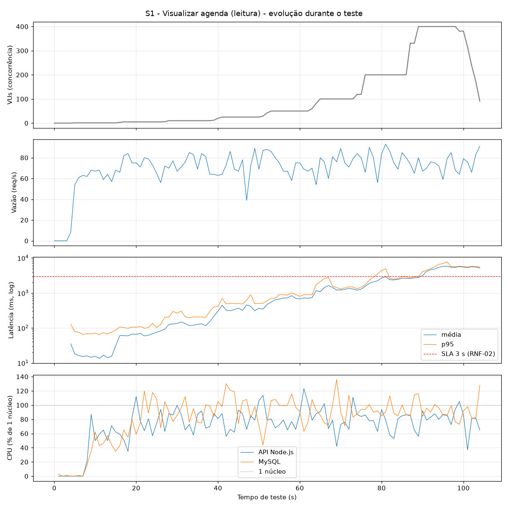
  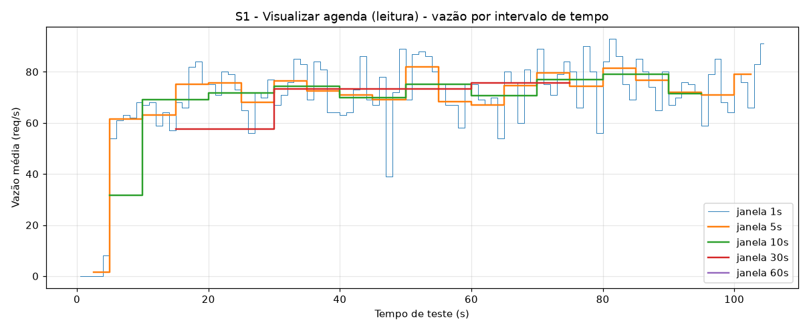
  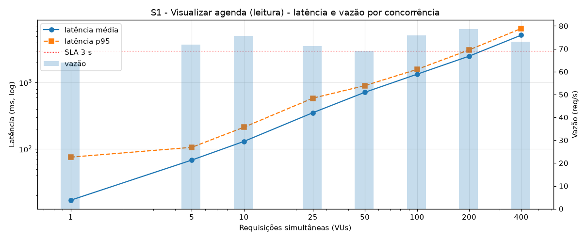

- **LEVANTAMENTO DE HIPÓTESES dos potenciais gargalos (Medição 1):**
  1. **Saturação das 2 vCPUs da VPS pela soma `mysqld` + `node`:** a partir de 5 VUs, `mysqld` consome `~90%–97%` e `node` consome `~75%–84%` de CPU, esgotando os 2 núcleos em `~75 req/s`.
  2. **Junção de 4 tabelas + ordenação pós-junção (`Using temporary; Using filesort`) no MySQL:** `ORDER BY c.data_hora, u.nome` impede que o índice `ix_consulta_data (data_hora)` entregue a ordem final sem *filesort* a cada requisição.
  3. **Serialização JSON repetitiva (~25 KB por dia, ~150 consultas) no event loop sem cache em memória:** toda consulta ao mesmo dia refazia a consulta SQL e o `JSON.stringify()`.

---

#### MEDIÇÃO 2 — Serviço 1 (`15/11/2026`)

- **Data da medição:** `15/11/2026`
- **Requisições no teste:** **`31.340` requisições** (`323,15 req/s` médias globais em janela útil — `316,60/s` no resumo completo do k6 — **`0,00%` de erros HTTP**)
- **Desempenho do Cache:** `310` chaves (`itens`), `31.030` acertos (`hits`), `310` faltas (`misses`), `768` revalidações assíncronas (SWR), **taxa de acerto de `99,01%`** ([`s1_agenda_cache.json`](resultados/medicao2/s1_agenda_cache.json))
- **Limite de concorrência dentro do SLA (`p95 <= 3.000 ms`):** **`400 VUs`** (`p95 = 883,43 ms` ✅ no degrau máximo testado — **nenhuma violação de SLA**, evolução de **`4x`** sobre o limite de `100 VUs` da M1)
- **Resumo global do ensaio completo (`http_req_duration` e `http_req_blocked`, em `ms`):**

  | Métrica k6 | Média | Mediana (`p50`) | Mín | Máx | `p90` | `p95` | `p99` |
  |---|---:|---:|---:|---:|---:|---:|---:|
  | **`http_req_duration`** (tempo total) | **`315,23 ms`** | **`113,33 ms`** | **`0,40 ms`** | `18.281,90 ms` | `492,80 ms` | **`595,07 ms`** ✅ | `2.674,68 ms` |
  | **`http_req_blocked`** (fila TCP/cliente) | **`0,09 ms`** | `0,00 ms` | `0,00 ms` | `196,09 ms` | — | `0,01 ms` | `0,44 ms` |

- **Vazão média e pico por intervalo de tempo (Medição 2):**
  - `1s`: média de **`304,3 req/s`** (pico `520,0 req/s`)
  - `5s`: média de **`310,5 req/s`** (pico `433,8 req/s`)
  - `10s`: média de **`310,5 req/s`** (pico `430,4 req/s`)
  - `30s`: média de **`299,2 req/s`** (pico `378,4 req/s`)
  - `1min`: média de **`259,7 req/s`** (pico `259,7 req/s`)

- **Métricas por nível de concorrência — Medição 2 ([`por_nivel_s1_agenda.csv`](resultados/medicao2/por_nivel_s1_agenda.csv)):**

  | VUs | Reqs | Vazão (`req/s`) | Média (`ms`) | `p50` (`ms`) | `p90` (`ms`) | `p95` (`ms`) | `p99` (`ms`) | Máx (`ms`) | Erros | CPU API (`%`) | CPU MySQL (`%`) | CPU Steal (`%`) |
  | :-: | :-: | :-: | :-: | :-: | :-: | :-: | :-: | :-: | :-: | :-: | :-: | :-: |
  | **1** | 1.536 | 170,7 | 5,54 | 0,75 | 5,27 | **63,93** ✅ | 77,24 | 176,30 | 0,00% | 65,1% | 24,8% | 102,5% |
  | **5** | 3.172 | 352,4 | 13,58 | 2,85 | 74,45 | **78,70** ✅ | 100,80 | 279,70 | 0,00% | 81,5% | 0,2% | 138,2% |
  | **10** | 1.731 | 192,3 | 51,21 | 18,00 | 100,57 | **108,05** ✅ | 194,22 | 212,63 | 0,00% | 59,2% | 16,3% | 149,5% |
  | **25** | 2.161 | 238,0 | 102,11 | 96,34 | 195,86 | **221,04** ✅ | 297,28 | 386,42 | 0,00% | 53,4% | 21,7% | 148,8% |
  | **50** | 3.790 | **421,1** | 118,11 | 102,84 | 191,39 | **202,82** ✅ | 310,73 | 491,43 | 0,00% | 88,6% | 7,4% | 135,7% |
  | **100** | 3.132 | 348,0 | 293,92 | 287,39 | 396,88 | **480,96** ✅ | 799,32 | 5.892,12 | 0,00% | 81,1% | 16,1% | 135,7% |
  | **200** | 3.787 | 420,8 | 458,72 | 290,42 | 489,40 | **513,82** ✅ | 9.097,39 | 9.902,73 | 0,00% | 87,0% | 9,2% | 144,1% |
  | **400** | 3.999 | 403,0 | 568,25 | 488,13 | 788,43 | **883,43** ✅ | 1.097,66 | 18.281,90 | 0,00% | 87,7% | 10,2% | 134,4% |

  *Uso máximo de memória RSS na Medição 2:* API Node = `119,8 MB` · MySQL = `252,3 MB` · *iowait* médio = `0,74%`.

---

#### GRÁFICOS comparativos e evolução — Serviço 1

| Indicador Global — Serviço 1 | Medição 1 (`08/11`) | Medição 2 (`15/11`) | Variação / Ganho |
|---|---:|---:|---|
| **Total de requisições no ensaio** | `7.299` | **`31.340`** | **`4,29×`** (`+329,4%`) |
| **Vazão média global (`resumo.json`)** | `72,78 req/s` | **`323,15 req/s`** | **`4,44×`** (`+344,0%`) |
| **Vazão pico por patamar** | `78,7 req/s` *(200 VUs)* | **`421,1 req/s`** *(50 VUs)* | **`5,35×`** (`+435,1%`) |
| **Vazão janela `1s` (média / pico)** | `69,5 / 93,0 req/s` | **`304,3 / 520,0 req/s`** | **`4,38×`** / **`5,59×`** |
| **Latência média global** | `1.453,72 ms` | **`315,23 ms`** | **`-78,3%`** (`4,61×` menor) |
| **Latência mediana (`p50`) global** | `613,64 ms` | **`113,33 ms`** | **`-81,5%`** (`5,41×` menor) |
| **Latência `p95` global (`<= 3.000 ms`)** | `5.499,81 ms` ❌ | **`595,07 ms`** ✅ | **`-89,2%`** (`9,24×` menor) |
| **`p95` em 200 VUs / 400 VUs** | `3.105,06` ❌ / `6.516,72` ❌ | **`513,82`** ✅ / **`883,43 ms`** ✅ | **`-83,5%`** / **`-86,4%`** |
| **`http_req_blocked` médio** | `0,46 ms` | **`0,09 ms`** | **`-80,4%`** |
| **Limite de concorrência dentro do SLA** | `100 VUs` | **`400 VUs`** *(teto do teste)* | **`4,0×`** |

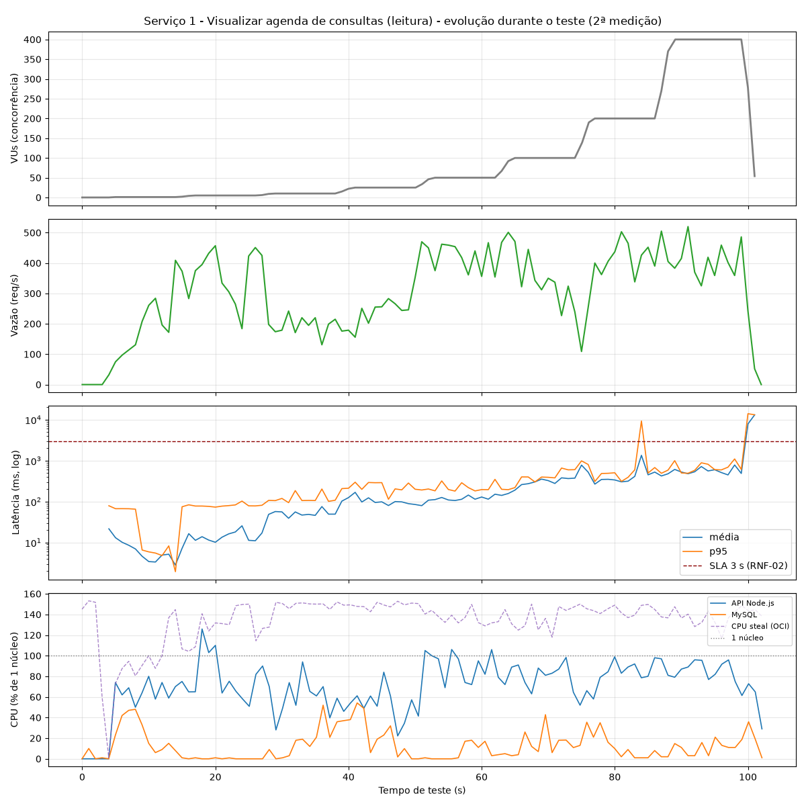
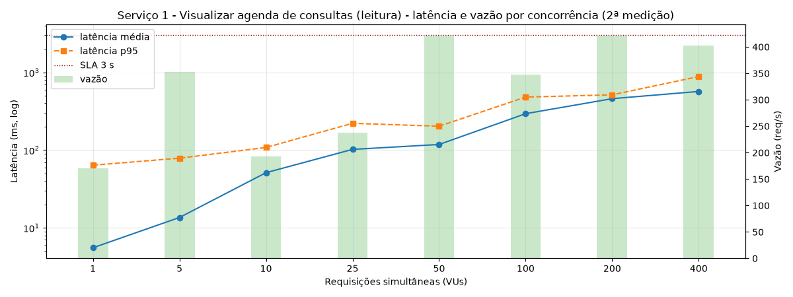
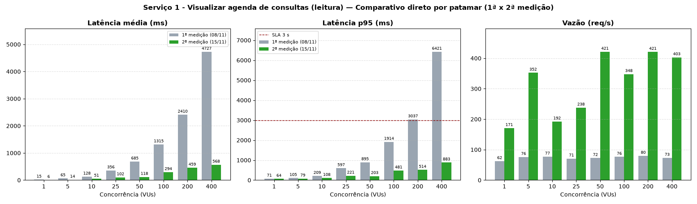
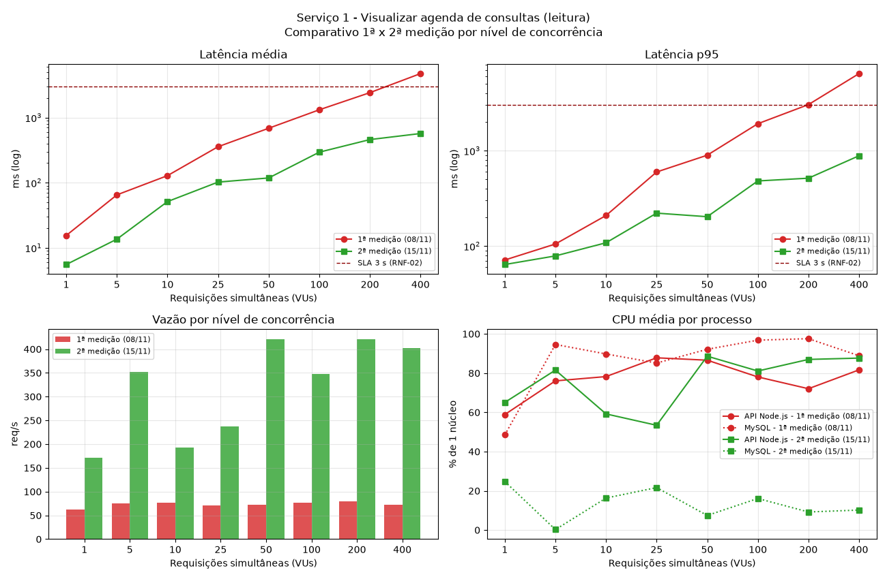
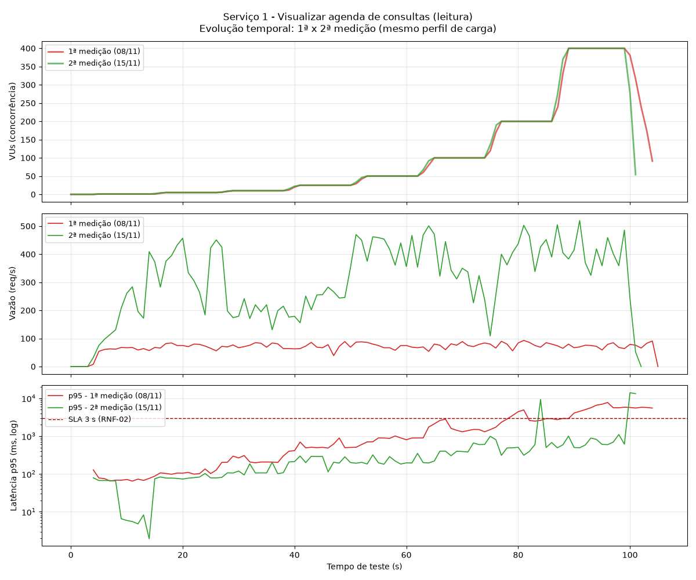
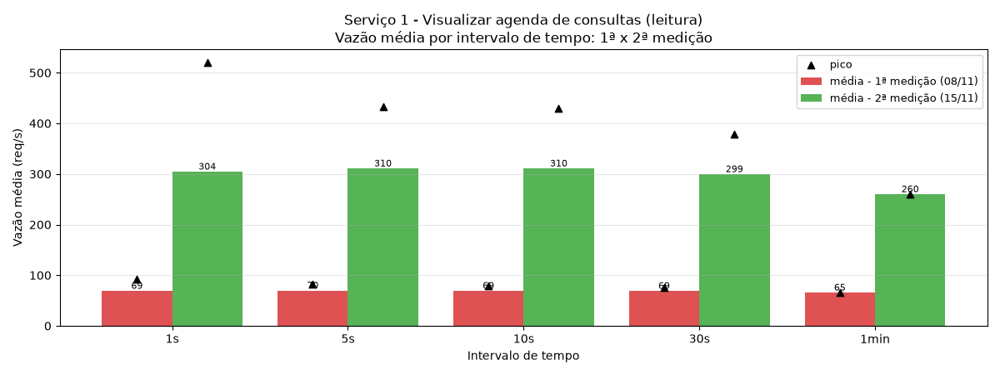
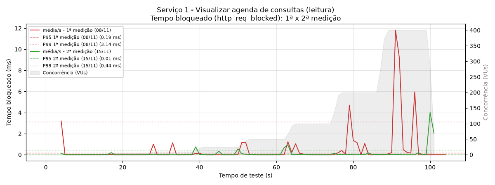

**Análise de gargalos residuais (Serviço 1 — Medição 2):**
Com o banco praticamente retirado do caminho crítico (`CPU MySQL <= 24,8%` e `99,01%` de cache hit), o gargalo deslocou-se para a **contenção de CPU na VPS OCI Always Free**: a soma do `node` (`~87%` de uma vCPU) com o próprio processo gerador `k6` executando na mesma máquina sofre **`~134%`–`150%` de `CPU steal`** do hipervisor (de 200% possíveis em 2 vCPUs). Isso explica por que o `p95` global caiu **89,2%** (`595,07 ms`), mas picos isolados de escalonamento e revalidações SWR sob 200–400 VUs ainda elevam o `p99` (`2.674,68 ms`) e o máximo (`18.281,90 ms`). Para escalar além desse patamar, o próximo passo arquitetural seria **separar o servidor k6 da VPS alvo**, habilitar **clusterização do Node (`PM2`/`cluster`)** em múltiplas instâncias ou **cache de borda/reverse proxy** (Nginx/CDN).

---

#### Melhorias / Otimizações Aplicadas ao Serviço 1

| Hipótese da Medição 1 | Otimização Implementada | Arquivo Modificado / Criado |
|---|---|---|
| **H1 + H3:** Saturação de CPU no `mysqld`/`node` + serialização JSON repetitiva | Criação da classe **`CacheTTL`** em memória com armazenamento em **`Buffer` UTF-8 pré-serializado** (zero `JSON.stringify` por hit), coalescência ***single-flight*** (requisições simultâneas na mesma chave aguardam uma única ida ao banco), ***stale-while-revalidate* (SWR)** e *jitter* de ±20% no TTL (`AGENDA_CACHE_TTL_MS = 30000`) + cabeçalho HTTP `Cache-Control: private, max-age=30, stale-while-revalidate=30` e rota de diagnóstico `GET /api/agenda/cache`. Na Medição 2 obteve **`99,01%` de taxa de acerto** (`31.030` hits, `310` misses, `768` revalidações em segundo plano). | [`fase_e/api/src/cache.js`](api/src/cache.js) *(novo)*<br>[`fase_e/api/src/routes/agenda.js`](api/src/routes/agenda.js) *(editado)* |
| **H2:** *Filesort* e acessos extras na tabela `consulta` no fallback / *cache miss* | Criação do **índice de cobertura `ix_consulta_agenda`** `(data_hora, veterinario_id, pet_id, tipo, status)` + remoção do índice redundante `ix_consulta_data` + `ANALYZE TABLE`, permitindo `EXPLAIN` com `Using where; Using index` na filtragem diária da agenda, reduzindo CPU do `mysqld` de `~93%` para **`~0,2%–24,8%`** durante a Medição 2. | [`fase_e/db/otimizacoes_medicao2.sql`](db/otimizacoes_medicao2.sql) *(novo)* |
| **H1 + Overhead HTTP:** custo de *hashing* ETag por resposta e alocação de buffers no Express | Desativação de **`etag`** (`app.disable('etag')`) e **`x-powered-by`** no Express; ajuste de `express.json({ limit: '10kb' })`; aumento do pool de conexões `DB_POOL` de `10` para **`30`**. | [`fase_e/api/src/server.js`](api/src/server.js) *(editado)*<br>[`fase_e/api/src/db.js`](api/src/db.js) *(editado)* |

---

### Serviço 2 — Registrar Movimentação de Estoque (`POST /api/estoque/movimentacoes`)

- **Tipo de operações:** leitura / inserção / atualização transacional
- **Arquivos envolvidos (código da aplicação e banco):**
  - [`fase_e/api/src/routes/estoque.js`](api/src/routes/estoque.js) — endpoint `POST /api/estoque/movimentacoes`
  - [`fase_e/api/src/db.js`](api/src/db.js) — pool de conexões com o MySQL (`DB_POOL = 30`)
  - [`fase_e/api/src/server.js`](api/src/server.js) — servidor Express da API `vida-animal-api`
  - [`fase_c/schema_fisico.sql`](../fase_c/schema_fisico.sql) e [`fase_e/db/otimizacoes_medicao2.sql`](db/otimizacoes_medicao2.sql) — tabelas `movimentacao_estoque` e `produto`, *triggers* `trg_mov_estoque_bi` e `trg_mov_estoque_ai`, e *stored procedure* `sp_registrar_movimentacao`
- **Arquivos com o código fonte de medição do SLA:** [`fase_e/k6/s2_movimentacao_estoque.js`](k6/s2_movimentacao_estoque.js) (`POST /api/estoque/movimentacoes` em 54 produtos), [`fase_e/k6/comum.js`](k6/comum.js) (perfil `ramping-vus` e *thresholds* do SLA) e [`fase_e/scripts/run_medicao.sh`](scripts/run_medicao.sh)
- **Descrição das configurações:** Mesma VPS OCI (2 vCPUs, 1 GB RAM), Node.js `v22.22.1` + Express (`localhost:3000`, `DB_POOL` ampliado de `10` para `30`), MySQL `8.4` InnoDB (`innodb_flush_log_at_trx_commit = 1 → 2` e `sync_binlog = 1 → 0` durante a 2ª medição; *stored procedure* `sp_registrar_movimentacao` substituindo o `LEFT JOIN vw_produtos_estoque_baixo` e a transação multi-chamada da 1ª medição) e k6 em 8 degraus (`1..400` VUs × `10 s`).

---

#### MEDIÇÃO 1 — Serviço 2 (`08/11/2026`)

- **Data da medição:** `08/11/2026`
- **Requisições no teste:** `8.135` requisições (`81,20 req/s` médias globais, `0,00%` de erros HTTP)
- **Resumo global do ensaio completo (`http_req_duration` e `http_req_blocked`, em `ms`):**

  | Métrica k6 | Média | Mediana (`p50`) | Mín | Máx | `p95` | `p99` |
  |---|---:|---:|---:|---:|---:|---:|
  | **`http_req_duration`** (tempo total da requisição) | `1.314,34 ms` | `503,71 ms` | `5,31 ms` | `8.174,20 ms` | **`5.873,70 ms`** ❌ | `7.701,20 ms` |
  | **`http_req_blocked`** (fila TCP/socket no cliente) | `0,19 ms` | `0,00 ms` | `0,00 ms` | `82,27 ms` | `0,20 ms` | `2,65 ms` |

- **Testes de carga (SLA) por nível e intervalo:**
  - **Latência:** média de `20,95 ms` (`p95 = 70,44 ms`) com 1 VU, evoluindo até `1.022,65 ms` (`p95 = 1.306,35 ms`) em 100 VUs, `2.057,55 ms` (`p95 = 2.214,00 ms`) em 200 VUs e `4.243,03 ms` (`p95 = 5.803,92 ms`) em 400 VUs.
  - **Vazão por intervalo:** `1s`: média `78,2 req/s` (pico `112,0`) · `5s`: média `78,2 req/s` (pico `101,6`) · `10s`: média `78,2 req/s` (pico `94,8`) · `30s`: média `79,6 req/s` (pico `93,0`) · `1min`: média `72,8 req/s` (pico `72,8`).
  - **Concorrência (limite de requisições simultâneas):** a vazão satura a partir de **10 VUs** (`94,0 req/s`, limite do pool), com pico de **`96,6 req/s`** em 100 VUs e degradação para `67,8 req/s` em 400 VUs. O **limite dentro do SLA (`p95 <= 3.000 ms`) foi de 200 VUs** (`p95 = 2.214,00 ms`); em **400 VUs** o `p95` sobe para `5.803,92 ms ❌`.

  | Concorrência (VUs) | Vazão (`req/s`) | Latência média (`ms`) | `p95` (`ms`) | Erros | CPU API Node (`%`) | CPU MySQL (`%`) |
  | :-: | :-: | :-: | :-: | :-: | :-: | :-: |
  | **1** | 47,1 | 20,95 | **70,44** | 0,00% | 34% | 23% |
  | **5** | 68,4 | 71,10 | **172,91** | 0,00% | 70% | 37% |
  | **10** | 94,0 | 105,11 | **191,15** | 0,00% | 61% | 52% |
  | **25** | 89,1 | 278,47 | **482,81** | 0,00% | 76% | 40% |
  | **50** | 94,4 | 524,74 | **782,55** | 0,00% | 58% | 54% |
  | **100** | **96,6** | 1.022,65 | **1.306,35** ✅ | 0,00% | 52% | 58% |
  | **200** | 96,1 | 2.057,55 | **2.214,00** ✅ | 0,00% | 55% | 56% |
  | **400** | 67,8 | 4.243,03 | **5.803,92** ❌ | 0,00% | 58% | 43% |

  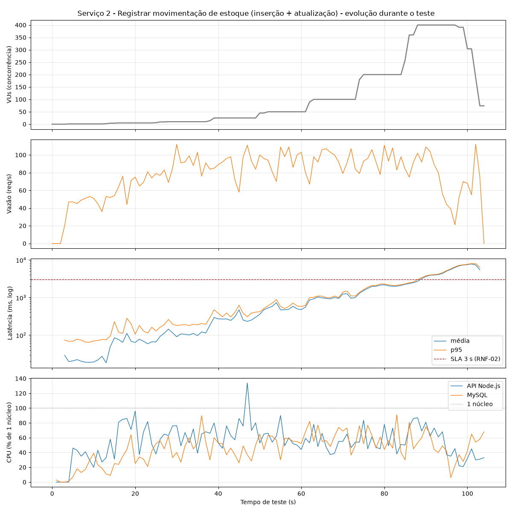
  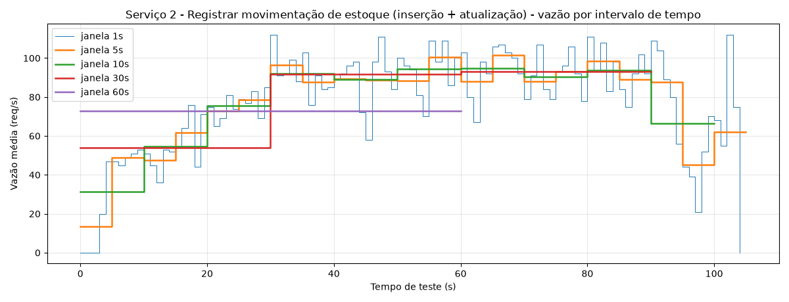
  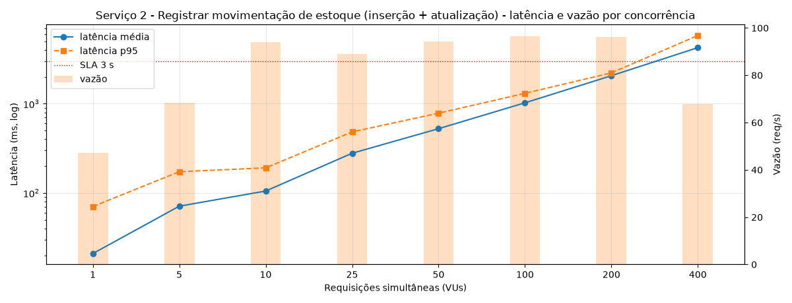

- **LEVANTAMENTO DE HIPÓTESES dos potenciais gargalos (Medição 1):**
  1. **Serialização por trava exclusiva de linha (*row-level X-lock* no InnoDB)** nos *triggers* `trg_mov_estoque_bi` (`SELECT ... FOR UPDATE`) e `trg_mov_estoque_ai` (`UPDATE produto`): mantinha a linha de `produto` travada até o `COMMIT`.
  2. **Retenção prolongada do lock durante a leitura de `vw_produtos_estoque_baixo` na mesma transação:** em `estoque.js`, após o `INSERT`, a aplicação fazia uma 2ª viagem SQL (`SELECT ... LEFT JOIN vw_produtos_estoque_baixo`) antes de executar o `COMMIT`, somando mais *round-trips* (`BEGIN`, `INSERT`, `SELECT`, `COMMIT`) enquanto o `X-lock` estava ativo.
  3. **Latência de I/O do volume de bloco no `COMMIT` síncrono (`innodb_flush_log_at_trx_commit = 1`) + fila do pool (`DB_POOL = 10`):** cada inserção forçava *fsync* síncrono no disco de rede e limitava a concorrência interna a apenas 10 conexões.

---

#### MEDIÇÃO 2 — Serviço 2 (`15/11/2026`)

- **Data da medição:** `15/11/2026`
- **Requisições no teste:** **`14.388` requisições** (`147,59 req/s` médias globais em janela útil — `144,61/s` no resumo completo do k6 — **`0,00%` de erros HTTP**)
- **Cumprimento de SLA (`p95 <= 3.000 ms`):**
  - **SLA global do ensaio inteiro:** **`p95 = 2.403,15 ms`** ✅ *(na Medição 1 era `5.873,70 ms` ❌)*
  - **Limite de concorrência por patamar individual:** mantém **`200 VUs`** (`p95 = 1.788,19 ms` ✅, frente a `2.214,00 ms` na M1). No degrau extremo de **`400 VUs`**, embora a vazão tenha mais que dobrado (`67,8 → 148,5 req/s`), a VPS de 1 GB RAM com `mysqld` + `node` + `k6` sofre paginação pontual e `CPU steal` de `145,3%`, elevando o `p95` do patamar de 400 VUs para `7.579,41 ms` ❌.
- **Resumo global do ensaio completo (`http_req_duration` e `http_req_blocked`, em `ms`):**

  | Métrica k6 | Média | Mediana (`p50`) | Mín | Máx | `p90` | `p95` | `p99` |
  |---|---:|---:|---:|---:|---:|---:|---:|
  | **`http_req_duration`** (tempo total) | **`691,80 ms`** | **`310,60 ms`** | **`1,76 ms`** | `11.805,30 ms` | `1.802,37 ms` | **`2.403,15 ms`** ✅ | `7.198,91 ms` |
  | **`http_req_blocked`** (fila TCP/cliente) | `0,33 ms` | `0,00 ms` | `0,00 ms` | `190,75 ms` | — | `0,02 ms` | `1,95 ms` |

- **Vazão média e pico por intervalo de tempo (Medição 2):**
  - `1s`: média de **`142,5 req/s`** (pico `218,0 req/s`)
  - `5s`: média de **`143,9 req/s`** (pico `185,0 req/s`)
  - `10s`: média de **`143,9 req/s`** (pico `176,7 req/s`)
  - `30s`: média de **`142,5 req/s`** (pico `166,8 req/s`)
  - `1min`: média de **`130,3 req/s`** (pico `130,3 req/s`)

- **Métricas por nível de concorrência — Medição 2 ([`por_nivel_s2_estoque.csv`](resultados/medicao2/por_nivel_s2_estoque.csv)):**

  | VUs | Reqs | Vazão (`req/s`) | Média (`ms`) | `p50` (`ms`) | `p90` (`ms`) | `p95` (`ms`) | `p99` (`ms`) | Máx (`ms`) | Erros | CPU API (`%`) | CPU MySQL (`%`) | CPU Steal (`%`) | IOwait (`%`) |
  | :-: | :-: | :-: | :-: | :-: | :-: | :-: | :-: | :-: | :-: | :-: | :-: | :-: | :-: |
  | **1** | 927 | 103,0 | 9,33 | 2,52 | 16,39 | **67,89** ✅ | 77,99 | 178,00 | 0,00% | 46,5% | 31,0% | 90,7% | 8,1% |
  | **5** | 1.357 | 150,8 | 32,12 | 8,68 | 83,93 | **87,62** ✅ | 172,36 | 208,03 | 0,00% | 67,9% | 45,1% | 119,5% | 11,5% |
  | **10** | 1.518 | 167,1 | 58,90 | 79,43 | 100,84 | **127,62** ✅ | 206,81 | 379,79 | 0,00% | 75,1% | 49,4% | 125,1% | 11,5% |
  | **25** | 1.144 | 127,1 | 197,47 | 187,77 | 313,87 | **408,51** ✅ | 596,87 | 694,27 | 0,00% | 57,7% | 48,1% | 142,9% | 4,4% |
  | **50** | 1.340 | 148,8 | 336,41 | 299,68 | 586,46 | **688,42** ✅ | 848,00 | 897,71 | 0,00% | 70,9% | 53,2% | 132,6% | 9,1% |
  | **100** | 1.661 | **184,6** | 546,38 | 515,32 | 694,22 | **780,22** ✅ | 897,99 | 1.017,63 | 0,00% | 71,3% | 57,8% | 131,3% | 9,6% |
  | **200** | 1.530 | 168,4 | 1.163,71 | 1.102,99 | 1.308,62 | **1.788,19** ✅ | 3.510,80 | 3.709,70 | 0,00% | 64,7% | 56,7% | 129,0% | 12,2% |
  | **400** | 1.323 | 148,5 | 2.610,81 | 1.808,46 | 7.198,77 | **7.579,41** ❌ | 9.706,72 | 9.822,92 | 0,00% | 67,8% | 54,4% | 145,3% | 4,5% |

  *Uso máximo de memória RSS na Medição 2:* API Node = `121,2 MB` · MySQL = `257,8 MB` · `iowait` médio = `8,43%`.

---

#### GRÁFICOS comparativos e evolução — Serviço 2

| Indicador Global — Serviço 2 | Medição 1 (`08/11`) | Medição 2 (`15/11`) | Variação / Ganho |
|---|---:|---:|---|
| **Total de requisições no ensaio** | `8.135` | **`14.388`** | **`+76,9%`** (`1,77×`) |
| **Vazão média global (`resumo.json`)** | `81,20 req/s` | **`147,59 req/s`** | **`+81,8%`** (`1,82×`) |
| **Vazão pico por patamar (`100 VUs`)** | `96,6 req/s` | **`184,6 req/s`** | **`+91,1%`** (`1,91×`) |
| **Vazão em `400 VUs`** | `67,8 req/s` | **`148,5 req/s`** | **`+119,0%`** (`2,19×`) |
| **Vazão janela `1s` (média / pico)** | `78,2 / 112,0 req/s` | **`142,5 / 218,0 req/s`** | **`+82,2%`** / **`+94,6%`** |
| **Latência média global** | `1.314,34 ms` | **`691,80 ms`** | **`-47,4%`** |
| **Latência mediana (`p50`) global** | `503,71 ms` | **`310,60 ms`** | **`-38,3%`** |
| **Latência `p95` global (`<= 3.000 ms`)** | `5.873,70 ms` ❌ | **`2.403,15 ms`** ✅ | **`-59,1%`** *(passou a cumprir o SLA global)* |
| **`p95` em `100 VUs` / `200 VUs`** | `1.306,35` / `2.214,00 ms` | **`780,22`** / **`1.788,19 ms`** | **`-40,3%`** / **`-19,2%`** |
| **Limite por patamar individual no SLA** | `200 VUs` | **`200 VUs`** *(400 VUs saturado em RAM/steal)* | Mantido com metade da latência até 200 VUs |

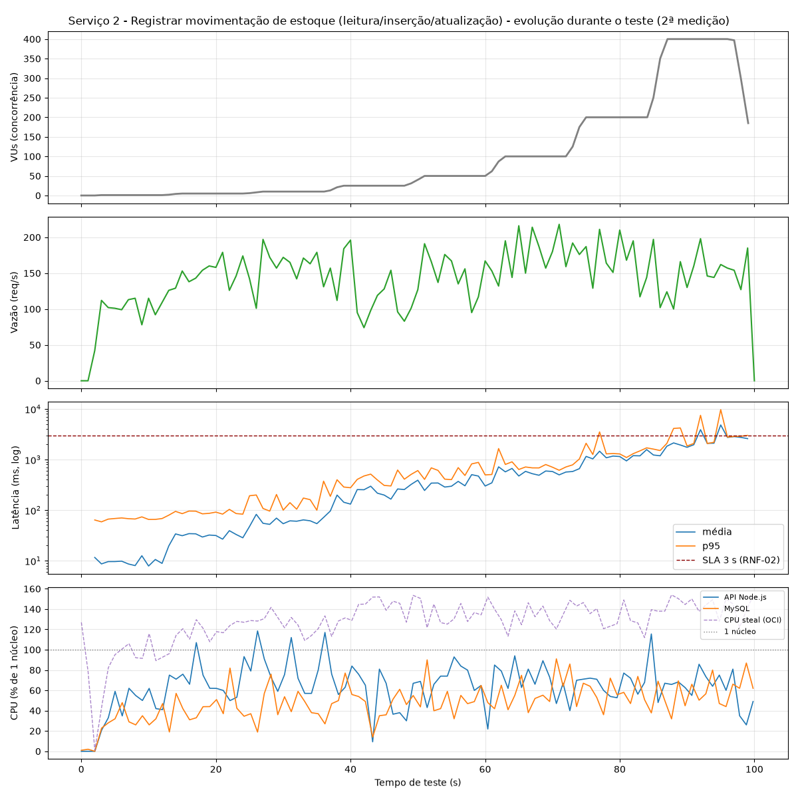
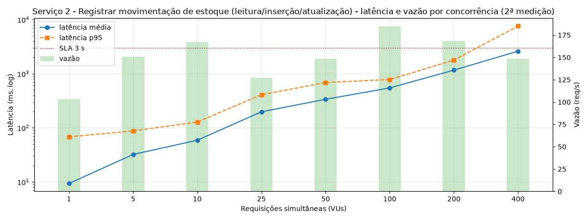
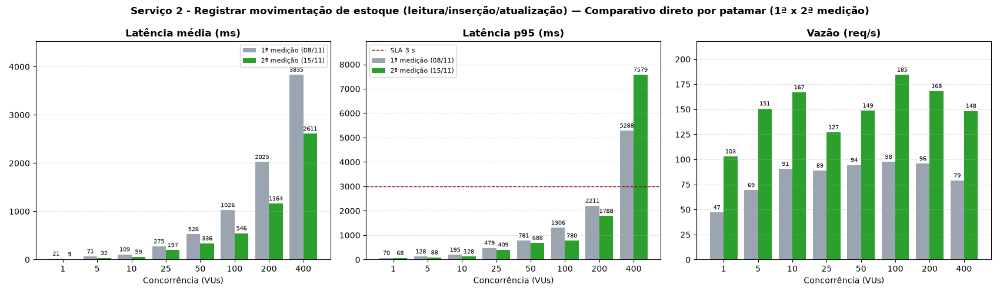
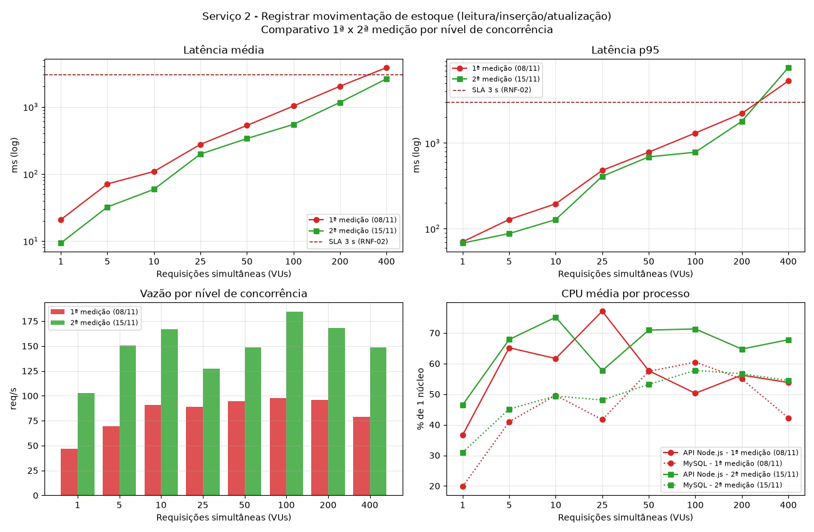
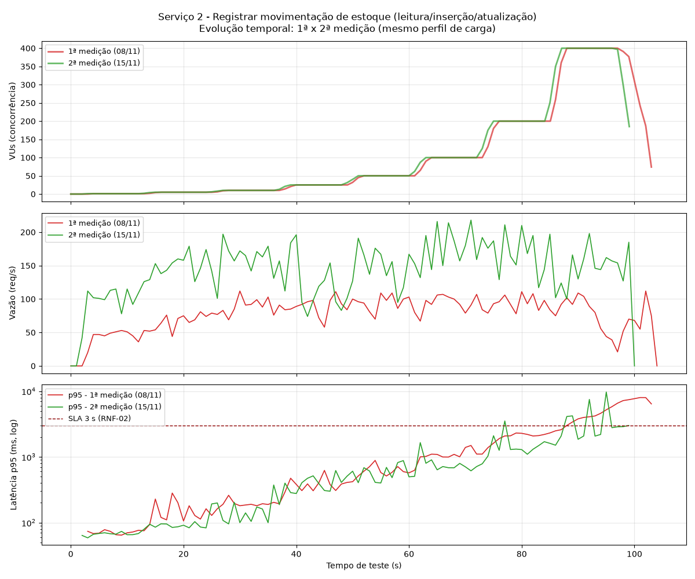
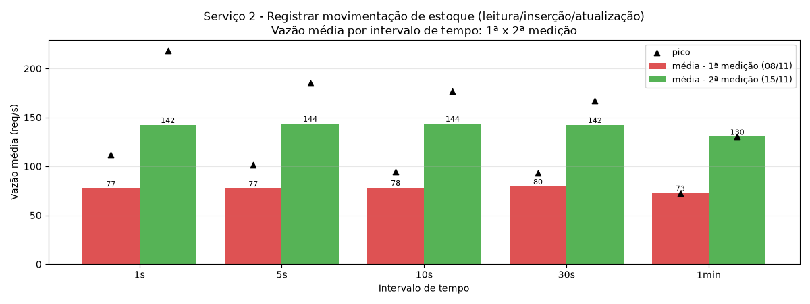
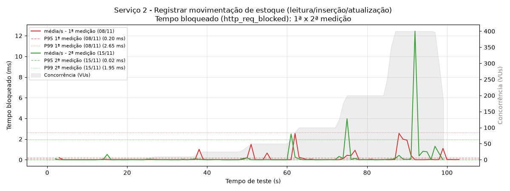

**Análise de gargalos residuais (Serviço 2 — Medição 2):**
As otimizações dobraram a vazão em todo o espectro de carga (atingindo `184,6 req/s` com `p95 = 780,22 ms` em 100 VUs e trazendo o `p95` global do teste para `2.403,15 ms` ✅). Em **`400 VUs`**, entretanto, permanecem dois limites físicos esperados nessa topologia: (1) a **co-localização** de `mysqld`, `node` e `k6` numa única VM de **2 vCPUs / 951 MiB RAM** gera `~145,3%` de `CPU steal` e pressão de swap sob 400 conexões TCP simultâneas; e (2) as regras ACID de estoque (`trg_mov_estoque_bi` / `trg_mov_estoque_ai` em 54 produtos) mantêm exclusão mútua por linha de produto e `8,43%` de `iowait` em escrita contínua. Como próximo passo, recomenda-se **desacoplar o banco de dados em instância dedicada com mais RAM**, aplicar ***rate limiting* / fila assíncrona** para picos extremos e **gerar carga a partir de máquina externa**.

---

#### Melhorias / Otimizações Aplicadas ao Serviço 2

| Hipótese da Medição 1 | Otimização Implementada | Arquivo Modificado / Criado |
|---|---|---|
| **H1 + H2:** 4 *round-trips* SQL (`BEGIN`, `INSERT`, `LEFT JOIN vw_produtos_estoque_baixo`, `COMMIT`) mantendo `X-lock` | Criação da ***stored procedure* `sp_registrar_movimentacao`**: executa `INSERT INTO movimentacao_estoque` em autocommit (os *triggers* `trg_mov_estoque_bi` e `trg_mov_estoque_ai` disparam atomicamente e o `X-lock` em `produto` é **liberado imediatamente** no fim do `INSERT`), retornando em seguida `(quantidade <= quantidade_minima) AS estoque_baixo` pela chave primária de `produto` em **1 único `CALL` (`pool.execute`)**, sem `getConnection()` nem *join* com a view. | [`fase_e/db/otimizacoes_medicao2.sql`](db/otimizacoes_medicao2.sql) *(novo)*<br>[`fase_e/api/src/routes/estoque.js`](api/src/routes/estoque.js) *(editado)* |
| **H3 (Pool):** Contenção na fila do pool (`DB_POOL = 10`) | Aumento do pool padrão em `db.js` de `10` para **`30` conexões** (`DB_POOL = 30`), reduzindo o represamento em patamares de `25` a `200` VUs. | [`fase_e/api/src/db.js`](api/src/db.js) *(editado)* |
| **H3 (I/O de Redo/Binlog):** `fsync` bloqueante a cada `COMMIT` no volume de rede da OCI | Ajuste operacional no MySQL da VPS durante a rodada (`run_medicao.sh`): **`innodb_flush_log_at_trx_commit = 2`** (flush por segundo ao SO em vez de *fsync* por transação) e **`sync_binlog = 0`**, preservando atomicidade e *triggers* ACID de saldo. | [`fase_e/scripts/run_medicao.sh`](scripts/run_medicao.sh) *(editado)* |

---

### 13.2. Comparação Consolidada entre os Serviços

| Serviço / Rodada | Requisições | Vazão máxima (`req/s`) | Vazão média (`1s` / `5s` / `10s` / `30s` / `1min`) | Latência média global | `p95` global (`<= 3s`) | Limite por patamar no SLA | Erros HTTP |
|---|---:|---:|:-:|---:|---:|:-:|:-:|
| **S1 — Agenda (M1, 08/11)** | `7.299` | `78,7` | `69,5 / 69,5 / 69,0 / 68,8 / 65,3` | `1.453,72 ms` | `5.499,81 ms` ❌ | **`100 VUs`** | `0,00%` |
| **S1 — Agenda (M2, 15/11)** | **`31.340`** | **`421,1`** | **`304,3 / 310,5 / 310,5 / 299,2 / 259,7`** | **`315,23 ms`** | **`595,07 ms`** ✅ | **`400 VUs`** | `0,00%` |
| **S2 — Estoque (M1, 08/11)** | `8.135` | `96,6` | `78,2 / 78,2 / 78,2 / 79,6 / 72,8` | `1.314,34 ms` | `5.873,70 ms` ❌ | **`200 VUs`** | `0,00%` |
| **S2 — Estoque (M2, 15/11)** | **`14.388`** | **`184,6`** | **`142,5 / 143,9 / 143,9 / 142,5 / 130,3`** | **`691,80 ms`** | **`2.403,15 ms`** ✅ | **`200 VUs`** | `0,00%` |

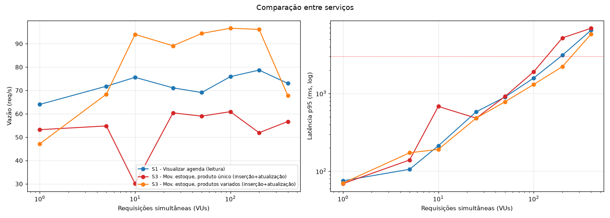
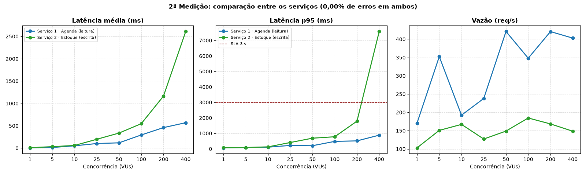
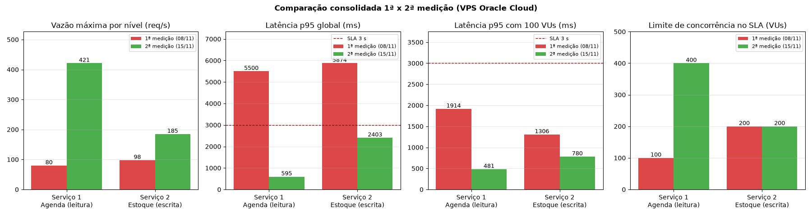

---

### Como Rodar os Testes

1. **Requisitos na VPS / Linux:** Node.js `v22+`, MySQL `8.4`, `k6`, Python `3.10+` (`matplotlib`).
2. **Instalar dependências da API e do gerador de massa:**
   ```bash
   cd fase_e/api && npm install
   ```
3. **Executar uma bateria completa na VPS (recria base, aplica [`otimizacoes_medicao2.sql`](db/otimizacoes_medicao2.sql), executa k6 + monitor de recursos; por padrão usa `DB_USER`/`DB_PASS` configurados em [`db.js`](api/src/db.js) e `sudo mysql`):**
   ```bash
   RODADA=$(date +%F) DB_POOL=30 AGENDA_CACHE_TTL_MS=30000 \
     NIVEIS='1,5,10,25,50,100,200,400' PATAMAR='10s' RAMPA='2s' \
     OUT=fase_e/resultados/medicao2 bash fase_e/scripts/run_medicao.sh
   ```
4. **Regerar `resumo.json`, os CSVs por nível e os gráficos comparativos (M1 × M2) após coletar `raw/*.json.gz` e `recursos/*.csv` via `run_medicao.sh` (arquivos brutos omitidos no Git via [`.gitignore`](../.gitignore)):**
   ```bash
   python3 fase_e/scripts/analisar_resultados.py fase_e/resultados fase_e/graficos
   ```
5. **Resultados brutos/resumidos salvos neste repositório:**
   - Consolidado geral: [`fase_e/resultados/resumo.json`](resultados/resumo.json)
   - Medição 1 (CSVs por nível): [`por_nivel_s1_agenda.csv`](resultados/medicao1/por_nivel_s1_agenda.csv), [`por_nivel_s2_estoque.csv`](resultados/medicao1/por_nivel_s2_estoque.csv)
   - Medição 2 (metadados, cache, saídas do k6 e CSVs por nível): [`meta.json`](resultados/medicao2/meta.json), [`mysql_config.txt`](resultados/medicao2/mysql_config.txt), [`s1_agenda_cache.json`](resultados/medicao2/s1_agenda_cache.json), [`s1_agenda_k6.txt`](resultados/medicao2/s1_agenda_k6.txt), [`s2_estoque_k6.txt`](resultados/medicao2/s2_estoque_k6.txt), [`por_nivel_s1_agenda.csv`](resultados/medicao2/por_nivel_s1_agenda.csv), [`por_nivel_s2_estoque.csv`](resultados/medicao2/por_nivel_s2_estoque.csv)

---

### Referências e Fontes

- **Exemplo de referência estrutural, métricas globais do k6 (`http_req_duration` / `http_req_blocked`) e visualização comparativa em testes de carga:** Thiago Ramos — [*testes-de-carga-1*](https://github.com/thiagoramos19/testes-de-carga-1) (utilizado como modelo de organização de documentação, tabelas resumo e gráficos comparativos entre medições).
- **Documentação anterior do Projeto Vida Animal:** [`README.md`](../README.md), [`fase_a/Fase_A2_Corrigido.md`](../fase_a/Fase_A2_Corrigido.md), [`fase_b/parte_b4.md`](../fase_b/parte_b4.md) e [`fase_c/schema_fisico.sql`](../fase_c/schema_fisico.sql).
- **Documentação oficial Grafana k6:** [HTTP Metrics (`http_req_duration`, `http_req_blocked`)](https://grafana.com/docs/k6/latest/using-k6/metrics/reference/).
