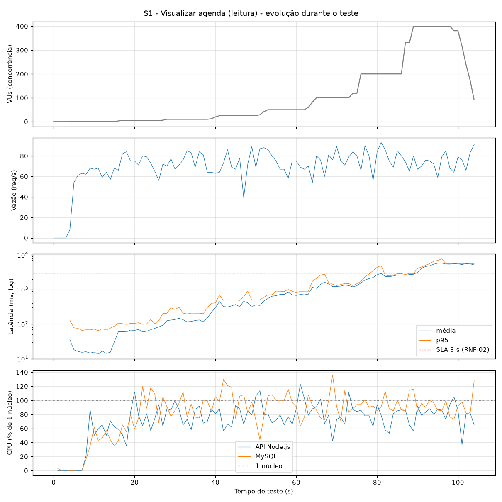
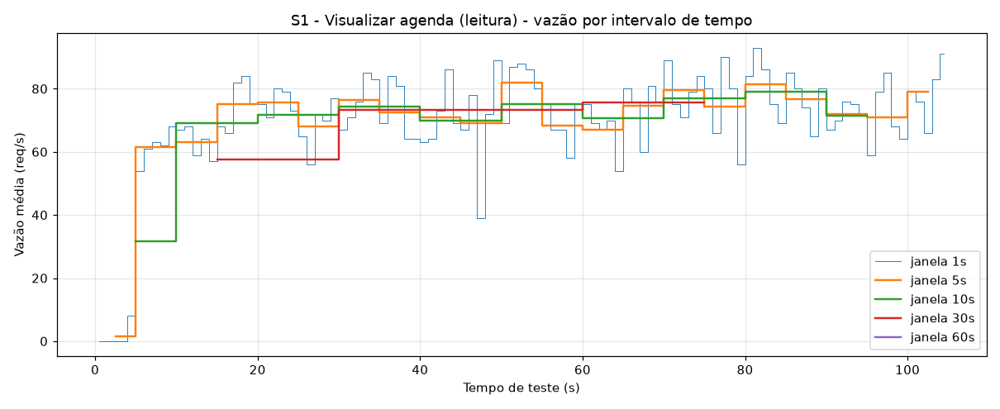
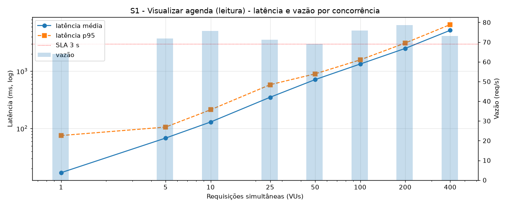
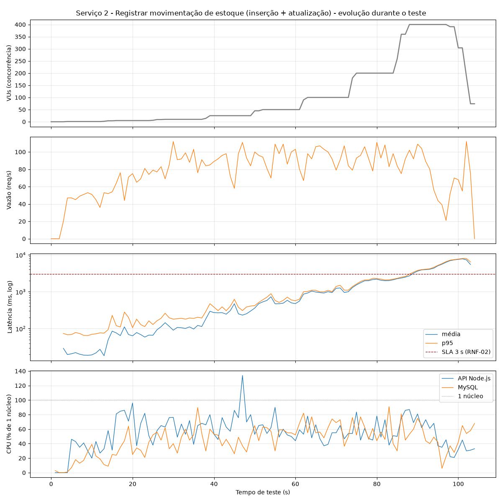
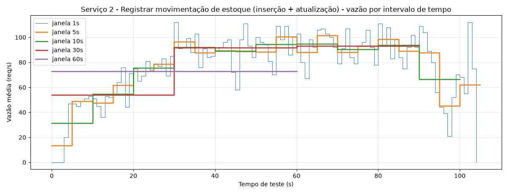
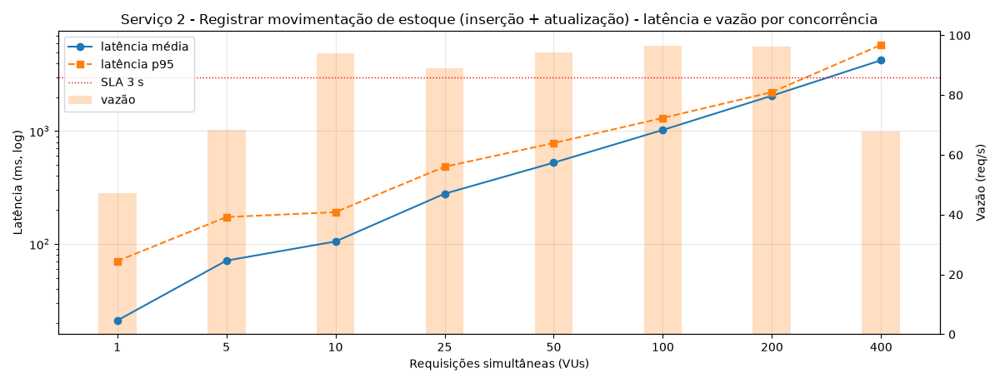
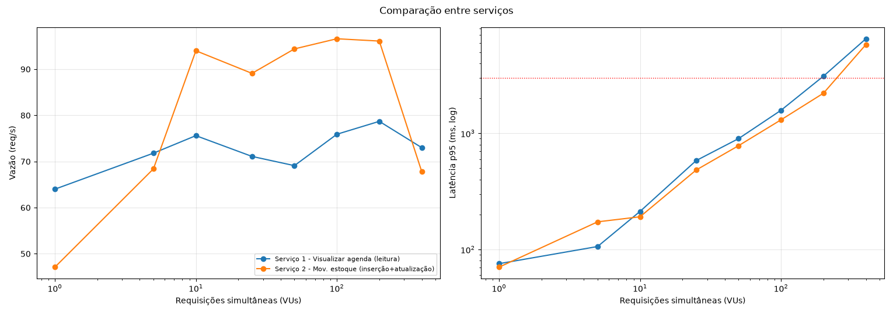

# Sistema de Gestão para Clínica Veterinária "Vida Animal"
## Fase E — 1ª Medição dos Testes de Carga (SLA)

**Disciplina:** Projeto Integrador II (TIN0210)  
**Ambiente de Implantação:** VPS Oracle Cloud Infrastructure (OCI)  
**SGBD:** MySQL 8.4 (InnoDB, `utf8mb4`) — Esquema físico da Seção 11 ([`fase_c/schema_fisico.sql`](../fase_c/schema_fisico.sql))  
**Data:** 08 de novembro de 2026  

---

## 13. 1ª Medição dos Testes de Carga e Análise de Gargalos (Fase E)

### 13.1. Visão Geral e Critérios de SLA

Em conformidade com o **Diagrama de Implantação da Seção 9.3 (Fase B-4)**, a API REST (`vida-animal-api`, em Node.js + Express) e o banco relacional `clinica_vida_animal` (MySQL/InnoDB) foram implantados na **VPS da Oracle Cloud Infrastructure (OCI)** e submetidos a testes de carga com o **Grafana k6** sobre uma base populada com **5.003 tutores, 8.004 pets, 22 veterinários, 45.262 consultas e 55 produtos** (~1 ano de operação da clínica).

Foram selecionados dois serviços internos centrais do sistema — um de **leitura** e outro de **leitura, inserção e atualização na base de dados**:

| Serviço | Endpoint HTTP | Caso de Uso / RF | Operações no Banco (`clinica_vida_animal`) |
|---|---|---|---|
| **Serviço 1 — Visualizar Agenda de Consultas** | `GET /api/agenda?data=AAAA-MM-DD` | UC-03 / RF-03 | **Leitura:** `SELECT` com `INNER JOIN` entre `consulta`, `pet`, `tutor` e `usuario`, filtrando por `ix_consulta_data`. |
| **Serviço 2 — Registrar Movimentação de Estoque** | `POST /api/estoque/movimentacoes` | UC-06 / RF-06 | **Leitura / Inserção / Atualização:** `INSERT` em `movimentacao_estoque` + *trigger* `trg_mov_estoque_bi` (`SELECT ... FOR UPDATE`, RN-05 e saldo) + *trigger* `trg_mov_estoque_ai` (`UPDATE produto`) + leitura de `vw_produtos_estoque_baixo` (RN-06). |

**Critério de SLA adotado (Seção 5 — Requisitos Não-Funcionais):**
- **RNF-02 (Desempenho):** tempo de resposta em até **3 segundos** (`p95 <= 3.000 ms`).
- **RNF-04 (Confiabilidade/Disponibilidade):** taxa de erros HTTP $< 1\%$.

---

## MEDIÇÕES DO SLA

* **Serviço 1 — Visualizar Agenda de Consultas (`GET /api/agenda`)**
  * **Tipo de operações:** leitura
  * **Arquivos envolvidos:**
    * [`fase_e/api/src/routes/agenda.js`](api/src/routes/agenda.js) — implementação do endpoint `GET /api/agenda`
    * [`fase_e/api/src/db.js`](api/src/db.js) — pool de conexões com o MySQL (`mysql2/promise`)
    * [`fase_e/api/src/server.js`](api/src/server.js) — servidor Express da API `vida-animal-api`
    * [`fase_c/schema_fisico.sql`](../fase_c/schema_fisico.sql) — tabelas `consulta`, `pet`, `tutor`, `usuario` e índice `ix_consulta_data`
  * **Arquivos com o código fonte de medição do SLA:**
    * [`fase_e/k6/s1_agenda.js`](k6/s1_agenda.js) — script de teste de carga do Serviço 1
    * [`fase_e/k6/comum.js`](k6/comum.js) — perfil de degraus de concorrência (*ramping-vus*) e *thresholds* do SLA
  * **Data da medição:** 08/11/2026
  * **Descrição das configurações:**
    * **Máquina:** VPS Oracle Cloud com Ubuntu Linux (2 vCPUs, 1 GB de RAM)
    * **Backend:** Node.js `v22` + Express (`localhost:3000`, pool MySQL com 10 conexões)
    * **SGBD:** MySQL Server `8.4` (`localhost:3306`, motor InnoDB)
    * **Ferramenta de teste:** Grafana k6 (rampa de 1, 5, 10, 25, 50, 100, 200 e 400 VUs)
  * **Testes de carga (SLA): latência, vazão e concorrência (limite de requisições simultâneas)**
    * **Latência (tempo de resposta médio e percentis):** média de `16,97 ms` (`p95 = 75,46 ms`) com 1 VU, evoluindo até `1.335,51 ms` (`p95 = 1.578,45 ms`) em 100 VUs e `5.176,95 ms` (`p95 = 6.516,72 ms`) em 400 VUs.
    * **Vazão (quantidade média de requisições por intervalo de tempo):**
      * Intervalo de `1s`: média de **69,5 req/s** (pico de `93,0 req/s`)
      * Intervalo de `5s`: média de **69,5 req/s** (pico de `82,0 req/s`)
      * Intervalo de `10s`: média de **69,0 req/s** (pico de `79,1 req/s`)
      * Intervalo de `30s`: média de **68,8 req/s** (pico de `75,6 req/s`)
      * Intervalo de `1min`: média de **65,3 req/s** (pico de `65,3 req/s`)
    * **Concorrência (limite de requisições simultâneas):** a vazão na VPS satura a partir de **5–10 VUs** (~71,8 a 75,6 req/s, com pico de **78,7 req/s**). O **limite de requisições simultâneas dentro do SLA (RNF-02: `p95 <= 3.000 ms`) é de 100 VUs** (`p95 = 1.578,45 ms`); a partir de **200 VUs** o `p95` atinge `3.105,06 ms`, ultrapassando o limite de 3 s (com `0,00%` de erros HTTP em todos os níveis).

    | Concorrência (VUs) | Vazão (`req/s`) | Latência média (`ms`) | Mediana `p50` (`ms`) | `p90` (`ms`) | `p95` (`ms`) | `p99` (`ms`) | Máx (`ms`) | Erros | CPU API Node (`%`) | CPU MySQL (`%`) |
    | :-: | :-: | :-: | :-: | :-: | :-: | :-: | :-: | :-: | :-: | :-: |
    | **1** | 64,0 | 16,97 | 5,40 | 66,20 | **75,46** | 84,84 | 97,36 | 0,00% | 51,7% | 37,6% |
    | **5** | 71,8 | 68,15 | 87,82 | 100,99 | **106,02** | 182,12 | 197,22 | 0,00% | 80,3% | 89,6% |
    | **10** | 75,6 | 130,06 | 104,24 | 202,76 | **212,62** | 325,44 | 486,70 | 0,00% | 77,6% | 90,5% |
    | **25** | 71,1 | 351,51 | 309,44 | 500,94 | **582,09** | 889,78 | 893,36 | 0,00% | 80,6% | 97,3% |
    | **50** | 69,1 | 714,46 | 701,52 | 814,23 | **900,28** | 1.000,27 | 1.176,71 | 0,00% | 84,1% | 92,7% |
    | **100** | 75,9 | 1.335,51 | 1.297,77 | 1.502,14 | **1.578,45** ✅ | 2.688,47 | 2.905,12 | 0,00% | 73,4% | 95,2% |
    | **200** | **78,7** | 2.500,61 | 2.416,92 | 2.695,46 | **3.105,06** ❌ | 4.892,15 | 5.206,49 | 0,00% | 75,2% | 92,2% |
    | **400** | 73,0 | 5.176,95 | 5.299,04 | 5.686,86 | **6.516,72** ❌ | 7.427,33 | 8.016,72 | 0,00% | 83,7% | 91,2% |

    
    
    

  * **LEVANTAMENTO DE HIPÓTESES dos potenciais gargalos do sistema que influenciam esta funcionalidade:**
    1. **Saturação das 2 vCPUs da VPS pela soma `mysqld` + `node`:** a partir de **5 VUs**, o processo `mysqld` consome **~90%–97%** e o processo `node` consome **~75%–84%** de CPU, esgotando a capacidade das 2 vCPUs disponíveis. Com a CPU saturada em ~75 req/s, elevar a concorrência apenas aumenta a fila proporcionalmente ($L \approx \text{VUs} / X$).
    2. **Custo de junção de 4 tabelas + ordenação pós-junção (`Using temporary; Using filesort`) no MySQL:** cada chamada recupera ~150 consultas do dia juntando `consulta`, `pet`, `tutor` e `usuario` e ordenando por `c.data_hora, u.nome`. Como `u.nome` pertence à tabela `usuario`, o otimizador não consegue satisfazer o `ORDER BY` apenas pela leitura ordenada do índice `ix_consulta_data (data_hora)`, realizando *filesort* a cada requisição.
    3. **Serialização JSON volumosa sem paginação ou cache:** a rota serializa todos os ~150 agendamentos do dia (~25 KB de JSON por resposta) no *event loop* single-thread do Node.js, sem cache em memória para consultas repetidas à agenda do mesmo dia.

---

* **Serviço 2 — Registrar Movimentação de Estoque (`POST /api/estoque/movimentacoes`)**
  * **Tipo de operações:** leitura / inserção / atualização
  * **Arquivos envolvidos:**
    * [`fase_e/api/src/routes/estoque.js`](api/src/routes/estoque.js) — implementação do endpoint `POST /api/estoque/movimentacoes`
    * [`fase_e/api/src/db.js`](api/src/db.js) — pool de conexões com o MySQL (`mysql2/promise`)
    * [`fase_e/api/src/server.js`](api/src/server.js) — servidor Express da API `vida-animal-api`
    * [`fase_c/schema_fisico.sql`](../fase_c/schema_fisico.sql) — tabelas `movimentacao_estoque` e `produto`, *triggers* `trg_mov_estoque_bi` e `trg_mov_estoque_ai`, e view `vw_produtos_estoque_baixo`
  * **Arquivos com o código fonte de medição do SLA:**
    * [`fase_e/k6/s2_movimentacao_estoque.js`](k6/s2_movimentacao_estoque.js) — script de teste de carga do Serviço 2 (movimentações de entrada e saída sobre 54 produtos)
    * [`fase_e/k6/comum.js`](k6/comum.js) — perfil de degraus de concorrência e *thresholds* do SLA
  * **Data da medição:** 08/11/2026
  * **Descrição das configurações:**
    * Mesma configuração do Serviço 1 (VPS Oracle Cloud Ubuntu Linux com 2 vCPUs e 1 GB de RAM, Node.js `v22` com pool de 10 conexões, MySQL Server `8.4` InnoDB e Grafana k6).
  * **Testes de carga (SLA): latência, vazão e concorrência (limite de requisições simultâneas)**
    * **Latência (tempo de resposta médio e percentis):** média de `20,95 ms` (`p95 = 70,44 ms`) com 1 VU, evoluindo até `1.022,65 ms` (`p95 = 1.306,35 ms`) em 100 VUs, `2.057,55 ms` (`p95 = 2.214,00 ms`) em 200 VUs e `4.243,03 ms` (`p95 = 5.803,92 ms`) em 400 VUs.
    * **Vazão (quantidade média de requisições por intervalo de tempo):**
      * Intervalo de `1s`: média de **78,2 req/s** (pico de `112,0 req/s`)
      * Intervalo de `5s`: média de **78,2 req/s** (pico de `101,6 req/s`)
      * Intervalo de `10s`: média de **78,2 req/s** (pico de `94,8 req/s`)
      * Intervalo de `30s`: média de **79,6 req/s** (pico de `93,0 req/s`)
      * Intervalo de `1min`: média de **72,8 req/s** (pico de `96,6 req/s`, máxima por degrau de concorrência)
    * **Concorrência (limite de requisições simultâneas):** a vazão satura a partir de **10 VUs** (`94,0 req/s`, limite do pool de conexões), com pico de **96,6 req/s**. O **limite de requisições simultâneas dentro do SLA (RNF-02: `p95 <= 3.000 ms`) é de 200 VUs** (`p95 = 2.214,00 ms`); em **400 VUs** o `p95` atinge `5.803,92 ms`, ultrapassando o limite de 3 s (com `0,00%` de erros HTTP em todos os níveis).

    | Concorrência (VUs) | Vazão (`req/s`) | Latência média (`ms`) | `p95` (`ms`) | Erros | CPU API Node (`%`) | CPU MySQL (`%`) |
    | :-: | :-: | :-: | :-: | :-: | :-: | :-: |
    | **1** | 47,1 | 20,95 | **70,44** | 0,00% | 34% | 23% |
    | **5** | 68,4 | 71,10 | **172,91** | 0,00% | 70% | 37% |
    | **10** | 94,0 | 105,11 | **191,15** | 0,00% | 61% | 52% |
    | **25** | 89,1 | 278,47 | **482,81** | 0,00% | 76% | 40% |
    | **50** | 94,4 | 524,74 | **782,55** | 0,00% | 58% | 54% |
    | **100** | **96,6** | 1.022,65 | **1.306,35** ✅ | 0,00% | 52% | 58% |
    | **200** | 96,1 | 2.057,55 | **2.214,00** ✅ | 0,00% | 55% | 56% |
    | **400** | 67,8 | 4.243,03 | **5.803,92** ❌ | 0,00% | 58% | 43% |

    
    
    

  * **LEVANTAMENTO DE HIPÓTESES dos potenciais gargalos do sistema que influenciam esta funcionalidade:**
    1. **Serialização por trava exclusiva de linha (*row-level X-lock* no InnoDB) nos *triggers* `trg_mov_estoque_bi` (`SELECT ... FOR UPDATE`) e `trg_mov_estoque_ai` (`UPDATE produto`):** toda inserção em `movimentacao_estoque` bloqueia exclusivamente o registro correspondente em `produto` até o `COMMIT`, de modo que movimentações simultâneas sobre o mesmo produto são executadas em fila.
    2. **Retenção prolongada do lock exclusivo durante a leitura de `vw_produtos_estoque_baixo` dentro da mesma transação:** em [`estoque.js`](api/src/routes/estoque.js), após o `INSERT` (que já adquiriu o `X-lock` sobre `produto`), a aplicação faz um segundo comando SQL (`SELECT ... LEFT JOIN vw_produtos_estoque_baixo`) antes de executar o `COMMIT`. Esse *round-trip* adicional mantém a linha bloqueada por mais tempo, reduzindo a vazão máxima de atualizações sobre um mesmo item.
    3. **Latência de I/O do volume de bloco da VPS OCI no `COMMIT` síncrono (`innodb_flush_log_at_trx_commit = 1`) somada ao limite do pool (`DB_POOL = 10`):** cada transação de escrita exige *flush* do redo log no armazenamento de rede da OCI; quando `VUs > 10`, as requisições aguardam em fila por uma das 10 conexões do pool antes mesmo de chegar ao SGBD.

---

### 13.2. Comparação Consolidada entre os Serviços (VPS Oracle Cloud)

| Serviço | Tipo de Operação | Latência média (1 VU) | Vazão máxima (`req/s`) | Vazão média (`1s` / `5s` / `10s` / `30s` / `1min`) | Ponto de saturação | Limite de concorrência no SLA (`p95 <= 3s`) | Taxa de erros |
|---|---|:-:|:-:|:-:|:-:|:-:|:-:|
| **Serviço 1 — Visualizar Agenda** | Leitura | `16,97 ms` | **78,7 req/s** | `69,5 / 69,5 / 69,0 / 68,8 / 65,3 req/s` | 5–10 VUs | **100 VUs** (`p95 = 1.578 ms`) | `0,00%` |
| **Serviço 2 — Registrar Movimentação de Estoque** | Leitura / Inserção / Atualização | `20,95 ms` | **96,6 req/s** | `78,2 / 78,2 / 78,2 / 79,6 / 72,8 req/s` | 10 VUs | **200 VUs** (`p95 = 2.214 ms`) | `0,00%` |

